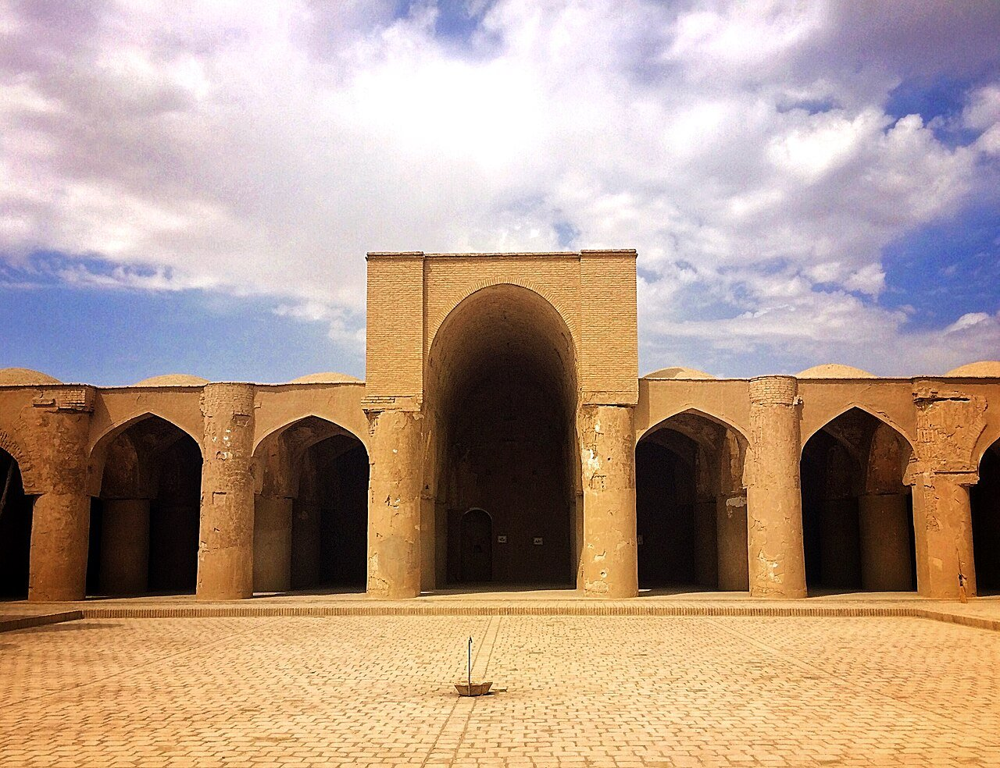

در شهر کهن دامغان، پایتخت دیرین اشکانیان و در مجاورت برج باستانی چهل‌دختران و ستون‌های خشتی تاریخانه، افسانه‌ای سوزناک و مقدس در دل خاک کویر ریشه دوانده است: افسانه‌ی «چهل‌دختران معصوم». در باور بومیان کومش، در روزگار باستان هنگامی که سپاهی خون‌خوار از مغولان یا راهزنان دشت به دیوارهای شهر یورش آوردند و مردان و مدافعان را از دم تیغ گذراندند، چهل دختر باکره و پاکدامن برای حفظ شرف و پاکی خویش از دست متجاوزان، دسته‌جمعی به سوی چاهی عمیق در دامنه کوه گریختند.

دختران که سپاه سواران را در چند قدمی خود می‌دیدند، به جای تسلیم شدن و تن دادن به اسارت و خواری، دست در دست یکدیگر نهادند، دعای پاکدامنی خواندند و با ایمانی استوار، خود را یکی پس از دیگری به درون تاریکی چاه پرتاب کردند. اما خاک مهربان کویر اجازه نداد کالبد پاک آنان بر سنگ خاره خرد شود؛ به اعجاز الهی، چاه دهان باز کرد، آبی زلال و خنک از قعر آن جوشید و دختران در آغوش نسیمی معطر ناپدید گشتند. روایت می‌کنند که از آن روز به بعد، از قعر این چاه، نوای لالایی‌های حزن‌انگیز و صدای همخوانی دخترانی شادمان به گوش می‌رسید که سرود آزادی و پاکی می‌خواندند.

> «چاه چهل‌دختران مزار نیست، دروازه آسمان است؛ دخترانی که خاک دامغان در آغوش کشید، زندگان جاودانه‌اند که شب‌های جمعه بوی اسفند و عطر گلاب بر گردنه می‌پراکنند.» — کلام پیرزنان دامغان در پای برج چهل‌دختران.

اسماعیل هنرور در کتاب «فرهنگ عامه سمنان و کومش» و سید ابوالقاسم انجوی شیرازی در «قصه‌های ایرانی» بیان می‌کنند که اسطوره چهل‌دختران یکی از فراگیرترین و در عین حال بومی‌ترین اسطوره‌های زنانه در فلات مرکزی ایران است که تجلی ایثار، حفظ کرامت انسانی و ایستادگی در برابر ستم را بازمی‌تاباند. زنان کهنسال دامغان در گذشته برای حاجت‌روایی و بخت‌گشایی دختران جوان، شمع‌های نذری در شکاف‌های این چاه و برج روشن می‌کردند و تکه‌های پارچه ابریشمی هفت‌رنگ بر آن می‌آویختند.

امروزه برج سلجوقی چهل‌دختران دامغان با گنبد فیروزه‌ای و کتیبه‌های کوفی‌اش، همچون مناره‌ای از یاد و احترام، استواری آن چهل دوشیزه آزاده را در حافظه تاریخی مردم کویر جاودانه ساخته است.

زنان سالخورده دامغان بازگو می‌کنند که در ایام سخت قحطی و جنگ، مادران برای حفظ شرف دختران خویش، نذر چهل‌دختران می‌کردند و چهل قرص نان روغنی میان نیازمندان تقسیم می‌نمودند. باور بر این بود که دعای آن چهل دوشیزه معصوم در دل چاه، دیوارهای شهر را از هجوم دشمنان و ارواح خبیث محافظت می‌کند و برکت دانه‌های پسته و گندم را در دشت‌های دامغان دوچندان می‌سازد.

### منابع و اعتبار تصویر
- **منبع پژوهشی افسانه:** اسماعیل هنرور، «فرهنگ عامه سمنان و کومش»، سمنان، انتشارات حبله‌رود، ص ۹۲-۹۸؛ سید ابوالقاسم انجوی شیرازی، «قصه‌های ایرانی»، جلد ۱، ص ۲۴۱.
- **اعتبار تصویر:** ثبت‌شده در ویکی‌مدیا کامنز توسط حسن اثباتی لواسانی؛ مجوز انتشار: [CC BY-SA 4.0](https://commons.wikimedia.org/wiki/File:Damghan-1.jpg).
