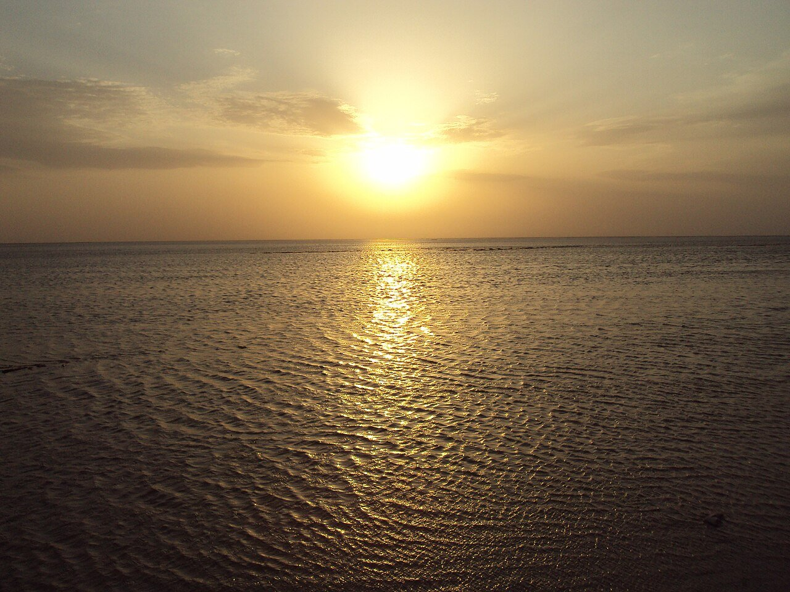

Near the historic city of Zabol, bordering an ancient arterial branch of the Helmand River, lies a roofless sanctum centered around a gnarled tamarisk tree known as *Bibi Doost*. Revered as an exclusive sanctuary of feminine sanctity, an unbending folk taboo forbids any adult male from crossing its threshold. Local oral tradition recounts that centuries ago, a virtuous maiden residing upon the fertile plains of Sistan found herself pursued by ruthless invading horsemen who had slain her protective brothers.

Fleeing across the arid wasteland with the hooves of the conquerors thundering behind her, the exhausted maiden realized capture was inevitable. In desperation, she lifted her hands to heaven and cried out to the mother earth: "O chaste soil of Sistan, open your bosom and shelter me from the clutches of dishonor!" In response to her pure prayer, the ground ruptured with a low tremor. The earth swallowed the maiden whole, leaving only the trailing hem of her veil above the fissure, which instantly transformed into an immortal, flourishing tamarisk tree.

> "The soil of Sistan never surrenders its chaste daughters to the conqueror; it splits wide to enfold them, keeping the honor of the realm unblemished." — Reverent testimony of Sistani women.

Folklorist Gholam-Ali Rais-al-Zakerin, in his masterwork *Kandoo: Folk Culture of Sistan*, explains that the shrine has functioned for centuries as a sanctuary for women seeking solace, fertility, and justice. Supplicants tie colorful fabric votives to the sacred branches and distribute traditional *tafto* bread in gratitude. Men strictly shun entering the sanctuary, dreading that trespassing would bring down the holy wrath of the earth maiden. This legend reflects the enduring myth of Spenta Armaiti—the ancient Zoroastrian divinity of the earth—reincarnated within the collective memory of Sistan.

### Sources & Image Attribution
- **Research Source:** Gholam-Ali Rais-al-Zakerin, *Kandoo: Folk Culture of Sistan*, Mashhad: Taftan, pp. 74-79; Iraj Afshar Sistani, *Sistan-Nameh*, Vol. 2, p. 215.
- **Image Attribution:** Documented on Wikimedia Commons by Sadegh.kamalian; License: [CC BY-SA 4.0](https://commons.wikimedia.org/wiki/File:Khaje-Sistan_mount.jpg).
