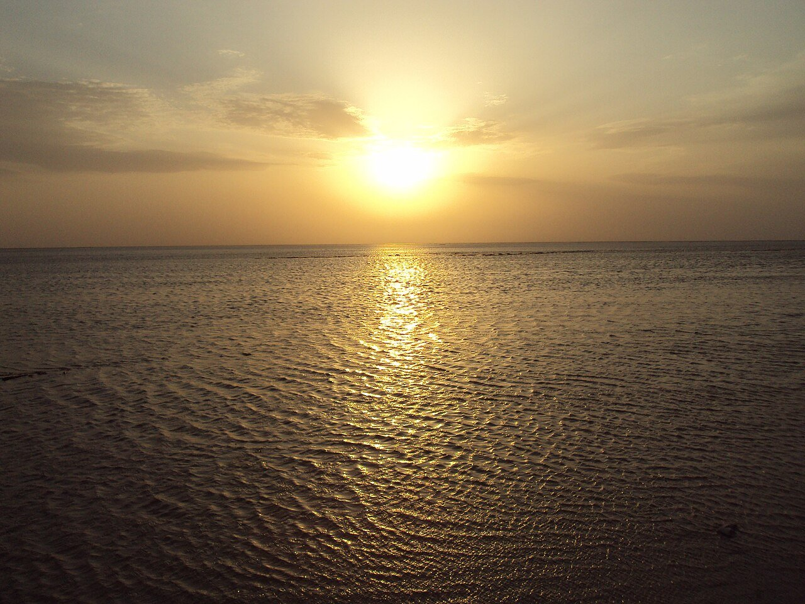

در حوالی شهر باستانی زابل و در کنار بستر یکی از شاخه‌های قدیمی رود هیرمند، زیارتگاهی بی‌سقف با درختی کهنسال و گره‌خورده قرار دارد که سیستانی‌ها آن را «بی‌بی دوست» می‌خوانند؛ مکانی سرشار از قداست زنانه که طبق باوری دیرین، هیچ مردی اجازه ورود به حریم خاکی آن را ندارد. افسانه بازگو می‌کند که قرن‌ها پیش، دوشیزه‌ای پاکدامن از سلاله پاکان به همراه برادرانش در دشت سیستان می‌زیست که ناگاه با هجوم لشکری از بیگانگان بدطینت و سواران ستمگر روبه‌رو شد.

چون سواران دشمن برادرانش را به خاک و خون کشیدند و در پی اسارت دخترک برآمدند، دوشیزه بی‌هیچ سلاحی به سوی دشت گریخت. در حالی که سم اسبان مهاجمان پشت سر او خاک را به آسمان می‌برد و دست دشمن به چادرش نزدیک می‌شد، دختر دستانش را به سوی آسمان برافراشت و با سوز دل به خاک کهن سیستان پناه برد: «ای زمین پاک، مرا در بر گیر و مگذار دست ناپاکان به پاکدامنی‌ام برسد!» در همان لحظه، زمین با غرش مهیبی دهان گشود، دخترک در آغوش گرم خاک فرو رفت و گوشه‌ای از چادر او بیرون ماند که بلافاصله به درختی تنومند و همیشه سبز به نام «گز» بدل شد.

> «خاک سیستان دختران پاک خویش را به دشمن نمی‌دهد؛ زمین دهان می‌گشاید و آنان را در سینه پنهان می‌کند تا آبروی سرزمین خدشه‌دار نشود.» — باور زنان سیستان در زیارتگاه بی‌بی دوست.

غلامعلی رئیس‌الذاکرین در کتاب «کندو؛ فرهنگ عامه مردم سیستان» ثبت کرده است که این زیارتگاه مأمن پناهجویان، دوشیزگان و زنان دردمند بوده است. زنان به شاخه‌های درخت مقدس پارچه‌های نذری گره می‌زنند و در ازای برآورده شدن حاجات، نان‌های روغنی محلی («تفتو») میان نیازمندان پخش می‌کنند. ورود مردان به محوطه زیارتگاه اکیداً تابو شمرده می‌شود، زیرا باور دارند چشمان ناپاک مردانه طلسم قدسی آرامگاه را می‌شکند و خشم بانوی مدفون در دل زمین را برمی‌انگیزد.

این افسانه تجلی ژرفی از اسطوره کهن اسفندارمذ (ایزدبانوی زمین و باروری) در ضمیر ناخودآگاه جمعی مردم سیستان است؛ سرزمینی که در آن خاک، حامی ابدی پاکدامنی و شرف در برابر تندباد حوادث روزگار بوده است.

در رسوم مردم سیستان، خاک پیرامون مزار بی‌بی دوست به عنوان خاکی شفابخش و متبرک شناخته می‌شود. زنان روستایی برای محافظت از دختران دم‌بخت در برابر چشم‌زخم و حوادث ناگوار روزگار، مقداری از این خاک تبرک را در کیسه‌های کوچک ابریشمی دوخته و به گیسوان دختران می‌آویختند. احترام عمیق مردم به این درخت گز همیشه سبز تا بدان پایه است که شکستن حتی یک شاخه خشک از آن، گناهی نابخشودنی شمرده می‌شود و باور بر این است که شکستن چوب مقدس، موجب فروریختن برکت از سفره خانواده خواهد شد.

### منابع و اعتبار تصویر
- **منبع پژوهشی افسانه:** غلامعلی رئیس‌الذاکرین، «کندو؛ فرهنگ عامه مردم سیستان»، مشهد، انتشارات تفتان، ص ۷۴-۷۹؛ ایرج افشار سیستانی، «سیستان‌نامه»، جلد ۲، ص ۲۱۵.
- **اعتبار تصویر:** ثبت‌شده در ویکی‌مدیا کامنز توسط Sadegh.kamalian؛ مجوز انتشار: [CC BY-SA 4.0](https://commons.wikimedia.org/wiki/File:Khaje-Sistan_mount.jpg).
