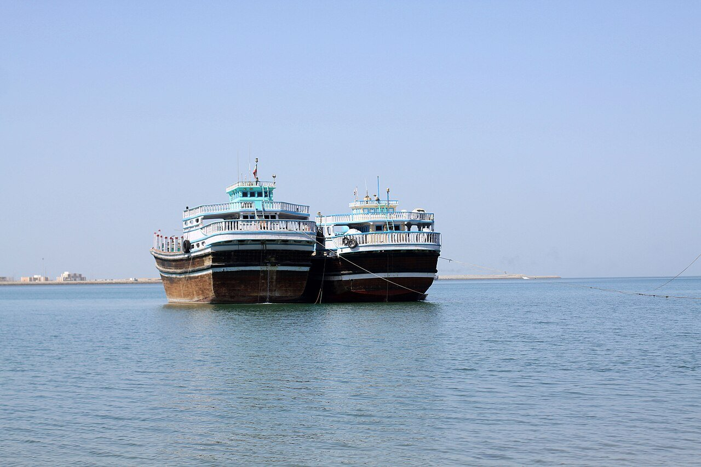

Along the dramatic marine cliffs of Pozm Bay west of Chabahar, where sheer headlands meet the tempestuous swells of the Makran Sea, Baluch fishermen revere the legendary figure of *Mamma Darya*—the Mother of the Seas. Embodying the primeval spirit of the ocean, she is depicted as a colossal, ethereal matriarch draped in seafoam, her wild hair braided with corals and glistening shells. On turbulent nights preceding violent tempests, she perches upon precipitous rock towers, her piercing laments rising above the roar of crashing surf.

The coastal Baluch believe Mamma Darya's midnight wails serve as an ominous harbinger of destructive tsunamis and monsoon surges. Hearing her mournful cries compels captains to immediately beach their vessels and secure anchor lines. Should human greed, oceanic desecration, or the shedding of blood anger her, Mamma Darya summons tidal walls capable of splintering wooden boats into driftwood within seconds.

> "When the wails of Mamma Darya echo from the rocky creek, cast aside your nets; she is a mother whose tears turn the Makran into an unyielding tomb." — Lore of the Baluch sailors of Pozm.

Dr. Abdolghafour Jahandideh, a preeminent scholar of Baluch folklore, traces Mamma Darya's origins to ancient Indo-Iranian water deities like Anahita. In bygone eras, fishing communities from Konarak to Chabahar performed solemn ceremonies prior to the annual monsoon, sacrificing a henna-horned ram into the surf at Pozm's edge to appease the great Mother and ensure bountiful fish migrations. To this day, the sonorous whistling of oceanic winds through Pozm’s sea caves evokes the everlasting lamentations of Mamma Darya across the Makran horizon.

### Sources & Image Attribution
- **Research Source:** Abdolghafour Jahandideh, *Ancient Beliefs and Myths of the Baluch*, Culture & Folklore Journal, No. 18, pp. 65-72; Iraj Afshar Sistani, *Ethnography of Baluchistan*, p. 163.
- **Image Attribution:** Documented on Wikimedia Commons by Safa.daneshvar; License: [CC BY-SA 4.0](https://commons.wikimedia.org/wiki/File:990804-Chabahar-IMG_5988-2.jpg).
