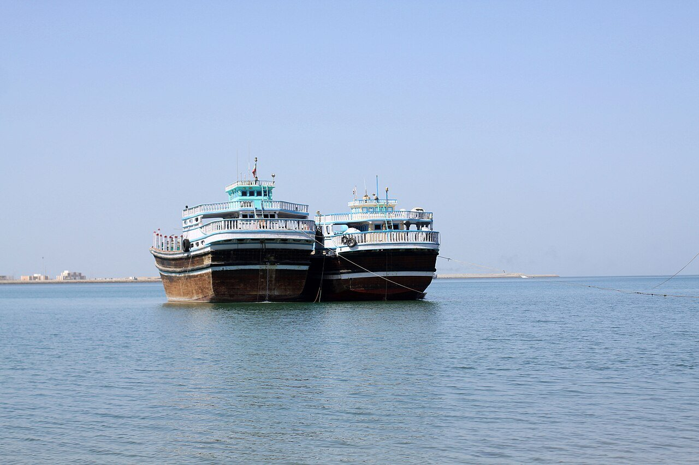

در کرانه‌های خشن و مریخی خلیج پزم در غرب چابهار، جایی که صخره‌های عمودی با خشم به امواج دریای عمان بوسه می‌زنند، صیادان بلوچ از زنی اسطوره‌ای به نام «ماما دریا» سخن می‌گویند. ماما دریا تجسم روح خروشان و حیات‌بخش آب‌های بی‌کران جنوب است؛ زنی کهنسال با قامتی پوشیده از کف دریا و موهایی از صدف و مرجان که در شب‌های طوفانی بر بالاترین تیغه‌ی صخره‌ها می‌ایستد و نوای زجه‌هایش بالاتر از غرش تندر به گوش می‌رسد.

بلوچ‌های مکران بر این باورند که گریه‌های ماما دریا هشداری است پیش از وقوع سونامی‌های ویرانگر یا خشم سهمگین طوفان‌های موسمی مونسون. اگر صیادی صدای مویه‌های او را بشنود، باید بی‌درنگ لنج خود را به آب‌های ساحلی بکشاند و لنگر بیندازد؛ زیرا ماما دریا هنگامی که از ناسپاسی آدمیان، ریختن خون در آب یا زیاده‌خواهی در صید خشمگین شود، امواجی به بلندای دیوارهای سنگی برمی‌انگیزد و لنج‌ها را همچون گردو خرد می‌کند.

> «چون شیون ماما دریا از دهانه خور برخیزد، تورها را در ساحل رها کنید؛ او مادری است که چون بگرید، دریای مکران هیچ قایقی را زنده بازنمی‌گرداند.» — روایت ناخداهای بلوچ در بندر پزم تیاب.

دکتر عبدالغفور جهاندیده، استاد زبان و ادبیات بلوچی، در پژوهش‌های خود پیرامون اسطوره‌های ساحل‌نشینان مکران بیان می‌کند که ماما دریا نمادی باستانی از ایزدبانوی آب‌ها در باورهای کهن هندوایرانی است. در گذشته‌های دور، صیادان چابهار و کنارک پیش از آغاز فصل طوفانی مونسون، آیینی کهن به نام «قربانی دریا» برگزار می‌کردند؛ در این آیین، بز نری با شاخ‌های حنابسته را بر لبه صخره‌های پزم قربانی می‌کردند و خون آن را به امواج می‌سپردند تا دل ماما دریا نرم شود و برکت صید را نصیب بومیان سازد.

هم‌اکنون نیز در شب‌های مه‌آلود ساحل پزم، زوزه باد در شکاف غارهای دریایی، یادآور ضجه‌های بی‌پایان ماما دریاست که از تنهایی ابدی خویش در اعماق دریای عمان حکایت می‌کند.

در فرهنگ دریانوردی مکران، پیوند عمیقی میان آیین‌های اهل هوا و باور به ماما دریا وجود دارد. ناخداهای کهنه‌کار چابهار در غروب‌های طوفانی، کوزه‌ای از آب شیرین و مقداری نان محلی تیموش را بر لبه صخره‌های مرجانی پزم قرار می‌دادند تا خشم ماما دریا فرونشیند. آنان باور داشتند که قطره‌های اشک ماما دریا در اعماق خلیج به مرواریدهای سیاه خلیج فارس بدل می‌شوند؛ مرواریدهایی کمیاب که هرگز نباید از آب صید شوند، زیرا برآوردن اشک مادر دریا، برکت صید صیادان را برای هفت نسل متوالی خواهد خشکاند.

### منابع و اعتبار تصویر
- **منبع پژوهشی افسانه:** عبدالغفور جهاندیده، «باورها و اسطوره‌های کهن بلوچی»، مجله فرهنگ و مردم، شماره ۱۸، ص ۶۵-۷۲؛ ایرج افشار سیستانی، «مردم‌شناسی بلوچستان»، تهران، ص ۱۶۳.
- **اعتبار تصویر:** ثبت‌شده در ویکی‌مدیا کامنز توسط Safa.daneshvar؛ مجوز انتشار: [CC BY-SA 4.0](https://commons.wikimedia.org/wiki/File:990804-Chabahar-IMG_5988-2.jpg).
