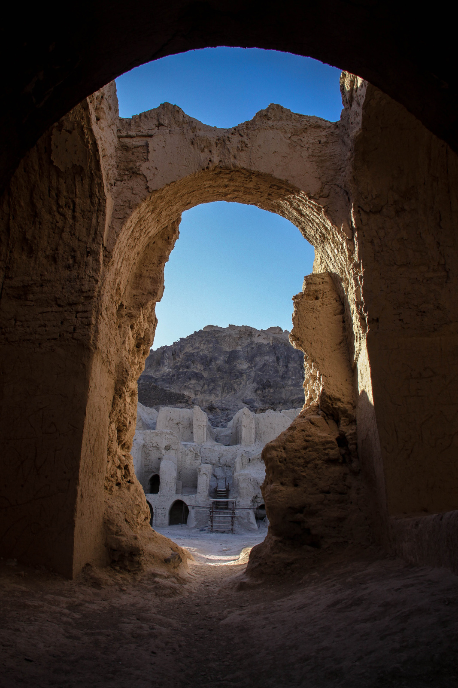

در دشت پهناور و بادگیر سیستان، آنجا که بادهای ۱۲۰ روزه بر بستر تفتیده هامون تازیانه می‌زنند و غبار ریگ‌روان افق را تیره می‌سازد، کوهی صخره‌ای و تنها از دل ماسه‌ها و نیزارها سر برآورده است که بومیان آن را «کوه خواجه» (کوه اوشیدای باستان) می‌نامند. این کوه بازالتی با کاخ‌ها و آتشکده‌های خشتی اشکانی و ساسانی بر فراز ستیغش، در باورهای مردم کهنسال زابل جایگاهی ورجاوند و خاستگاه ظهور موعود دانسته می‌شود. بستر خشکیده یا پرآب هامون در گرداگرد این صخره سترگ، بستری برای رویش مرموزترین باورهای اسطوره‌ای بوده است. اما در تاریک‌روشن شب‌های کویری، نام موجودی اساطیری بر زبان ساربانان و بومیان جاری است: «مردآزما»؛ موجودی تغییر شکل‌دهنده و سهمگین که در ویرانه‌های کهن کوه خواجه کمین می‌کند تا دلیری یا ترس مسافران شب را در ترازوی آزمون بگذارد.

بنا بر روایت پیران سیستان، مردآزما در ابتدا به هیبت مردی بسیار قدکوتاه، خسته‌دل یا ناتوان در کنار کوره راه‌ها ظاهر می‌شود و از رهگذر تنها تقاضای همسفری می‌کند. اما همین که رهگذر با او همگام می‌شود، مردآزما با هر قدم که برمی‌دارد قد می‌کشد؛ ساق پاهایش همچون ستون‌های نخل کشیده می‌شود، چشمانش مانند دو پاره آتش در تاریکی افق می‌درخشد و سرش به بلندای آسمان می‌رسد تا هیبتش ترسی فلج‌کننده در دل بیننده بنشاند. اگر مسافر فریاد کشد، فرار کند یا بر زمین افتد، مردآزما با خنده‌ای رعدآسا بر او چیره شده و او را دیوانه و بیهوش در میان بوته‌های گز رها می‌سازد. ساربانان سیستانی باور دارند که صدای خنده‌های او تا فرسنگ‌ها در زوزه باد لوار می‌پیچد.

> کهنسالان سیستانی همواره به جوانان سفارش می‌کنند: «اگر در بیابان کوه خواجه با غریبه‌ای روبه‌رو شدید که پاهایش درازتر از قامت آدمی می‌شد، هرگز مگریزید؛ دست بر قبضه کارد آهنین بگذارید و محکم بگویید: من نمی‌ترسم! آهن و دلیری طلسم مردآزما را در دم می‌شکند.»

افسانه‌ها می‌گویند ساربانی دلیر از طایفه بزی در شبی مهتابی، با مردآزما در پای صخره‌های کوه خواجه روبه‌رو شد. ساربان نه تنها نهراسید، بلکه با شجاعت تمام کارد فولادی‌اش را از نیام برکشید و بر سایه بلند او کوبید. در دم، مردآزما به اندازه حیوانی کوچک درآمد، التماس کرد و در ازای رهایی، نشانی دفینه‌ای از سکه‌های زرین اشکانی را در تالار نیایشگاه کهن فاش ساخت. بومیان معتقدند مردآزما دشمن انسان نیست، بلکه روح نگهبان آزمون پهلوانی است تا خاک پاک سیستان همواره در آغوش مردانی با اراده پولادین و دلیر باقی بماند و نام رستم دستان از یادها نرود. توتن‌سواران هامون هنوز هم هنگام عبور شبانه از نزدیکی کوه، با درود فرستادن بر ارواح پاک اوشیدا، یاد آزمون‌های سخت کویر را گرامی می‌دارند. این افسانه، تجسم زنده پیکار همیشگی انسان با وهم کویر و تاریکی است.

### منبع روایت و تصویر
- **خاستگاه افسانه:** اسطوره‌شناسی و باورهای شفاهی مردم سیستان و بلوچستان پیرامون مردآزما و تقدس کوه خواجه، متون فولکلور زابل.
- **عکاس / پدیدآورنده تصویر:** Ebrahim Alipoor
- **منبع تصویر:** [صفحه تصویر در ویکی‌انبار](https://commons.wikimedia.org/wiki/File:Ebrahim_Alipoor_(2).jpg)
- **نوع مجوز:** CC BY-SA 4.0
