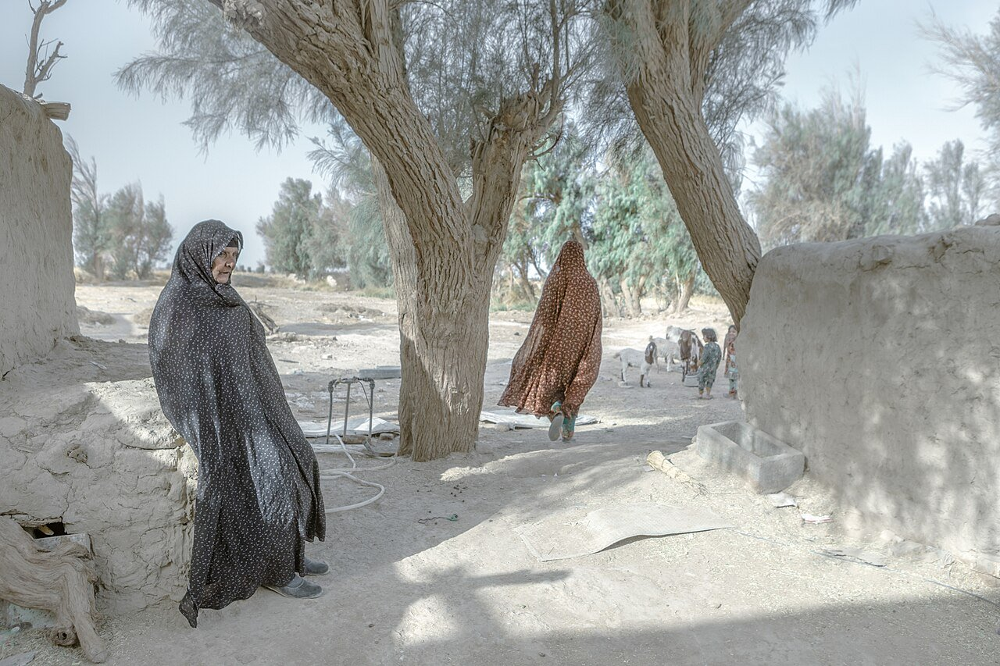

Across the wind-lashed flats of Sistan and throughout the historic reed beds that once fringed mythical Lake Hamun, the mention of *Medu* chills the hearts of nomadic herders. In Sistani oral tradition, the Medu is a supernatural, demonic hyena endowed with uncanny hypnotic faculties and the gift of vocal mimicry. Lurking in the shadow of the dunes, the creature calls out to isolated wanderers in the familiar voices of beloved kin, weaving hollow chuckles that strip the human mind of reason.

Victims snared by the Medu's piercing, phosphorescent glare lose all independent volition, helplessly following the laughing beast into the night. It lures the entranced soul toward desolate grottos around Mount Khwaja or the labyrinthine sand dunes of the Rigestan desert, where it drags its prey into subterranean dens and crushes their bones beneath heavy jaws.

> "If within the wind's shriek you hear your mother's tongue calling into the dark, touch the earth and utter holy verses; Medu hunts the solitary, and whoever turns his gaze is bound for the hyena’s feast." — Ancient adage of the Hamun marsh-dwellers.

Sistani scholar Javad Mohammadi Khomak notes that the Medu myth synthesizes the nocturnal scavenging habits of the striped hyena with ancient Zoroastrian concepts of *xrafstars*—demonic noxious beasts allied with Angra Mainyu. To dissolve the Medu's hypnotic thrall, desert travelers carried wild rue (esfand), iron nails, and pomegranate wood. The Medu was said to abhor the wood of the pomegranate, while burning rue immediately broke its bewitching vocal enchantments. For generations, this fearsome legend safeguarded wanderers from straying into deadly Sistani dust storms.

### Sources & Image Attribution
- **Research Source:** Javad Mohammadi Khomak, *Glossary and Folk Beliefs of Sistan*, Tehran, pp. 89-94; Gholam-Ali Rais-al-Zakerin, *Folklore and Legends of the Sistani People*, Mashhad, p. 231.
- **Image Attribution:** Documented on Wikimedia Commons by Solmaz Daryani; License: [CC BY-SA 4.0](https://commons.wikimedia.org/wiki/File:Hamun(Hamoun)_wetlands_Iran-Afghanistan_Border_%D9%87%D8%A7%D9%85%D9%88%D9%86.jpg).
