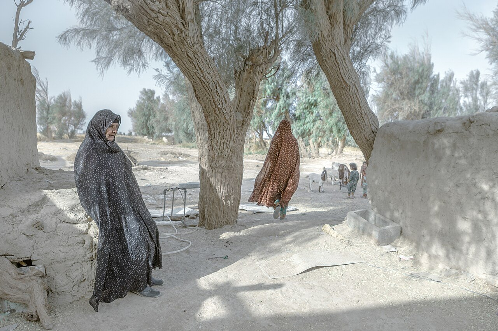

در گستره‌ی غبارآلود دشت سیستان و میان نیزارهای انبوهی که روزگاری دریاچه اسطوره‌ای هامون را در آغوش می‌کشیدند، نام «مَدو» لرزه بر اندام چوپانان و روستاییان می‌اندازد. مدو در فرهنگ عامه سیستان، کفتاری جادویی و دیوصفت است که به قدرت سحرانگیز «مسخ» و فریب مجهز است. باور بر این است که مدو با تقلید صدای نزدیک‌ترین عزیزان یا دوستان یک مسافر، او را به نام صدا می‌زند و با خنده‌هایی شبیه قهقهه انسان، عقل و هوش قربانی را زایل می‌سازد.

کسی که مسحور نگاه چشم‌های فسفری مدو شود، اراده‌ی خود را به تمامی از دست می‌دهد؛ گویی پاهایش بی‌اختیار به دنبال این هیولای خندان روان می‌گردد. مدو طعمه‌ی مسخ‌شده خود را گام به گام به درون غارهای دورافتاده در دامنه کوه خواجه یا میان تپه‌های شنی هولناک ریگستان می‌کشاند، جایی که چنگال‌هایش استخوان‌های قربانی را خرد کرده و در اعماق دخمه‌های تاریک مدفون می‌سازد.

> «اگر در زوزه‌ی باد صدایی شنیدی که با نام مادرت تو را به شب فراخواند، دست بر خاک بزن و آیه بخوان؛ مدو در پی تنهایی توست و هر که پشت سر بنگرد، جانش در چنگال کفتار مسخ خواهد شد.» — ضرب‌المثل کهن پیرمردان نیزارنشین هامون.

جواد محمدی خمک در کتاب ارزشمند «واژه‌نامه و باورهای بومی سیستان» اشاره می‌کند که اسطوره مدو، حاصل درآمیختگی رفتارهای طبیعی کفتار راه‌راه با باورهای دیرین ایرانیان باستان درباره جانوران اهریمنی (خرفستران) است. مردم سیستان برای در امان ماندن از طلسم مسخ‌کننده مدو، همواره در جیب‌های خود دانه‌های اسپند، میخ آهنی و یک تکه چوب انار به همراه داشتند؛ زیرا باور داشتند که مدو تاب دیدن چوب درخت انار را ندارد و بوی سوختن اسپند جادوی کلام او را باطل می‌کند.

باور به حضور مدو در شب‌های طوفانی ماسه‌باد، قرن‌ها کودکان و مسافران دشت سیستان را از سرگردانی در تاریکی بیابان و افتادن در کام خطرات واقعی اقلیم خشن هامون در امان نگه داشته است.

پیران نیزارنشین هامون حکایت می‌کنند که در عهد خشکسالی‌های بزرگ سیستان، رد پاهای غیرعادی مدو بیشتر در اطراف قبرستان‌های کهن کوه خواجه دیده می‌شد. به باور مردم زابل، صدای خنده‌ی هولناک مدو در طوفان‌های ۱۲۰ روزه سیستان، بازتاب بادهایی بود که میان شیارهای تپه‌های باستانی می‌پیچید. چوپانان برای مصون ماندن از مسخ مدو، همیشه دستار خود را به رنگ زرد زعفرانی می‌بستند و قطعه‌ای از استخوان سر گوسفند قربانی را به عنوان حرز در جیب می‌نهادند تا نگاه مغناطیسی کفتار بر اراده‌شان بی‌اثر گردد.

### منابع و اعتبار تصویر
- **منبع پژوهشی افسانه:** جواد محمدی خمک، «واژه‌نامه و باورهای بومی سیستان»، تهران، ص ۸۹-۹۴؛ غلامعلی رئیس‌الذاکرین، «فرهنگ کنایات و افسانه‌های مردم سیستان»، مشهد، ص ۲۳۱.
- **اعتبار تصویر:** ثبت‌شده در ویکی‌مدیا کامنز توسط Solmaz Daryani؛ مجوز انتشار: [CC BY-SA 4.0](https://commons.wikimedia.org/wiki/File:Hamun(Hamoun)_wetlands_Iran-Afghanistan_Border_%D9%87%D8%A7%D9%85%D9%88%D9%86.jpg).
