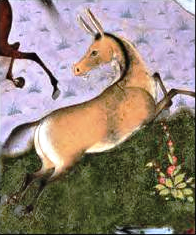

Preserved across centuries within the rich oral folklore of **South Khorasan** (encircling the historical domains of **بیرجند / طبس**), the legendary lore of **Akvan Div** stands as a compelling testament to Iran's enduring mythic imagination. Transmitted across hearths, mountain paths, and rural caravans, the tale has survived through the living memories of local elders.

Folklorists generally categorize **Akvan Div** within the mythological taxonomy of *موجود افسانه‌ای*. As with many traditional entities of Iranian folk belief, it embodies both the untamed natural elements and the ancestral anxieties regarding solitary wilderness. Classical collectors recorded its traditional traits as follows:

> "Illustration by Farima Keshavarz Akvan Deev Is the name of a Deev, present in the Epic of Shahnameh. His story is stated in the Shahnameh as follows: During the reign of KayKhosrow (King of Iran), in the middle of a celebration in which the king's warriors were present, the royal shepherd hastily entered the hall and announced the presence of a yellow zebra with black stripes from its mane to its tail. Claiming that the animal attacked the king's herd of horses and killed them. Whoever KayKhosrow knew that this animal could not have been a zebra, because a zebra is not stronger than a horse. Therefore he concluded that magic was involved. So he ordered, Rostam, the strongest Iranian hero, to go and bring the strange zebra. After a few days of trying to find the creature, Rostam finally finds it on the fourth day and when he tries to catch it, it disappears. So Rostam realizes that this creature is a Deev who can change his appearance. As the Deev reappears, Rostam shoots an arrow at it, but he disappears again. Rostam tries to find Akvan Deev for three more days, but he doesn't succeed, he rests next to a spring and sleeps because he is tired. Ekvan Dev took advantage of this situation and lifted Rostam while in sleep and brought him above its head. Then he asks Rostam, who is now awake and confused if he would like to throw him into the sea or into the mountains. Rostam, who knows that if he falls into the mountain, he will perish, and on the other hand, he knows that the Deevs always do the opposite, and everything upside down, he tells the Deev to throw him into the mountain. And because Ekwan acts in reverse, he throws him into the sea. Rostam swims and is saved and sees Akwan again by the spring, this time he ties him up with a lasso and hits the demon on the head with his famous mace. After that, he dismounts from Raxsh (Rostam's mighty red horse) and takes Akwans head. According to the writings of the ""Borhan-e-Qaati' "", some researchers have considered the name of this demon to be a perversion of Aku-man, which in the Avesta ""Akamanah"" means evil thought and the name of the demon was the manifestation of evil, evil thoughts. And hypocrisy and anti-humanity. Also, some believe this Deev is related to the god of wind in ancient Indo-Iranian beliefs. … …"

In local oral tradition, an encounter with **Akvan Div** was regarded as a formidable threshold between familiar domestic reality and the unseen realm. Elders customarily advised night travelers, shepherds, and caravan drivers traversing the historic passes of South Khorasan to heed ancient apotropaic rituals—such as carrying iron amulets, maintaining solemn reverence towards nature, and never uttering provocative words—to pass through its territorial domain unharmed.

Today, the chronicle of **Akvan Div** forms an invaluable component of Iran's intangible cultural heritage, offering modern readers an evocative window into how ancient communities interpreted their ecology, mystery, and moral balance.

---

### Sources & Image Attribution
- **Folklore Research & Origin:** Sourced and adapted from the Eranshahr Folklore Archive (`eranshahr.com/myths`) and regional oral narratives of South Khorasan.
- **Visual Artifact:** *"Akvan, The Onager-Div (The Shahnama of Shah Tahmasp).png"*, sourced via Wikimedia Commons, contributed by Attributed to Muzaffar Ali, licensed under `Public domain` ([Source Link](https://commons.wikimedia.org/wiki/File:Akvan,_The_Onager-Div_(The_Shahnama_of_Shah_Tahmasp).png)).