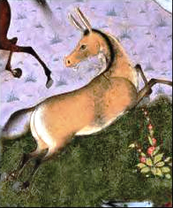

در یادمان‌های شفاهی و باورهای عامیانه‌ی مردم **خراسان جنوبی** (به‌ویژه در گستره‌ی **بیرجند / طبس**)، روایت‌های پرشماری از پدیده‌ای شگفت و موجودی دیرپا به نام **«اکوان دیو»** سینه به سینه از روزگاران باستان تا کنون بازگو شده است. راویان بومی که با گویش و لهجه‌ی **بیرجندی** به نقل قصه‌ها می‌نشستند، پیدایش این پدیده را با کوهساران، دشت‌های بی‌کران، جنگل‌ها یا آب‌های مرموز این خطه پیوند می‌زدند.

در طبقه‌بندی فرهنگ عامه، **اکوان دیو** را غالباً با تیره‌ی *موجود افسانه‌ای* هم‌بسته می‌دانند؛ چهره‌ای که تجسم نیروهای ناشناخته‌ی اقلیم و جهان نادیدنی پیرامون نیاکان بوده است. در توصیف‌ها و متون بازمانده‌ی پژوهشی پیرامون این افسانه آمده است:

> «Akwan Div | Akvān Deev | اَکوان دیو دیگر دیوی که در شاهنامه فردوسی حضور دارد اکوان دیو است، داستان آن در شاهنامه این چنین است که در زمان کیخسرو جانوری پدید می آید و خود را به شکل گورخری زرد رنگ که خطی سیاه از یال تا دم بر تن دارد در می آورد و به گله اسبان شاه حمله می کند و اسبان را از پای در می آورد . کیخسرو پی می برد که این جانور گورخر نمی تواند باشد ، زیرا گورخر از اسب زورمندتر نیست ، این جانور همان اکوان دیو است که در هئیت گورخر در آمده است. همان طور که گفته شد اکوانِ دیو در شاهنامه به هیئت گورخر وحشی به گله‌های اسب کیخسرو یورش میبرد. رستم در نبرد با این دیو، هر بار که سوار بر رخش، به او هجوم میبرد و دیو ناپدید می‌شد. در این نبرد رستم، خسته در کنار چشمه ای به خواب می‌رود و در آن زمان اکوان به او می‌تازد و او را با زمین اطرافش بلند کرده و به هوا می برد و به رستم می‌گوید که او را به دریا افکند یا به کوهستان؟ رستم چون می‌داند که کار دیو واژگونه است، کوه را انتخاب می‌کند و چون به آب افکنده می‌شود با شنا خود را نجات می‌دهد. بعد از آن دیو را یافته با او رو به رو می‌شود و برای شکست او نام خدا را بر زبان می‌آورد تا دیو جادو به کار نبندد و سر دیو را می‌برد. سپس رستم بر رخش نشست و اسبان و پیلان غنائم را نزد شاه برد و اسبان را بین ایرانیان قسمت کرد و پیلان را به شاه سپرد و ماجرای جنگش را برای شاه بازگفت. محمدجعفر یاحقی نیز در کتاب «فرهنگ اساطیر ایران» اشاره کرده‌است که برخی پژوهشگران، اکوان را همان اکه منه یا اکومن دانسته‌اند. برخی پژوهشگران ریشه داستان اکوان دیو را بر گرفته ازگردباد دریایی می‌دانند که به ناگهان از دریا سربرکشیده کشتی‌ها را منهدم ساخته و به فاصله دور پرتاب می‌کرده‌است. این پدیده در دریای هند و دریای چین در فصل توفان موسمی و همچنین در سواحل فلوریدا و کوبا و غرب استرالیا رخ می‌دهد. خروشید و پیچید و بانگ و غریوز دریا برآمد چو اکوان دیو اکوان دیو - ویکی‌پدیا، دانشنامهٔ آزاد (wikipedia.org) اکوان دیو - داستانهای شاهنامه (blogsky.com)»

پیران و ریش‌سفیدان منطقه در شب‌نشینی‌ها گوشزد می‌کردند که رویارویی با **اکوان دیو** همواره نشانه‌ای از لزوم هشیاری در برابر ناشناخته‌های طبیعت بوده است. در اعصار گذشته، مسافران، شبانان و کاروانیانی که شب‌هنگام در این نواحی گذر می‌کردند، برای مصون ماندن از گزند یا فریب این موجودات، آیین‌ها و دعاهای محافظتی خاصی را به کار می‌بستند و از شکستن سکوت شب یا نزدیک شدن به زیستگاه‌های آنان پرهیز می‌کردند.

امروزه داستان **اکوان دیو** یکی از گنجینه‌های ماندگار میراث معنوی و مردم‌شناسی دیار **خراسان جنوبی** به شمار می‌رود که پیوند عمیق روان‌شناختی انسان کهن را با رمزورازهای زیست‌بوم سرزمین ایران به تصویر می‌کشد.

---

### منابع و اعتبار تصویر
- **پژوهش و خاستگاه روایت:** برگرفته از دانشنامه فولکلور و اسطوره‌شناسی ایران‌شهر (`eranshahr.com/myths`) و روایت‌های شفاهی بومی خراسان جنوبی.
- **تصویر:** اثر *«Akvan, The Onager-Div (The Shahnama of Shah Tahmasp).png»*، بارگذاری‌شده در ویکی‌انبار (Wikimedia Commons)، پدیدآورنده: Attributed to Muzaffar Ali، تحت مجوز آزاد `Public domain` ([مشاهده منبع](https://commons.wikimedia.org/wiki/File:Akvan,_The_Onager-Div_(The_Shahnama_of_Shah_Tahmasp).png)).