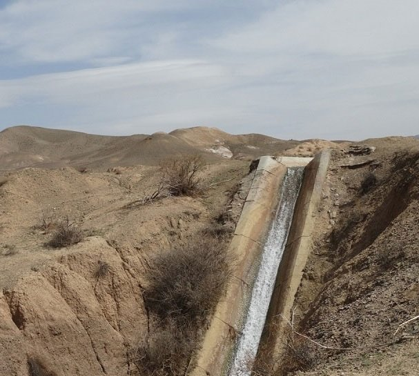

In the arid, sun-baked expanse of South Khorasan near the historical city of Ferdows (ancient Toon), the subterranean marvel known as the *Baladeh Qanat* has sustained human survival for over a millennium. This monumental hydraulic system, transporting mountain runoff across miles through dark aqueducts to irrigate orchards, is revered in regional oral tradition as the sanctuary of *Khatoun-e Ab*—the Lady of the Subterranean Waters. A sacred, white-clad maiden dwelling in the mother well (*Madarchah*), her crystalline locks are the vital source of all living moisture.

Local lore holds that if the community commits waste, acts deceitfully, or hoards water, the Lady of the Waters turns her gaze away, coiling her tresses around the subterranean channels and causing the aquifers to dry up overnight. To maintain harmony with this divinity, the elders of Toon traditionally practiced the ritual of the "Qanat Wedding," anointing the head of the spring with rosewater, henna, and sweetmeats while offering blessings for the Lady’s eternal benevolence.

> "The water of the qanat is the honor of the earth; utter no profanity over the wellhead and soil not the channel, lest the Lady of the Waters weep in the dark and the streams plunge to the underworld in shame." — Ancient counsel of the Mirabs (water masters) of Ferdows.

Folklorist Mahmoud Rafiee in *Folklore of Birjand and Qaenat* points out that reverence for the Lady of the Waters provided psychological fortitude for the heroic well-diggers (*muqannis*) descending into hundred-meter vertical shafts in utter darkness. Diggers performed purification rites before descending, invoking the Lady’s protection against cave-ins. The crystal-clear streams of the UNESCO-registered Baladeh Qanat singing beneath century-old plane trees continue to echo the blessing of this ancient guardian of the desert.

### Sources & Image Attribution
- **Research Source:** Mahmoud Rafiee, *Folklore of Birjand and Qaenat*, Tehran, pp. 144-150; Manouchehr Sotoudeh, *Qanats of the Desert and Ancient Water Myths*, p. 77.
- **Image Attribution:** Documented on Wikimedia Commons by Smhinfo; License: [CC BY-SA 4.0](https://commons.wikimedia.org/wiki/File:%D9%82%D9%86%D8%A7%D8%AA_%D8%A8%D9%84%D8%AF%D9%87_%D9%81%D8%B1%D8%AF%D9%88%D8%B3.jpg).
