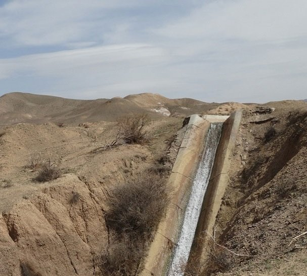

در دل کویر خشک و تفته‌ی خراسان جنوبی در شهر تاریخی فردوس (تون کهن)، شاهکار مهندسی آب باستانی به نام «قنات بلده» قرن‌هاست که نبض زندگی را در رگ‌های این سرزمین خاکی جاری نگه داشته است. این شبکه گسترده از کاریزهای ساسانی که آب خنک و زلال را از فرسنگ‌ها زیر پای کوه‌های سیاه به دشت می‌رساند، در باور کهن مردم جنوب خراسان آشیانه‌ی «خاتون آب» یا «پری قنات» است؛ بانویی سپیدپوش و مقدس که در تاریکی تالارهای زیرزمینی مظهر قنات‌ها زندگی می‌کند و گیسوان بلورینش سرچشمه‌ی زلالی آب است.

افسانه کهن مردم تون روایت می‌کند که اگر خاتون آب از مردم شهری به دلیل هدر دادن آب، ناسپاسی یا دل‌سیاهی خشمگین شود، گیسوانش را به دور مظهر چاه می‌پیچد و رگه‌های آب را در اعماق زمین پنهان می‌سازد؛ در پی آن، قنات‌ها می‌خشکند و دشت به کویر بدل می‌شود. از این رو، مردم فردوس آیینی کهن به نام «عروسی قنات» برگزار می‌کردند؛ پیرزنی یا دوشیزه‌ای پارسا را به عنوان نماد پیوند با خاتون آب بر سر مظهر قنات می‌نشاندند و با هدیه دادن دانه‌های شیرینی، حنا و عطر گل محمدی به آب، رضایت و پیوند مبارک خاتون را طلب می‌کردند.

> «آب قنات آبروی خاک است؛ در مظهر چاه ناسزا مگوی و دست ناپاک در جویبار مبر، که خاتون آب در ظلمت قنات اشک می‌ریزد و چشمه‌ها از شرم در دل زمین فرو می‌روند.» — پند کهنسالان میراب در شهر فردوس و باغستان.

محمود رفیعی در اثر ارزشمند «فرهنگ مردم بیرجند و قاینات» و منوچهر ستوده در مطالعات قنات‌های کویر نشان می‌دهند که باور به خاتون آب، پشتوانه‌ی معنوی شگفت‌انگیزی برای حفظ و لایروبی دشوار قنات‌ها توسط مقنیان فداکار کویر بوده است. مقنیان پیش از فرود آمدن به پایاب‌های تاریک و صد متری، غسل طهارت می‌کردند و با خواندن ادعیه به پیشگاه خاتون آب سلام می‌دادند تا سقف خاک بر سر آنان فرو نریزد.

امروزه جویبار خروشان قنات ثبت جهانی بلده فردوس که از میان درختان چنار باغستان می‌گذرد، تداعی‌گر خنده‌های گوارای خاتون آب است که خنکای زندگی را به دل کویر هدیه می‌کند.

میراب‌های کهن فردوس و باغستان اشاره می‌کنند که آیین پیوند با خاتون آب، ریشه در تقدس باستانی آناهیتا در فلات مرکزی ایران دارد. برای سالیان متمادی، مردم قنات بلده را تنها یک سازه آبی نمی‌دانستند، بلکه آن را موجودی جاندار و نیازمند احترام می‌شمردند. مقنیان با لباس‌های یکدست سفید وارد کاریز می‌شدند تا احترام به روح پاکیزه خاتون آب را در تاریکی مطلق چاه‌ها به جا آورند.

### منابع و اعتبار تصویر
- **منبع پژوهشی افسانه:** محمود رفیعی، «فرهنگ مردم بیرجند و قاینات»، تهران، ص ۱۴۴-۱۵۰؛ منوچهر ستوده، «قنات‌های کویر و اسطوره‌های کهن آب»، ص ۷۷.
- **اعتبار تصویر:** ثبت‌شده در ویکی‌مدیا کامنز توسط Smhinfo؛ مجوز انتشار: [CC BY-SA 4.0](https://commons.wikimedia.org/wiki/File:%D9%82%D9%86%D8%A7%D8%AA_%D8%A8%D9%84%D8%AF%D9%87_%D9%81%D8%B1%D8%AF%D9%88%D8%B3.jpg).
