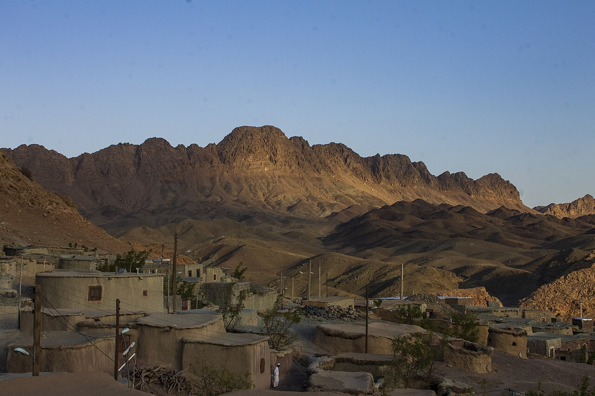

در شرقی‌ترین بخش‌های فلات ایران، در شهرستان سربیشه استان خراسان جنوبی و در نزدیکی مرز، روستایی شگفت‌انگیز و منزوی با معماری حیرت‌آور در میان شکاف تپه‌های سنگی پنهان شده است که آن را «ماخونیک» یا «شهر لی‌لی‌پوت‌های ایران» می‌نامند. خانه‌های این روستا بسیار کوچک، تاریک و بدون پنجره هستند و درهای ورودی آن‌ها چنان کوتاه ساخته شده‌اند که حتی برای ورود به اتاق باید تا کمر خم شد. این ویژگی‌های اقلیمی و زیستی در طول قرن‌ها بستری برای زایش یکی از جذاب‌ترین افسانه‌های فولکلوریک شرق ایران درباره آدم‌کوچولوهای باستانی و ارواح محافظ کوهستان شده است که در دل کویر سربیشه به حیات خود ادامه داده‌اند.

بنا بر روایت پیران ماخونیک و بیرجند، نیاکان کهن این روستا مردمانی بسیار کوتاه‌قامت (کمتر از یک متر) اما بی‌نهایت صبور، باهوش و دانا بودند که برای در امان ماندن از هجوم دیوان بلندبالا و سواران غارتگر، خانه‌های خود را در دل خاک حفر کردند. سقف کوتاه خانه‌ها نه تنها برای گرم ماندن در سوز سرمای کویر بود، بلکه دیوان غول‌پیکر به سبب تنومندی‌شان هرگز نمی‌توانستند از درگاه‌های باریک به درون بخزند. افسانه‌ها می‌گویند این مردمان کوچک‌پیکر با ارواح پاک چشمه‌ها و بوته‌های دارویی کلپوره هم‌پیمان بودند و با نجواهای کهن می‌توانستند مارها و عقرب‌های گزنده را رام سازند.

> کهنسالان ماخونیک می‌گویند: «کوتاهی قامت نیاکان ما از خاک پاک و خضوع آنان بود؛ در زمین کوچک زیستند تا غرور به سراغشان نیاید و دست غارتگران به خشت‌های آنان نرسد.»

در قصه‌های بومی آمده است که در زیر بافت خشتی روستا، راهروهایی پنهان وجود داشت که ماخونیکی‌ها را به غارهای دوردست کوهستان پیوند می‌داد. هنگامی که لشکری بیگانه به روستا نزدیک می‌شد، تمام اهالی در چشم‌به‌هم‌زدنی ناپدید می‌شدند، گویی زمین دهان باز کرده و فرزندان کوچک خود را بلعیده است؛ مهاجمان با ورود به روستا جز کاسه‌های سفالین خالی و اجاق‌های خاموش چیزی نمی‌یافتند و از این سکوت وهم‌آور می‌گریختند. مردم خراسان جنوبی باور دارند روح آن مردمان صبور و بی‌آزار هنوز در کوچه‌های باریک ماخونیک جاری است و برکت دانه‌های عناب و شلغم را در دل خاک کویر زنده نگاه می‌دارد. در باور بومیان، این مردمان با برپایی برج‌های دیده‌بانی کوتاه بر فراز صخره‌ها، آمدن هر بیگانه‌ای را با دود بوته‌های خشکیده به یکدیگر خبر می‌دادند و در چشم‌به‌هم‌زدنی در دل سوراخ‌های کوه ناپدید می‌شدند. کودکان ماخونیک تا دهه‌ها پیش با سفال‌های دست‌ساز و سنگ‌ریزه‌های رنگین بازی می‌کردند و هرگز داستانی از دیو را باور نداشتند مگر آنکه پهلوانی کوتاه‌قامت او را به بند کشیده باشد. سادگی بی‌پیرایه ماخونیک، یادآور روزگاری است که انسان با کمترین نیازها در صلح با خشن‌ترین چهره طبیعت می‌زیست.

### منبع روایت و تصویر
- **خاستگاه افسانه:** باورهای عامیانه مردم سربیشه و بیرجند پیرامون معماری باستانی روستای ماخونیک، پژوهش‌های انسان‌شناسی فرهنگی خراسان جنوبی.
- **عکاس / پدیدآورنده تصویر:** Ebrahim Rahiminezhad
- **منبع تصویر:** [صفحه تصویر در ویکی‌انبار](https://commons.wikimedia.org/wiki/File:Makhunik097.jpg)
- **نوع مجوز:** CC BY-SA 4.0
