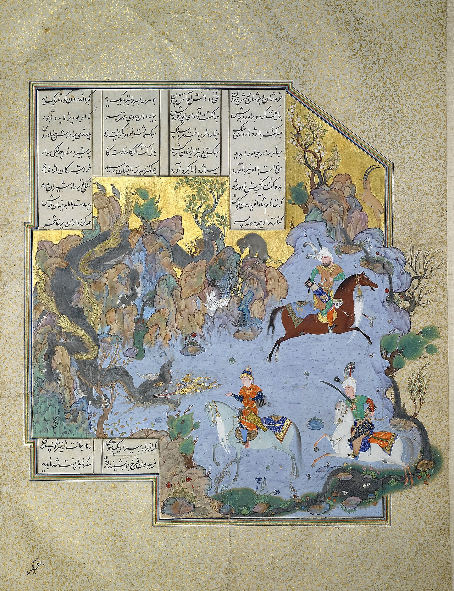

Preserved across centuries within the rich oral folklore of **South Khorasan** (encircling the historical domains of **بیرجند / طبس**), the legendary lore of **Dragon of Mount Saghila** stands as a compelling testament to Iran's enduring mythic imagination. Transmitted across hearths, mountain paths, and rural caravans, the tale has survived through the living memories of local elders.

Folklorists generally categorize **Dragon of Mount Saghila** within the mythological taxonomy of *Dragon*. As with many traditional entities of Iranian folk belief, it embodies both the untamed natural elements and the ancestral anxieties regarding solitary wilderness. Classical collectors recorded its traditional traits as follows:

> "Illustration by Farima Keshavarz It is mentioned in the Shahnameh that the daughter of the Roman emperor had a suitor named Ahran. However, the Roman emperor had made a condition for Ahran that he only would allow him to marry her daughter if he killed the dragon of Mount Saqila, which had caused trouble for the country and the people.Unable to resist the dragon, Ahren consults with the emperor's son-in-law, Mirin, and eventually seeks out Goshtasp to ask him to kill the dragon. Goshtasp accepted this request, went to Mount Saqila, and killed the dragon.Ahran threw the dragon's body on the cart that the cow was pulling and went to the emperor. The emperor celebrated seeing the dragon dead and allowed Ahran and his daughter to marry. Translation: Nasim Rasoulipour … …"

In local oral tradition, an encounter with **Dragon of Mount Saghila** was regarded as a formidable threshold between familiar domestic reality and the unseen realm. Elders customarily advised night travelers, shepherds, and caravan drivers traversing the historic passes of South Khorasan to heed ancient apotropaic rituals—such as carrying iron amulets, maintaining solemn reverence towards nature, and never uttering provocative words—to pass through its territorial domain unharmed.

Today, the chronicle of **Dragon of Mount Saghila** forms an invaluable component of Iran's intangible cultural heritage, offering modern readers an evocative window into how ancient communities interpreted their ecology, mystery, and moral balance.

---

### Sources & Image Attribution
- **Folklore Research & Origin:** Sourced and adapted from the Eranshahr Folklore Archive (`eranshahr.com/myths`) and regional oral narratives of South Khorasan.
- **Visual Artifact:** *"FOLIO FROM THE SHAHNAMEH OF SHAH TAHMASP, ATTRIBUTED TO AQA MIRAK, CIRCA 1525-35, Sotheby,s.jpg"*, sourced via Wikimedia Commons, contributed by Attributed to Āqā Mīrak, licensed under `Public domain` ([Source Link](https://commons.wikimedia.org/wiki/File:FOLIO_FROM_THE_SHAHNAMEH_OF_SHAH_TAHMASP,_ATTRIBUTED_TO_AQA_MIRAK,_CIRCA_1525-35,_Sotheby,s.jpg)).