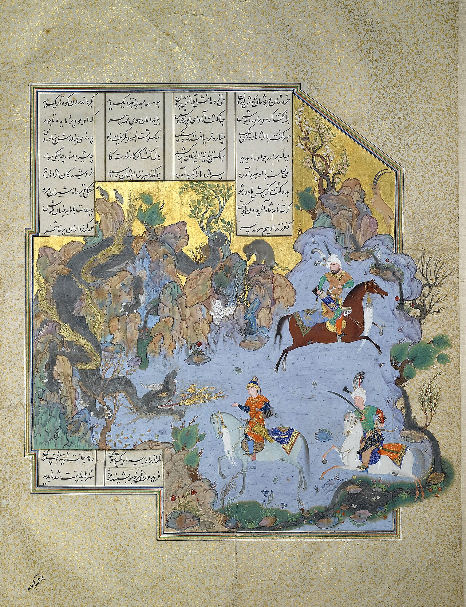

در یادمان‌های شفاهی و باورهای عامیانه‌ی مردم **خراسان جنوبی** (به‌ویژه در گستره‌ی **بیرجند / طبس**)، روایت‌های پرشماری از پدیده‌ای شگفت و موجودی دیرپا به نام **«اژدهای کوه سقیلا»** سینه به سینه از روزگاران باستان تا کنون بازگو شده است. راویان بومی که با گویش و لهجه‌ی **بیرجندی** به نقل قصه‌ها می‌نشستند، پیدایش این پدیده را با کوهساران، دشت‌های بی‌کران، جنگل‌ها یا آب‌های مرموز این خطه پیوند می‌زدند.

در طبقه‌بندی فرهنگ عامه، **اژدهای کوه سقیلا** را غالباً با تیره‌ی *Dragon* هم‌بسته می‌دانند؛ چهره‌ای که تجسم نیروهای ناشناخته‌ی اقلیم و جهان نادیدنی پیرامون نیاکان بوده است. در توصیف‌ها و متون بازمانده‌ی پژوهشی پیرامون این افسانه آمده است:

> «Ejdaha|AŽDAHĀ|اژدهای کوه سقیلا در شاهنامه آمده است که دختر قیصر روم خواستگاری داشت به نام اَهرن. قیصر روم برای اهرن این شرط را گذاشته بود که اگر اژدهای کوه سقیلا را که برای کشور و مردم بلا و گرفتاری درست کرده بود بکشد، اجازه ازدواج می‌دهد.اهرن که در خود نیروی مقابله با این اژدها را نمی‌دید، با میرین داماد قیصر مشورت می‌کند و در نهایت به جستجوی گشتاسپ می‌پردازد تا از او بخواهد این اژدها را برایش بکشد. گشتاسپ این خواسته را پذیرفت، به کوه سقیلا رفت و اژدها را کشت.به شمشیر برد آن زمان دست شیربزد بر سر اژدهای دلیرهمی ریخت مغزش بران سنگ سختز باره درآمد گو نیکبختبکند از دهانش دو دندان نخستپس آنگه بیامد سر و تن بشستاهرن جسد اژدهای کوه سقیلا را بر روی گاری‌ای که گاوی آن را می‌کشید انداخت و نزد قیصر رفت. قیصر نیز با دیدن اژدها جشن می‌گیرد و به اهرن و دخترش اجازه ازدواج می‌دهد. منابعشاهنامه فردوسی/ تصحیح خالقی‌»

پیران و ریش‌سفیدان منطقه در شب‌نشینی‌ها گوشزد می‌کردند که رویارویی با **اژدهای کوه سقیلا** همواره نشانه‌ای از لزوم هشیاری در برابر ناشناخته‌های طبیعت بوده است. در اعصار گذشته، مسافران، شبانان و کاروانیانی که شب‌هنگام در این نواحی گذر می‌کردند، برای مصون ماندن از گزند یا فریب این موجودات، آیین‌ها و دعاهای محافظتی خاصی را به کار می‌بستند و از شکستن سکوت شب یا نزدیک شدن به زیستگاه‌های آنان پرهیز می‌کردند.

امروزه داستان **اژدهای کوه سقیلا** یکی از گنجینه‌های ماندگار میراث معنوی و مردم‌شناسی دیار **خراسان جنوبی** به شمار می‌رود که پیوند عمیق روان‌شناختی انسان کهن را با رمزورازهای زیست‌بوم سرزمین ایران به تصویر می‌کشد.

---

### منابع و اعتبار تصویر
- **پژوهش و خاستگاه روایت:** برگرفته از دانشنامه فولکلور و اسطوره‌شناسی ایران‌شهر (`eranshahr.com/myths`) و روایت‌های شفاهی بومی خراسان جنوبی.
- **تصویر:** اثر *«FOLIO FROM THE SHAHNAMEH OF SHAH TAHMASP, ATTRIBUTED TO AQA MIRAK, CIRCA 1525-35, Sotheby,s.jpg»*، بارگذاری‌شده در ویکی‌انبار (Wikimedia Commons)، پدیدآورنده: Attributed to Āqā Mīrak، تحت مجوز آزاد `Public domain` ([مشاهده منبع](https://commons.wikimedia.org/wiki/File:FOLIO_FROM_THE_SHAHNAMEH_OF_SHAH_TAHMASP,_ATTRIBUTED_TO_AQA_MIRAK,_CIRCA_1525-35,_Sotheby,s.jpg)).