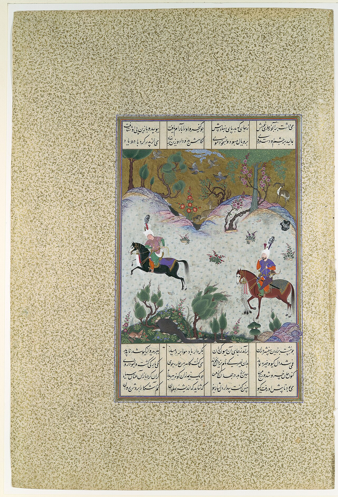

در یادمان‌های شفاهی و باورهای عامیانه‌ی مردم **خراسان جنوبی** (به‌ویژه در گستره‌ی **بیرجند / طبس**)، روایت‌های پرشماری از پدیده‌ای شگفت و موجودی دیرپا به نام **«شبرنگ»** سینه به سینه از روزگاران باستان تا کنون بازگو شده است. راویان بومی که با گویش و لهجه‌ی **بیرجندی** به نقل قصه‌ها می‌نشستند، پیدایش این پدیده را با کوهساران، دشت‌های بی‌کران، جنگل‌ها یا آب‌های مرموز این خطه پیوند می‌زدند.

در طبقه‌بندی فرهنگ عامه، **شبرنگ** را غالباً با تیره‌ی *موجود افسانه‌ای* هم‌بسته می‌دانند؛ چهره‌ای که تجسم نیروهای ناشناخته‌ی اقلیم و جهان نادیدنی پیرامون نیاکان بوده است. در توصیف‌ها و متون بازمانده‌ی پژوهشی پیرامون این افسانه آمده است:

> «Shabrang Behzad|شبرنگ بهزاد شبرنگ اسمي است مرکب به معناي سياه رنگ، بهزاد نيز صفتي است مرکب به معاني «نيک ذات و خوش فطرت، نجيب و اصيل، حلال زاده، به زاد، نيکوزاده، نيک نژاد و اين صفتي است نيک درخور اسب نجيب و نيکوتبار سياووش نام اسب سیاوش در شاهنامه است که بعدها کیخسرو پسر سیاوش صاحب آن شد «شبرنگ بهزاد» اسبي است دلاور و شگفت که در خطرگاه ها يار و ياور خداوند خويش سياووش و فرزند او کيخسرو بوده است. در پي تهمت ناروايي که سوادبه - نامادري سياووش - به او زده است بايد بي گناهي خود را به اثبات رساند يعني بر آيين پيشينيان از «ورگرم» بگذرد. اين اسب او را تند و شتابان از ميان شعله هاي آتش دمان است و جهاني خروشان، خودي زرين بر سر نهاده است، جامه هاي سپيد پوشيده، لبي پر از خنده دارد و دلي پر از اميد. در اين لحظه پر خطر چرا سياووش خندان است؟ بدان دليل که او باور دارد «اگر بي گناهم رهايي مراست» (شاهنامه، ص375ب500) و يقين دارد که به نيروي يزدان نيکي دهش از اين کوه آتش نيابم تپش (شاهنامه:ص375، ب502) و به علاوه اين که سياووش به مرکب تيزپوي خويش پشت گرم است. اسب تندسير که در سختي ها به ياري او مي شتابد: يکي تازي برنشسته سياه همي خاک نعلش بر آمد به ماه (همان، ب495) در برابر چشمان خونبار حاضران نگران، سياووش و اسب او سرافراز و سلامت از آتش بيرون مي آيند. همه جا و همه کس غرق در شور و شادي مي شود، و همگان بر سياووش درم مي ريزند و به يکديگر مژده مي دهند که «بخشود بر بي گنه دادگر» (همان، ب517) سياووش چون بيگناه است بدون گزند از آتش برون مي آيد اسب سياوش، اسبي عادي و زميني نيست بلکه موجودي است فرازميني که به ياري سياووش آمده است. نشانه هايي بر فرازميني بودن اين اسب در جهان حماسه مي توان يافت. اوّلين نشانه ابهامي است که در آغاز و انجام زندگاني شبرنگ مي بينيم. فردوسي از اصل و تبار اين اسب نام و نشاني به دست ما نمي دهد. بر خلاف ديگر اسبان نام آور همچون رخش - اسب جهان پهلوان - و داستان سهراب که به فراخي در باب اصل و تبار آنها سخن رانده است. ظهور شبرنگ در داستان سياووش ناگهاني است. شبرنگ همچو رنگ شب مقايسه شبرنگ بهزاد و پگاز(1) (rasekhoon.net) شبرنگ - ویکی‌پدیا، دانشنامهٔ آزاد (wikipedia.org) شاهنامه»

پیران و ریش‌سفیدان منطقه در شب‌نشینی‌ها گوشزد می‌کردند که رویارویی با **شبرنگ** همواره نشانه‌ای از لزوم هشیاری در برابر ناشناخته‌های طبیعت بوده است. در اعصار گذشته، مسافران، شبانان و کاروانیانی که شب‌هنگام در این نواحی گذر می‌کردند، برای مصون ماندن از گزند یا فریب این موجودات، آیین‌ها و دعاهای محافظتی خاصی را به کار می‌بستند و از شکستن سکوت شب یا نزدیک شدن به زیستگاه‌های آنان پرهیز می‌کردند.

امروزه داستان **شبرنگ** یکی از گنجینه‌های ماندگار میراث معنوی و مردم‌شناسی دیار **خراسان جنوبی** به شمار می‌رود که پیوند عمیق روان‌شناختی انسان کهن را با رمزورازهای زیست‌بوم سرزمین ایران به تصویر می‌کشد.

---

### منابع و اعتبار تصویر
- **پژوهش و خاستگاه روایت:** برگرفته از دانشنامه فولکلور و اسطوره‌شناسی ایران‌شهر (`eranshahr.com/myths`) و روایت‌های شفاهی بومی خراسان جنوبی.
- **تصویر:** اثر *«"Kai Khusrau Rides Bihzad for the First Time", Folio 212r from the Shahnama (Book of Kings) of Shah Tahmasp MET DP107149.jpg»*، بارگذاری‌شده در ویکی‌انبار (Wikimedia Commons)، پدیدآورنده: Qasim ibn 'Ali / Ferdowsi، تحت مجوز آزاد `CC0` ([مشاهده منبع](https://commons.wikimedia.org/wiki/File:%22Kai_Khusrau_Rides_Bihzad_for_the_First_Time%22,_Folio_212r_from_the_Shahnama_(Book_of_Kings)_of_Shah_Tahmasp_MET_DP107149.jpg)).