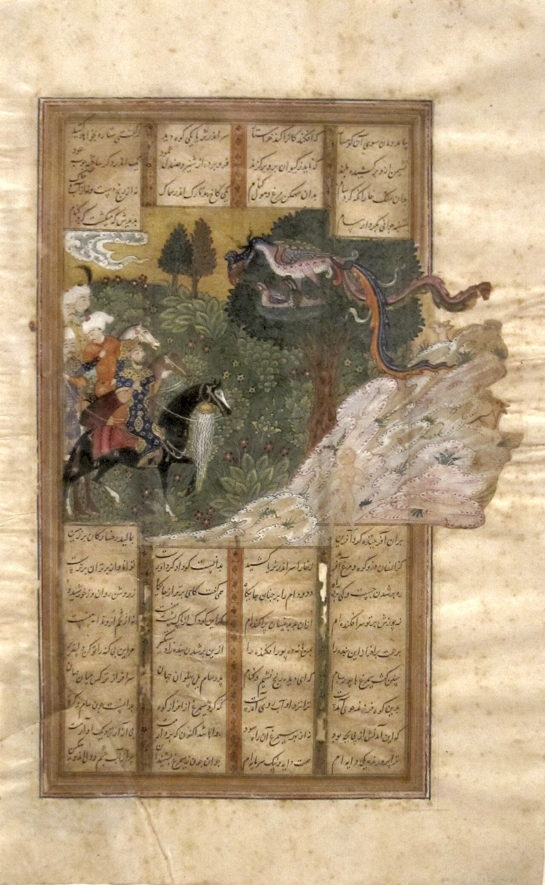

Preserved across centuries within the rich oral folklore of **South Khorasan** (encircling the historical domains of **بیرجند / طبس**), the legendary lore of **SIMURGH** stands as a compelling testament to Iran's enduring mythic imagination. Transmitted across hearths, mountain paths, and rural caravans, the tale has survived through the living memories of local elders.

Folklorists generally categorize **SIMURGH** within the mythological taxonomy of *موجود افسانه‌ای*. As with many traditional entities of Iranian folk belief, it embodies both the untamed natural elements and the ancestral anxieties regarding solitary wilderness. Classical collectors recorded its traditional traits as follows:

> "Illustration by Farima Keshavarz """The Simurgh"" is a legendary bird that, according to ancient narratives, has its nest atop the ""Tree of All Seeds."" Whenever the Simurgh takes flight from the tree, a thousand branches grow, and upon its return, a thousand branches break, scattering the eggs of those branches around, thus causing the growth of various plants. The name ""Simurgh"" appears in the Shahnameh, Avesta, and middle-Persian narratives, describing it as having wings of beautiful colors on all four sides. With a face resembling a human, it has a beak similar to an eagle's and can easily carry away an elephant. This king of birds has a lifespan of one thousand and seven hundred years. In Ferdowsi's Shahnameh, it's mentioned that the Simurgh had its dwelling atop the Alborz mountain and raised Zaal (Rostam's father) along with his children. When Zaal returned to his family, the Simurgh gave him a feather from its plumage so that if he fell into danger, he could seek help by burning the feather. After that, the Simurgh appeared once during Rostam's birth and another time during the battle between Rostam and Esfandyar, aiding Zaal and Rostam. Moreover, in some texts, the Simurgh is described as the guardian at the gate between the Moon and the Sun." …"

In local oral tradition, an encounter with **SIMURGH** was regarded as a formidable threshold between familiar domestic reality and the unseen realm. Elders customarily advised night travelers, shepherds, and caravan drivers traversing the historic passes of South Khorasan to heed ancient apotropaic rituals—such as carrying iron amulets, maintaining solemn reverence towards nature, and never uttering provocative words—to pass through its territorial domain unharmed.

Today, the chronicle of **SIMURGH** forms an invaluable component of Iran's intangible cultural heritage, offering modern readers an evocative window into how ancient communities interpreted their ecology, mystery, and moral balance.

---

### Sources & Image Attribution
- **Folklore Research & Origin:** Sourced and adapted from the Eranshahr Folklore Archive (`eranshahr.com/myths`) and regional oral narratives of South Khorasan.
- **Visual Artifact:** *"'Zal and the Simurgh', ink and opaque watercolor painting from Iran, 16th century, Honolulu Academy of Arts.JPG"*, sourced via Wikimedia Commons, contributed by Unknown author Unknown author, licensed under `Public domain` ([Source Link](https://commons.wikimedia.org/wiki/File:%27Zal_and_the_Simurgh%27,_ink_and_opaque_watercolor_painting_from_Iran,_16th_century,_Honolulu_Academy_of_Arts.JPG)).