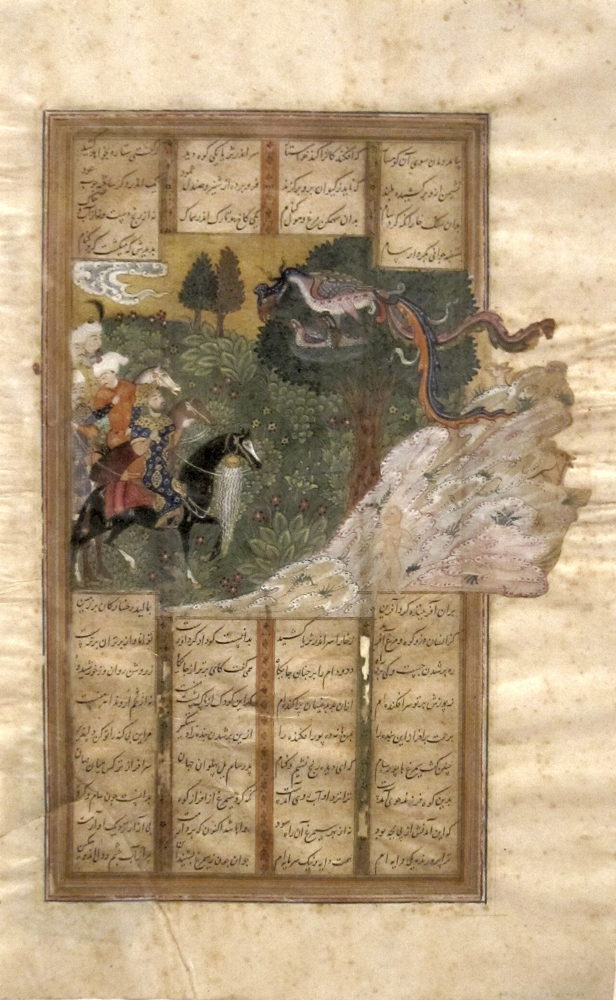

در یادمان‌های شفاهی و باورهای عامیانه‌ی مردم **خراسان جنوبی** (به‌ویژه در گستره‌ی **بیرجند / طبس**)، روایت‌های پرشماری از پدیده‌ای شگفت و موجودی دیرپا به نام **«SIMURGH»** سینه به سینه از روزگاران باستان تا کنون بازگو شده است. راویان بومی که با گویش و لهجه‌ی **بیرجندی** به نقل قصه‌ها می‌نشستند، پیدایش این پدیده را با کوهساران، دشت‌های بی‌کران، جنگل‌ها یا آب‌های مرموز این خطه پیوند می‌زدند.

در طبقه‌بندی فرهنگ عامه، **SIMURGH** را غالباً با تیره‌ی *موجود افسانه‌ای* هم‌بسته می‌دانند؛ چهره‌ای که تجسم نیروهای ناشناخته‌ی اقلیم و جهان نادیدنی پیرامون نیاکان بوده است. در توصیف‌ها و متون بازمانده‌ی پژوهشی پیرامون این افسانه آمده است:

> «Simorgh | Symorgh | سیمرغ «سیمرغ» پرنده‌ای اسطوره‌ای است که بر اساس روایات کهن، بر بالای درخت همه‌تخمه خانه دارد. هر وقت که سیمرغ از روی درخت پرواز می‌کند، هزار شاخه بر روی درخت می‌روید و هنگامی که بر آن فرود می‌آید، هزار شاخه شکسته می‌شود و تخم‌های آن شاخه‌ها در اطراف پراکنده و باعث رویش گیاهان گوناگون می‌شود. نام «سیمرغ» در شاهنامه، اوستا و روایات پهلوی آمده است و گفته شده که او از هر چهار طرف بال‌هایی با رنگ‌های نیکو دارد. او که صورتی مانند انسان دارد، منقارش همچون منقار عقاب است و می‌تواند یک فیل را به آسانی برباید. این پادشاه مرغان، هزار و هفتصد سال عمر دارد. در شاهنامه‌ی فردوسی آمده است که «سیمرغ» بر بالای کوه البرز خانه داشت و زال (پدر رستم) را به همراه فرزندان خودش بزرگ کرده بود. هنگامی هم که زال نزد خانواده‌ی خود برگشت، سیمرغ پری از پرهایش را به او داد تا اگر در خطر افتاد، با آتش‌زدن آن پر از سیمرغ کمک بگیرد. بعد از آن «سیمرغ» یک‌بار در جریان به دنیا آمدن رستم و یکبار هم در نبرد بین رستم و اسفندیار به یاری زال و رستم آمد. همچنین در بندهش «سیمرغ» نگهبان دروازه‌ی بین ماه و خورشید معرفی شده است. دانشنامه آزاد ( سیمرغ)https://asemooni.com»

پیران و ریش‌سفیدان منطقه در شب‌نشینی‌ها گوشزد می‌کردند که رویارویی با **SIMURGH** همواره نشانه‌ای از لزوم هشیاری در برابر ناشناخته‌های طبیعت بوده است. در اعصار گذشته، مسافران، شبانان و کاروانیانی که شب‌هنگام در این نواحی گذر می‌کردند، برای مصون ماندن از گزند یا فریب این موجودات، آیین‌ها و دعاهای محافظتی خاصی را به کار می‌بستند و از شکستن سکوت شب یا نزدیک شدن به زیستگاه‌های آنان پرهیز می‌کردند.

امروزه داستان **SIMURGH** یکی از گنجینه‌های ماندگار میراث معنوی و مردم‌شناسی دیار **خراسان جنوبی** به شمار می‌رود که پیوند عمیق روان‌شناختی انسان کهن را با رمزورازهای زیست‌بوم سرزمین ایران به تصویر می‌کشد.

---

### منابع و اعتبار تصویر
- **پژوهش و خاستگاه روایت:** برگرفته از دانشنامه فولکلور و اسطوره‌شناسی ایران‌شهر (`eranshahr.com/myths`) و روایت‌های شفاهی بومی خراسان جنوبی.
- **تصویر:** اثر *«'Zal and the Simurgh', ink and opaque watercolor painting from Iran, 16th century, Honolulu Academy of Arts.JPG»*، بارگذاری‌شده در ویکی‌انبار (Wikimedia Commons)، پدیدآورنده: Unknown author Unknown author، تحت مجوز آزاد `Public domain` ([مشاهده منبع](https://commons.wikimedia.org/wiki/File:%27Zal_and_the_Simurgh%27,_ink_and_opaque_watercolor_painting_from_Iran,_16th_century,_Honolulu_Academy_of_Arts.JPG)).