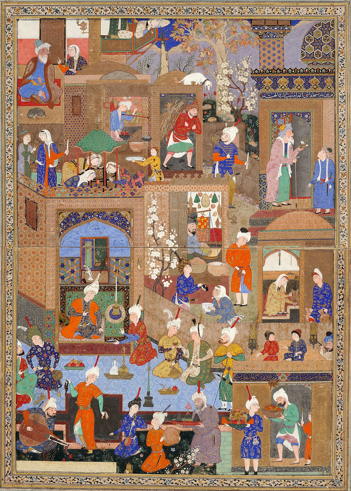

Preserved across centuries within the rich oral folklore of **Tehran** (encircling the historical domains of **ری / تهران**), the legendary lore of **Gaokerna** stands as a compelling testament to Iran's enduring mythic imagination. Transmitted across hearths, mountain paths, and rural caravans, the tale has survived through the living memories of local elders.

Folklorists generally categorize **Gaokerna** within the mythological taxonomy of *Plant*. As with many traditional entities of Iranian folk belief, it embodies both the untamed natural elements and the ancestral anxieties regarding solitary wilderness. Classical collectors recorded its traditional traits as follows:

> "Illustration by Mo.Rasoulipour In Zoroastrian mythology, the mighty Gaokerena was a mythic Haoma plant that had healing properties when eaten and gave immortality to the resurrected bodies of the dead. The juice from its fruit gave the elixir of immortality. The name Gaokerena means "ox horn".According to Bandheshan, the devil creates a toad in the Farakhkard Sea To destroy this tree, but in return, Ormazd forms two fishes that always guard this tree, and one of these fish constantly monitors the evil toad. …"

In local oral tradition, an encounter with **Gaokerna** was regarded as a formidable threshold between familiar domestic reality and the unseen realm. Elders customarily advised night travelers, shepherds, and caravan drivers traversing the historic passes of Tehran to heed ancient apotropaic rituals—such as carrying iron amulets, maintaining solemn reverence towards nature, and never uttering provocative words—to pass through its territorial domain unharmed.

Today, the chronicle of **Gaokerna** forms an invaluable component of Iran's intangible cultural heritage, offering modern readers an evocative window into how ancient communities interpreted their ecology, mystery, and moral balance.

---

### Sources & Image Attribution
- **Folklore Research & Origin:** Sourced and adapted from the Eranshahr Folklore Archive (`eranshahr.com/myths`) and regional oral narratives of Tehran.
- **Visual Artifact:** *"Full view. Nighttime in a City. Circa 1540, Tabriz (Sackler Museum, 1958.76).jpg"*, sourced via Wikimedia Commons, contributed by Circa 1540, licensed under `Public domain` ([Source Link](https://commons.wikimedia.org/wiki/File:Full_view._Nighttime_in_a_City._Circa_1540,_Tabriz_(Sackler_Museum,_1958.76).jpg)).