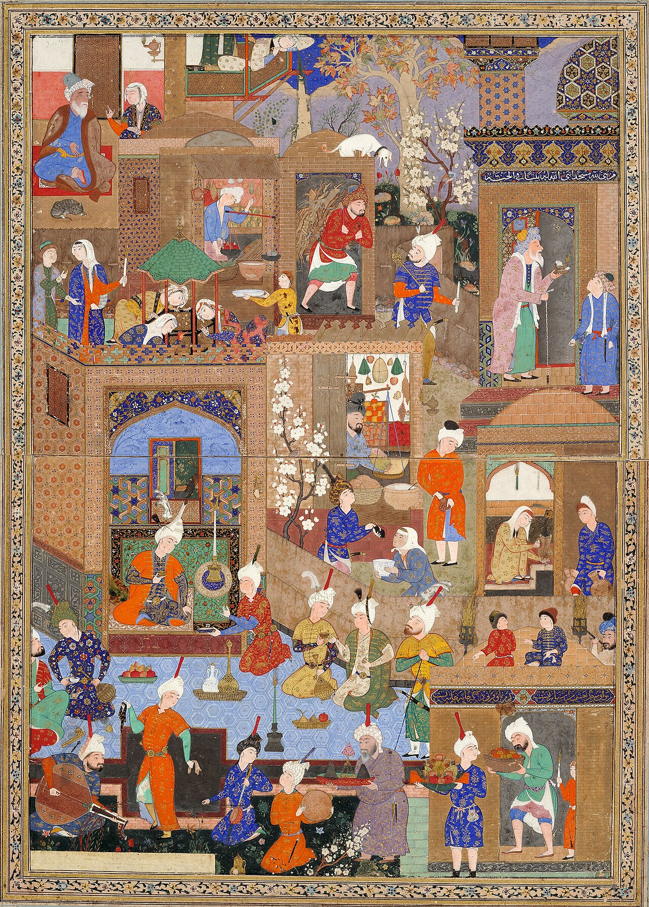

در یادمان‌های شفاهی و باورهای عامیانه‌ی مردم **تهران** (به‌ویژه در گستره‌ی **ری / تهران**)، روایت‌های پرشماری از پدیده‌ای شگفت و موجودی دیرپا به نام **«گاوکرن»** سینه به سینه از روزگاران باستان تا کنون بازگو شده است. راویان بومی که با گویش و لهجه‌ی **تهرانی** به نقل قصه‌ها می‌نشستند، پیدایش این پدیده را با کوهساران، دشت‌های بی‌کران، جنگل‌ها یا آب‌های مرموز این خطه پیوند می‌زدند.

در طبقه‌بندی فرهنگ عامه، **گاوکرن** را غالباً با تیره‌ی *Plant* هم‌بسته می‌دانند؛ چهره‌ای که تجسم نیروهای ناشناخته‌ی اقلیم و جهان نادیدنی پیرامون نیاکان بوده است. در توصیف‌ها و متون بازمانده‌ی پژوهشی پیرامون این افسانه آمده است:

> «Gaokerna|گاوکِرن|گیوکرن|گیوکرن توانا گئوکرن یا گاوکرن در اساطیر مزدیسنا اسطوره‌ای از گیاه هوم بود که با نام «گئوکرن توانا» نیز خوانده می‌شد. گاوکرن دارای خواص شفابخش است و عصاره و افشره آن با زنده کردن بدن‌های مُرده، باعث جاودانگی می‌گردد. گاوکرن، از نظر لغوی به معنای «شاخ گاو» است.بنابر متن پهلوی بندهشن، اهریمن در تلاش برای کوتاه کردن عمر این درخت است. اهریمن برای از بین بردن این درخت وزغی را در دریای فراخکرد به وجود می‌آورد اما در مقابل، اورمزد دو ماهی مینوی می‌آفریند که مامور نگهبانی از این درخت می‌شوند و همواره یکی از این ماهی‌ها آن وزغ اهریمنی را زیر نظر دارد.در آثار زرتشتی گفته شده که آشیانه سیمرغ بر فراز درخت گاوکرن قرار دارد. این درخت دانه همه رستنی‌ها را در خود دارد. هرگاه سیمرغ از این درخت بلند می‌شود، هزار شاخه از درخت می‌روید و هرگاه بر درخت می‌نشیند، هزار شاخه درخت می‌شکند و همه این دانه‌ها پراکنده می‌شود و گیاهان مختلف از این دانه‌ها روی زمین می‌رویند. درخت طوبی/درخت زندگی منابعاساطیر ایران/ جان راسل هینیلز، ترجمه محمدحسین باجلان فرخی»

پیران و ریش‌سفیدان منطقه در شب‌نشینی‌ها گوشزد می‌کردند که رویارویی با **گاوکرن** همواره نشانه‌ای از لزوم هشیاری در برابر ناشناخته‌های طبیعت بوده است. در اعصار گذشته، مسافران، شبانان و کاروانیانی که شب‌هنگام در این نواحی گذر می‌کردند، برای مصون ماندن از گزند یا فریب این موجودات، آیین‌ها و دعاهای محافظتی خاصی را به کار می‌بستند و از شکستن سکوت شب یا نزدیک شدن به زیستگاه‌های آنان پرهیز می‌کردند.

امروزه داستان **گاوکرن** یکی از گنجینه‌های ماندگار میراث معنوی و مردم‌شناسی دیار **تهران** به شمار می‌رود که پیوند عمیق روان‌شناختی انسان کهن را با رمزورازهای زیست‌بوم سرزمین ایران به تصویر می‌کشد.

---

### منابع و اعتبار تصویر
- **پژوهش و خاستگاه روایت:** برگرفته از دانشنامه فولکلور و اسطوره‌شناسی ایران‌شهر (`eranshahr.com/myths`) و روایت‌های شفاهی بومی تهران.
- **تصویر:** اثر *«Full view. Nighttime in a City. Circa 1540, Tabriz (Sackler Museum, 1958.76).jpg»*، بارگذاری‌شده در ویکی‌انبار (Wikimedia Commons)، پدیدآورنده: Circa 1540، تحت مجوز آزاد `Public domain` ([مشاهده منبع](https://commons.wikimedia.org/wiki/File:Full_view._Nighttime_in_a_City._Circa_1540,_Tabriz_(Sackler_Museum,_1958.76).jpg)).