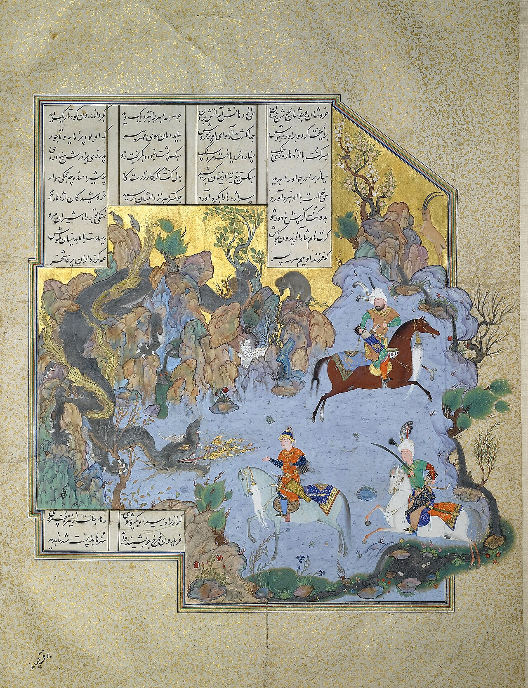

Preserved across centuries within the rich oral folklore of **Tehran** (encircling the historical domains of **ری / تهران**), the legendary lore of **Jowsha Snake** stands as a compelling testament to Iran's enduring mythic imagination. Transmitted across hearths, mountain paths, and rural caravans, the tale has survived through the living memories of local elders.

Folklorists generally categorize **Jowsha Snake** within the mythological taxonomy of *Dragon*. As with many traditional entities of Iranian folk belief, it embodies both the untamed natural elements and the ancestral anxieties regarding solitary wilderness. Classical collectors recorded its traditional traits as follows:

> "Illustration by Mo.Rasoulipour In Faramarz-nama, there is a tale about a snake named [Mar-e-Josha]. The snake is the enemy of India's king. Faramarz (Rostam's son), who wants to assist the Indian king in defeating his enemy, fights this snake and manages to destroy it.According to Faramarz-nama, the snake's length is 40 Zar (about 40 meters). It's highly venomous and has an extremely thick skin that no sword or ax can cut through. The snake is so furious and huge that it can take a lion out of the woods with one breath and eat it.In this tale, Faramarz takes Zahhāk's diamond and hides it in a box. When the snake arrives, the box is sucked into its mouth by its breath. After the box is inside the snake's body, Faramarz gets out of it and starts cutting the snake's organs and brain from within. In the end, he cuts Mar-e-Josha's flesh and gets out of its body. Translation: Sarah Mohebbi Moghadam"

In local oral tradition, an encounter with **Jowsha Snake** was regarded as a formidable threshold between familiar domestic reality and the unseen realm. Elders customarily advised night travelers, shepherds, and caravan drivers traversing the historic passes of Tehran to heed ancient apotropaic rituals—such as carrying iron amulets, maintaining solemn reverence towards nature, and never uttering provocative words—to pass through its territorial domain unharmed.

Today, the chronicle of **Jowsha Snake** forms an invaluable component of Iran's intangible cultural heritage, offering modern readers an evocative window into how ancient communities interpreted their ecology, mystery, and moral balance.

---

### Sources & Image Attribution
- **Folklore Research & Origin:** Sourced and adapted from the Eranshahr Folklore Archive (`eranshahr.com/myths`) and regional oral narratives of Tehran.
- **Visual Artifact:** *"FOLIO FROM THE SHAHNAMEH OF SHAH TAHMASP, ATTRIBUTED TO AQA MIRAK, CIRCA 1525-35, Sotheby,s.jpg"*, sourced via Wikimedia Commons, contributed by Attributed to Āqā Mīrak, licensed under `Public domain` ([Source Link](https://commons.wikimedia.org/wiki/File:FOLIO_FROM_THE_SHAHNAMEH_OF_SHAH_TAHMASP,_ATTRIBUTED_TO_AQA_MIRAK,_CIRCA_1525-35,_Sotheby,s.jpg)).