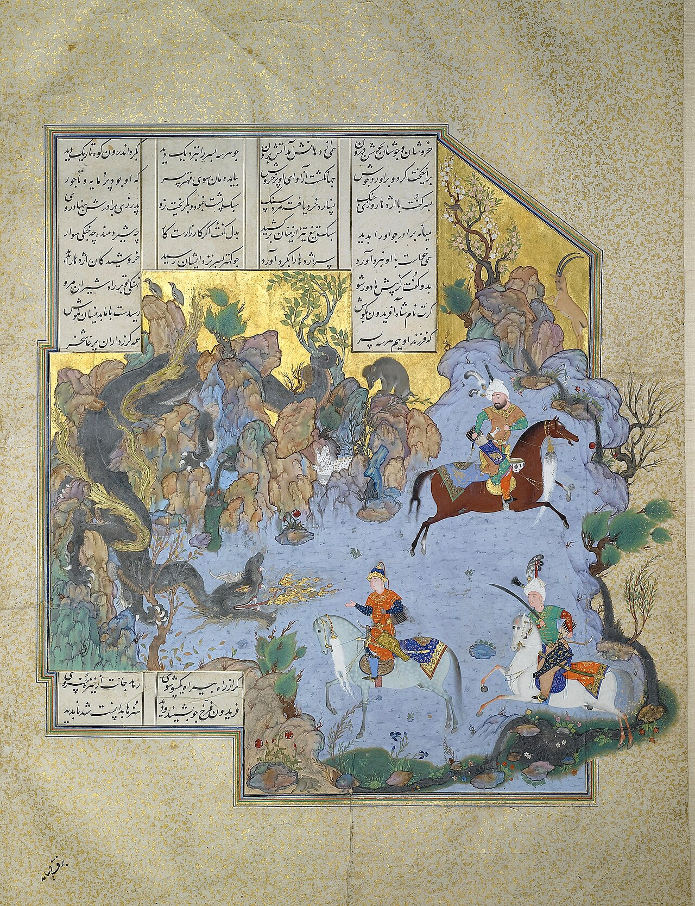

در یادمان‌های شفاهی و باورهای عامیانه‌ی مردم **تهران** (به‌ویژه در گستره‌ی **ری / تهران**)، روایت‌های پرشماری از پدیده‌ای شگفت و موجودی دیرپا به نام **«مار جوشا»** سینه به سینه از روزگاران باستان تا کنون بازگو شده است. راویان بومی که با گویش و لهجه‌ی **تهرانی** به نقل قصه‌ها می‌نشستند، پیدایش این پدیده را با کوهساران، دشت‌های بی‌کران، جنگل‌ها یا آب‌های مرموز این خطه پیوند می‌زدند.

در طبقه‌بندی فرهنگ عامه، **مار جوشا** را غالباً با تیره‌ی *Dragon* هم‌بسته می‌دانند؛ چهره‌ای که تجسم نیروهای ناشناخته‌ی اقلیم و جهان نادیدنی پیرامون نیاکان بوده است. در توصیف‌ها و متون بازمانده‌ی پژوهشی پیرامون این افسانه آمده است:

> «Jowsha Snake|Mar-e-Jowsha|مار جوشا در منظومه فرامرزنامه، 《مار جوشا 》 دشمن پادشاه هند است. فرامرز که می‌خواهد پادشاه هند را یاری کند، و دشمنانش را از میان بردارد، با این مار می‌جنگد و او را از بین می‌برد.به روایت فرامرزنامه، از دم تا سر این مار چهل ذرع ( حدودا چهل متر) است، زهر او بسیار سمی‌ و پوست او چنان کلفت است که هیچ تیر و شمشیری آن را نمی‌برد. این مار آنچنان بزرگ و خشمگین است که با یک نفس کشیدن او شیر از بیشه بیرون کشیده می‌شود و به داخل دهان او می‌رود.در این داستان، فرامرز الماسِ ضحاک را به دست می‌گیرد و خود را داخل صندوقی پنهان می‌کند. وقتی که اژدها ظاهر می‌شود، با نفس کشیدنش صندوق به داخل دهانش می‌رود. فرامرز از صندوق بیرون می‌آید و با الماس تن و مغز اژدها را از درون زخمی می‌کند. در انتها پهلوی مار جوشا را پاره کرده و از بدنش بیرون می‌جهد. باسیلیسک منابعفرامرزنامه»

پیران و ریش‌سفیدان منطقه در شب‌نشینی‌ها گوشزد می‌کردند که رویارویی با **مار جوشا** همواره نشانه‌ای از لزوم هشیاری در برابر ناشناخته‌های طبیعت بوده است. در اعصار گذشته، مسافران، شبانان و کاروانیانی که شب‌هنگام در این نواحی گذر می‌کردند، برای مصون ماندن از گزند یا فریب این موجودات، آیین‌ها و دعاهای محافظتی خاصی را به کار می‌بستند و از شکستن سکوت شب یا نزدیک شدن به زیستگاه‌های آنان پرهیز می‌کردند.

امروزه داستان **مار جوشا** یکی از گنجینه‌های ماندگار میراث معنوی و مردم‌شناسی دیار **تهران** به شمار می‌رود که پیوند عمیق روان‌شناختی انسان کهن را با رمزورازهای زیست‌بوم سرزمین ایران به تصویر می‌کشد.

---

### منابع و اعتبار تصویر
- **پژوهش و خاستگاه روایت:** برگرفته از دانشنامه فولکلور و اسطوره‌شناسی ایران‌شهر (`eranshahr.com/myths`) و روایت‌های شفاهی بومی تهران.
- **تصویر:** اثر *«FOLIO FROM THE SHAHNAMEH OF SHAH TAHMASP, ATTRIBUTED TO AQA MIRAK, CIRCA 1525-35, Sotheby,s.jpg»*، بارگذاری‌شده در ویکی‌انبار (Wikimedia Commons)، پدیدآورنده: Attributed to Āqā Mīrak، تحت مجوز آزاد `Public domain` ([مشاهده منبع](https://commons.wikimedia.org/wiki/File:FOLIO_FROM_THE_SHAHNAMEH_OF_SHAH_TAHMASP,_ATTRIBUTED_TO_AQA_MIRAK,_CIRCA_1525-35,_Sotheby,s.jpg)).