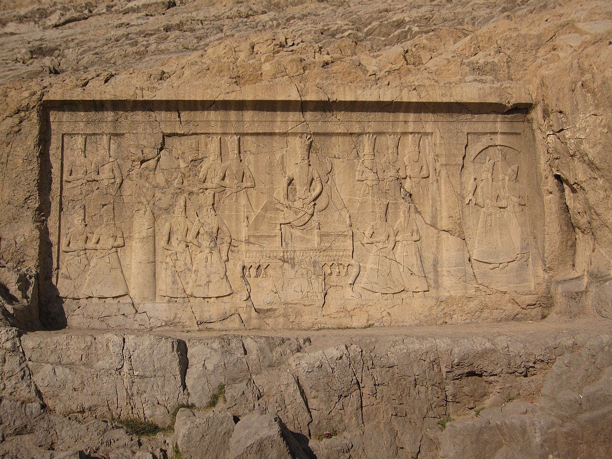

At the base of the weathered stone escarpment of the ancient city of Rey in southern Tehran, an eight-thousand-year-old freshwater spring known as *Cheshmeh-Ali* (ancient Suran) surges from the bedrock beneath the Qajar cliff reliefs. For generations, the inhabitants of Old Tehran and Rey assembled along its flagstones prior to the Persian New Year (Nowruz) to wash their hand-woven wool carpets in the mineral-rich waters. This beloved tradition was intertwined with the legend of the *Pari of Cheshmeh-Ali*—a radiant celestial nymph clothed in jasmine-scented white silk residing within the subterranean fissures of the spring.

Tehrani oral lore recounts that the Pari of Cheshmeh-Ali personifies renewal, purity, and household prosperity. According to folk tradition, in the dead of night preceding the annual carpet-washing season, the nymph emerges within the warm steam rising from the water. Running her silver fingers through the stream, she blesses the waters so that every carpet cleansed within its flow gleams with renewed brilliance and brings lasting prosperity to the hearth. Conversely, should a corrupt usurer attempt to wash carpets bought with ill-gotten wealth, the offended nymph causes the warp and weft to fray and dissolve in the current.

> "Wash your New Year carpet in the waters of Cheshmeh-Ali that the mountain nymph may touch its knots; bring no deceit to the springs of Rey, for Cheshmeh-Ali is the tear of history, bestowing its blessing only upon the pure." — Folk adage of Old Tehran matriarchs.

Literary pioneer Sadegh Hedayat in *Neyrangestan* and Seyyed Abolghasem Enjavi Shirazi in *Winter Festivals and Customs* document this iconic carpet-washing ritual as an ancient springtime catharsis designed to purge communal misfortune before the spring equinox. The limestone waters naturally brighten vegetable dyes, an empirical phenomenon poeticized by local folk memory into the miraculous touch of the spring's guardian nymph. Today, the ancient cliff reliefs of Cheshmeh-Ali continue to echo this ageless celebration of renewal.

### Sources & Image Attribution
- **Research Source:** Sadegh Hedayat, *Neyrangestan*, Tehran: Amir Kabir, p. 59; Seyyed Abolghasem Enjavi Shirazi, *Winter Festivals and Customs*, p. 151.
- **Image Attribution:** Documented on Wikimedia Commons by Alireza Javaheri; License: [CC BY 3.0](https://commons.wikimedia.org/wiki/File:Cheshme_Ali_in_the_city_of_Rey.jpg).
