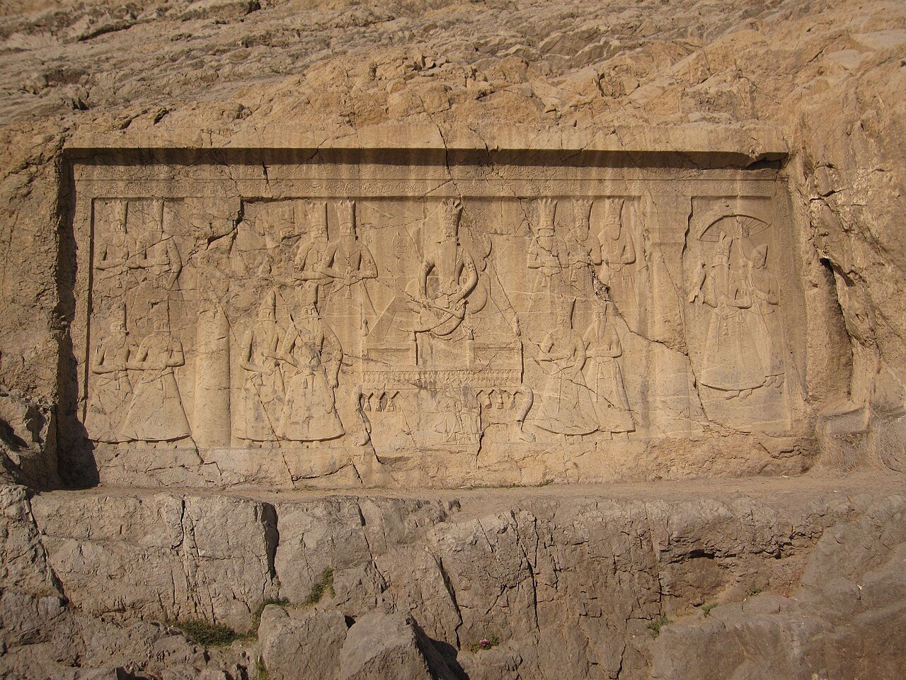

در پای صخره‌های تاریخی شهر باستانی ری در جنوب تهران، چشمه‌ای هشت‌هزارساله به نام «چشمه‌علی» (سورن کهن) از دل سنگ‌های خارا می‌جوشد که در پای برج طغرل و کتیبه قاجاری، یکی از کهن‌ترین زیستگاه‌های بشری فلات ایران به شمار می‌رود. برای قرن‌ها، مردم تهران و ری در آستانه نوروز، قالی‌ها و زیراندازهای دستباف خود را به آب خنک این چشمه می‌سپردند؛ سنتی که با باوری رازآلود پیرامون «پری چشمه‌علی» پیوند خورده است؛ بانویی سپیدجامه با چهره‌ای از نور و گیسوان آغشته به یاس که در آب‌انبارهای پنهان صخره زندگی می‌کند.

روایت تهرانی قدیم بازگو می‌کند که پری چشمه‌علی، فرشته‌ی برکت، پاکیزگی و نوآوری روزگاران است. باور عامه بر این بود که در نیمه‌شب‌های اسفندماه، پیش از آنکه مردم فرش‌های خویش را به آب بزنند، پری چشمه در مه غلیظی که از سطح آب برمی‌خیزد پدیدار می‌شود و با پنجه‌های سیمین خود بر آب چشمه دست می‌کشد تا هر قالی که در آن شسته شود، رنگ‌هایش درخشان‌تر، تارش ناگسستنی و برکت خانه صاحبش فزونی یابد. اما اگر فردی ناپاک‌دل یا نزول‌خوار فرشی را با مال غصب‌شده به آب چشمه‌علی می‌آورد، پری رو ترش می‌کرد و تار و پود قالی در آب پوسیده و پاره می‌شد.

> «قالی عید را به آب چشمه‌علی بشوی تا پری کوه دست بر گره‌هایش کشد؛ در آب ری ناپاکی مبرید، که چشمه‌علی اشک چشم تاریخ است و برکت را تنها به پاک‌دستان نثار می‌کند.» — باور زنان تهرانی قدیم در مراسم سالانه قالی‌شویان ری.

صادق هدایت در کتاب پیشگام «نیرنگستان» و سید ابوالقاسم انجوی شیرازی در «جشن‌ها و آداب و معتقدات زمستان» به آیین‌های قالی‌شویی در چشمه‌علی ری به عنوان سنتی نمادین برای زدودن پلیدی‌های کهنه و تجدید حیات در آستانه اعتدال بهاری اشاره می‌کنند. آب چشمه‌علی به دلیل املاح معدنی خاص، رنگ‌های طبیعی قالی‌های ابریشمی و پشمی را جلا می‌بخشید و این خصلت طبیعی در باورهای مردمی، به نوازش معجزه‌آسای پری چشمه تعبیر می‌شد.

امروزه صخره‌های کهن چشمه‌علی و صدای شرشر آب گوارای آن در قلب شهر باستانی ری، یادگار پیوند ناگسستنی آیین‌های نوروزی با اساطیر ایزدبانوان پاکیزگی و آب در پایتخت کهن ایران‌زمین است.

مردم کهن ری و تهران بر این عقیده بودند که آب چشمه‌علی ریشه در چشمه‌های اساطیری البرز دارد و پاک‌کننده آلودگی‌های روحی و جسمی است. در آستانه نوروز، شستن قالی‌ها در آب روان چشمه‌علی، فراتر از یک نظافت ساده، آیینی نمادین برای پیوند دوباره با روح طراوت، مهرورزی و خیرخواهی پری چشمه بود تا سال نو با دلی پاک و آغوشی گشوده به روی روشنایی آغاز گردد.

### منابع و اعتبار تصویر
- **منبع پژوهشی افسانه:** صادق هدایت، «نیرنگستان»، تهران، انتشارات امیرکبیر، ص ۵۹؛ سید ابوالقاسم انجوی شیرازی، «جشن‌ها و آداب زمستان»، ص ۱۵۱.
- **اعتبار تصویر:** ثبت‌شده در ویکی‌مدیا کامنز توسط Alireza Javaheri؛ مجوز انتشار: [CC BY 3.0](https://commons.wikimedia.org/wiki/File:Cheshme_Ali_in_the_city_of_Rey.jpg).
