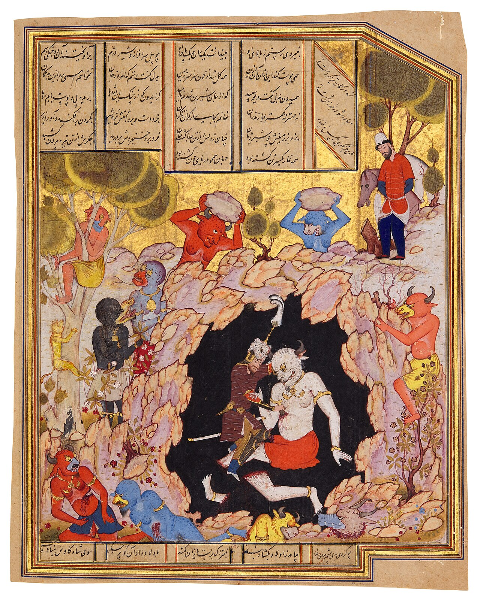

Preserved across centuries within the rich oral folklore of **Tehran** (encircling the historical domains of **ری / تهران**), the legendary lore of **Pouladvand** stands as a compelling testament to Iran's enduring mythic imagination. Transmitted across hearths, mountain paths, and rural caravans, the tale has survived through the living memories of local elders.

Folklorists generally categorize **Pouladvand** within the mythological taxonomy of *Div*. As with many traditional entities of Iranian folk belief, it embodies both the untamed natural elements and the ancestral anxieties regarding solitary wilderness. Classical collectors recorded its traditional traits as follows:

> "Illustration by Farima Keshavarzz In the epic of Borzu-nama, there's a Div named Puladvand. He is the enemy of Rostam. In this story, Rostam had a famous armor named Babr-e-Bayan. To pass it on to his grandson Borzu, he forces a condition. Borzu had to challenge Puladvand to a battle to receive the armor. Borzu accepts the condition and leads an army to China. On the way, he encounters a Div. He introduces himself and explains he's there to behead Puladvand. The Div, being Puladvand himself, gets furious, and they begin to fight. After fighting for some time, they decide to postpone it to another day, and the battle continues. In the end, they begin to wrestle, and Borzu manages to defeat Puladvand. Translation: Sarah Mohebbi Moghadam …"

In local oral tradition, an encounter with **Pouladvand** was regarded as a formidable threshold between familiar domestic reality and the unseen realm. Elders customarily advised night travelers, shepherds, and caravan drivers traversing the historic passes of Tehran to heed ancient apotropaic rituals—such as carrying iron amulets, maintaining solemn reverence towards nature, and never uttering provocative words—to pass through its territorial domain unharmed.

Today, the chronicle of **Pouladvand** forms an invaluable component of Iran's intangible cultural heritage, offering modern readers an evocative window into how ancient communities interpreted their ecology, mystery, and moral balance.

---

### Sources & Image Attribution
- **Folklore Research & Origin:** Sourced and adapted from the Eranshahr Folklore Archive (`eranshahr.com/myths`) and regional oral narratives of Tehran.
- **Visual Artifact:** *"An illustrated leaf from a manuscript of Firdausi’s Shahnameh; Rustam killing the White Div, Persia, Shiraz, Safavid, circa 1560-80.jpg"*, sourced via Wikimedia Commons, contributed by Sotheby's, licensed under `Public domain` ([Source Link](https://commons.wikimedia.org/wiki/File:An_illustrated_leaf_from_a_manuscript_of_Firdausi%E2%80%99s_Shahnameh;_Rustam_killing_the_White_Div,_Persia,_Shiraz,_Safavid,_circa_1560-80.jpg)).