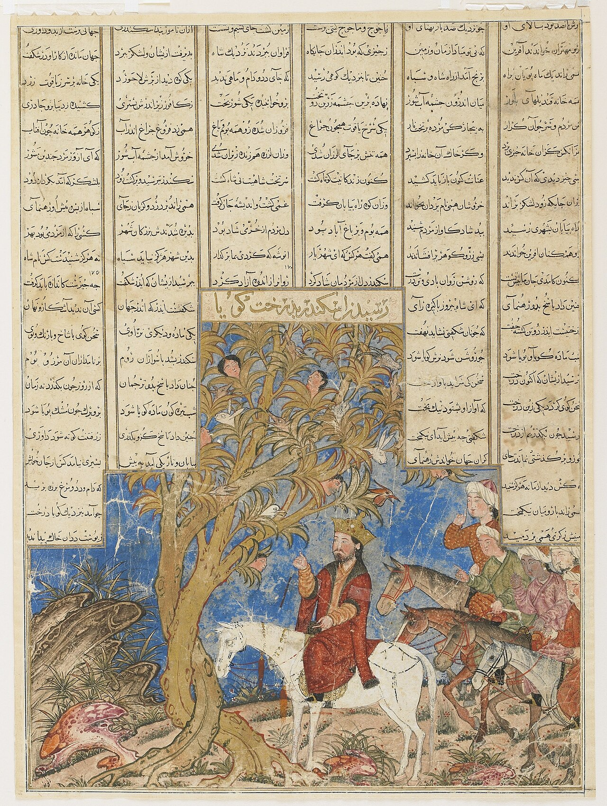

Preserved across centuries within the rich oral folklore of **Tehran** (encircling the historical domains of **ری / تهران**), the legendary lore of **The Tree of Life** stands as a compelling testament to Iran's enduring mythic imagination. Transmitted across hearths, mountain paths, and rural caravans, the tale has survived through the living memories of local elders.

Folklorists generally categorize **The Tree of Life** within the mythological taxonomy of *موجود افسانه‌ای*. As with many traditional entities of Iranian folk belief, it embodies both the untamed natural elements and the ancestral anxieties regarding solitary wilderness. Classical collectors recorded its traditional traits as follows:

> "Illustration by Farima Keshavarz According to the teachings of Manichaen religion, there is a tree of life growing in the Kingdom of Light. It has three trunks, which symbolize the East, West, and North of the Kingdom of Light. The tree has luxuriant branches and leaves, fragrant flowers in full bloom, and numerous fruits. …"

In local oral tradition, an encounter with **The Tree of Life** was regarded as a formidable threshold between familiar domestic reality and the unseen realm. Elders customarily advised night travelers, shepherds, and caravan drivers traversing the historic passes of Tehran to heed ancient apotropaic rituals—such as carrying iron amulets, maintaining solemn reverence towards nature, and never uttering provocative words—to pass through its territorial domain unharmed.

Today, the chronicle of **The Tree of Life** forms an invaluable component of Iran's intangible cultural heritage, offering modern readers an evocative window into how ancient communities interpreted their ecology, mystery, and moral balance.

---

### Sources & Image Attribution
- **Folklore Research & Origin:** Sourced and adapted from the Eranshahr Folklore Archive (`eranshahr.com/myths`) and regional oral narratives of Tehran.
- **Visual Artifact:** *"Iskandar (Alexander) and the Talking Tree, Folio from a Great Mongol Shahnameh.jpg"*, sourced via Wikimedia Commons, contributed by Unknown, licensed under `Public domain` ([Source Link](https://commons.wikimedia.org/wiki/File:Iskandar_(Alexander)_and_the_Talking_Tree,_Folio_from_a_Great_Mongol_Shahnameh.jpg)).