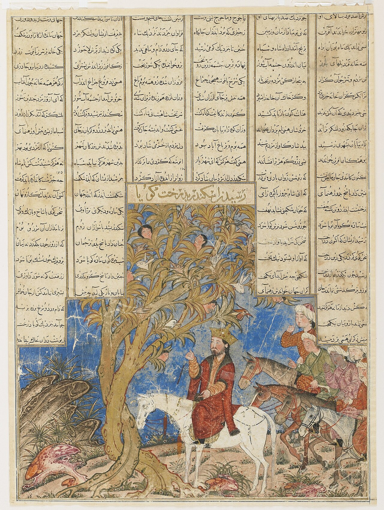

در یادمان‌های شفاهی و باورهای عامیانه‌ی مردم **تهران** (به‌ویژه در گستره‌ی **ری / تهران**)، روایت‌های پرشماری از پدیده‌ای شگفت و موجودی دیرپا به نام **«درخت زندگی»** سینه به سینه از روزگاران باستان تا کنون بازگو شده است. راویان بومی که با گویش و لهجه‌ی **تهرانی** به نقل قصه‌ها می‌نشستند، پیدایش این پدیده را با کوهساران، دشت‌های بی‌کران، جنگل‌ها یا آب‌های مرموز این خطه پیوند می‌زدند.

در طبقه‌بندی فرهنگ عامه، **درخت زندگی** را غالباً با تیره‌ی *موجود افسانه‌ای* هم‌بسته می‌دانند؛ چهره‌ای که تجسم نیروهای ناشناخته‌ی اقلیم و جهان نادیدنی پیرامون نیاکان بوده است. در توصیف‌ها و متون بازمانده‌ی پژوهشی پیرامون این افسانه آمده است:

> «The Tree of Life|درخت زندگی درخت زندگی بر اساس آیین مانوی، درختی است که در پادشاهی روشنایی روییده است. این درخت سه تنه دارد که نماد شرق، غرب و شمال قلمرو روشنایی است. همچنین این سه تنه، نمایان گر سه دوره آفرینش در آیین مانوی است.درخت زندگی شاخه‌ها و برگ‌های باشکوه و گل‌هایی همیشه شکفته با بوی خوش دارد.در سروده‌ای از مانی، درخت زندگی به این صورت توصیف گردیده است:خورشید روشن و ماه نو برازندگی از تنه تناور درخت زندگی دارندمرغان سحرخیز بر شاخسارش به شادی نغمه سرایی کنند، کبوتر و طاوس سخن‌ها سرایند.دختران زیبا، آواز برآورند، و همگی درخت ماندگار را می ستایند و ثنا می گویند منابعایرانیکا - مانیکِیزم در چینRemains of Manichaeism in Turpan - Ma Jian“Veneration of Tree of Life” - Wikipediaاسطوره‌ی آفرینش در آیین مانی با گفتاری در عرفان مانوی - ابوالقاسم اسماعیل پور - کاروان»

پیران و ریش‌سفیدان منطقه در شب‌نشینی‌ها گوشزد می‌کردند که رویارویی با **درخت زندگی** همواره نشانه‌ای از لزوم هشیاری در برابر ناشناخته‌های طبیعت بوده است. در اعصار گذشته، مسافران، شبانان و کاروانیانی که شب‌هنگام در این نواحی گذر می‌کردند، برای مصون ماندن از گزند یا فریب این موجودات، آیین‌ها و دعاهای محافظتی خاصی را به کار می‌بستند و از شکستن سکوت شب یا نزدیک شدن به زیستگاه‌های آنان پرهیز می‌کردند.

امروزه داستان **درخت زندگی** یکی از گنجینه‌های ماندگار میراث معنوی و مردم‌شناسی دیار **تهران** به شمار می‌رود که پیوند عمیق روان‌شناختی انسان کهن را با رمزورازهای زیست‌بوم سرزمین ایران به تصویر می‌کشد.

---

### منابع و اعتبار تصویر
- **پژوهش و خاستگاه روایت:** برگرفته از دانشنامه فولکلور و اسطوره‌شناسی ایران‌شهر (`eranshahr.com/myths`) و روایت‌های شفاهی بومی تهران.
- **تصویر:** اثر *«Iskandar (Alexander) and the Talking Tree, Folio from a Great Mongol Shahnameh.jpg»*، بارگذاری‌شده در ویکی‌انبار (Wikimedia Commons)، پدیدآورنده: Unknown، تحت مجوز آزاد `Public domain` ([مشاهده منبع](https://commons.wikimedia.org/wiki/File:Iskandar_(Alexander)_and_the_Talking_Tree,_Folio_from_a_Great_Mongol_Shahnameh.jpg)).