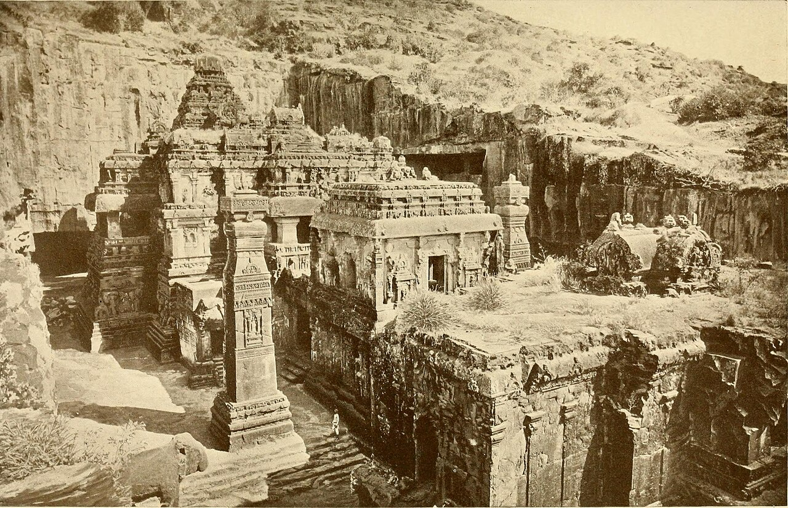

Preserved across centuries within the rich oral folklore of **Tehran** (encircling the historical domains of **ری / تهران**), the legendary lore of **Yama & Yami** stands as a compelling testament to Iran's enduring mythic imagination. Transmitted across hearths, mountain paths, and rural caravans, the tale has survived through the living memories of local elders.

Folklorists generally categorize **Yama & Yami** within the mythological taxonomy of *موجود افسانه‌ای*. As with many traditional entities of Iranian folk belief, it embodies both the untamed natural elements and the ancestral anxieties regarding solitary wilderness. Classical collectors recorded its traditional traits as follows:

> "Illustration by Mo.Rasoulipour According to ancient Hindu-Iranian beliefs, Yameh and Yami were the first humans created. They were siblings. Yameh and Yami were also the first humans created according to Vedic texts. It's said that they had a special connection with Gods. Yameh was the first human and the first mortal creature. After his death, he became the king of the dead. Yameh and Yami have also been mentioned in Chinese mythology, and we can see how deep this legend goes. It has been carved deep inside the culture of different countries. The character similar to Yameh in Iranian Mythology is named Yimeh. Yimeh has appeared in Avesta and is related to Jam or Jamshid. Translation: Sarah Mohebbi Moghadam"

In local oral tradition, an encounter with **Yama & Yami** was regarded as a formidable threshold between familiar domestic reality and the unseen realm. Elders customarily advised night travelers, shepherds, and caravan drivers traversing the historic passes of Tehran to heed ancient apotropaic rituals—such as carrying iron amulets, maintaining solemn reverence towards nature, and never uttering provocative words—to pass through its territorial domain unharmed.

Today, the chronicle of **Yama & Yami** forms an invaluable component of Iran's intangible cultural heritage, offering modern readers an evocative window into how ancient communities interpreted their ecology, mystery, and moral balance.

---

### Sources & Image Attribution
- **Folklore Research & Origin:** Sourced and adapted from the Eranshahr Folklore Archive (`eranshahr.com/myths`) and regional oral narratives of Tehran.
- **Visual Artifact:** *"Kailasa Temple Ellora Caves 1913.jpg"*, sourced via Wikimedia Commons, contributed by Internet Archive Book Images, licensed under `No restrictions` ([Source Link](https://commons.wikimedia.org/wiki/File:Kailasa_Temple_Ellora_Caves_1913.jpg)).