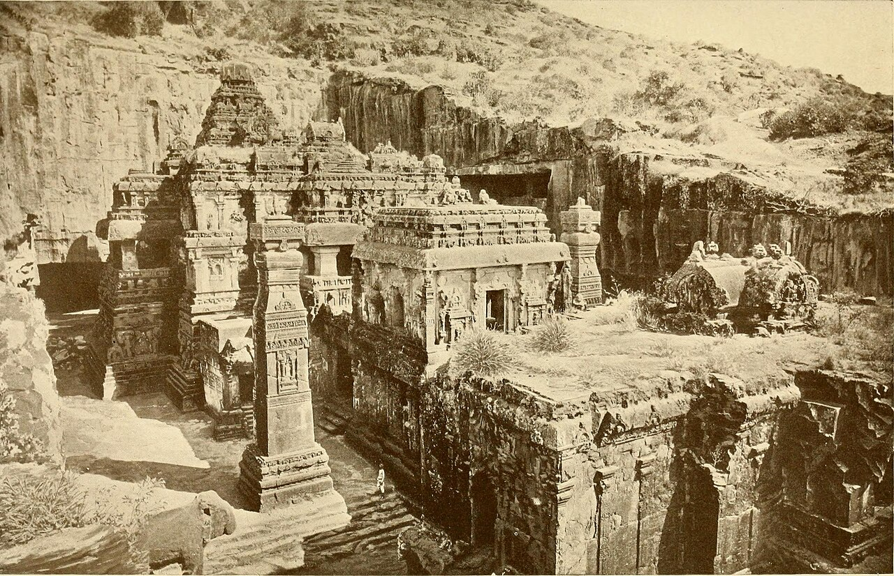

در یادمان‌های شفاهی و باورهای عامیانه‌ی مردم **تهران** (به‌ویژه در گستره‌ی **ری / تهران**)، روایت‌های پرشماری از پدیده‌ای شگفت و موجودی دیرپا به نام **«یم و یمی»** سینه به سینه از روزگاران باستان تا کنون بازگو شده است. راویان بومی که با گویش و لهجه‌ی **تهرانی** به نقل قصه‌ها می‌نشستند، پیدایش این پدیده را با کوهساران، دشت‌های بی‌کران، جنگل‌ها یا آب‌های مرموز این خطه پیوند می‌زدند.

در طبقه‌بندی فرهنگ عامه، **یم و یمی** را غالباً با تیره‌ی *موجود افسانه‌ای* هم‌بسته می‌دانند؛ چهره‌ای که تجسم نیروهای ناشناخته‌ی اقلیم و جهان نادیدنی پیرامون نیاکان بوده است. در توصیف‌ها و متون بازمانده‌ی پژوهشی پیرامون این افسانه آمده است:

> «Yama & Yami|یم و یمی در باورهای بسیار کهن هندو-ایرانی یمه و یمی دو خواهر و برادرند که نخستین زوج بشرند. در متون ودایی نیز یمه و یمی نخستین زوج بشرند که با خدایان ارتباط بسیاری داشته‌اند. یمه همانطور که نخستین بشر است، نخستین میرا هم هست و به محض مرگ پادشاه دنیای مردگان می‌شود. ردپای این اسطوره در افسانه‌های چین هم دیده می‌شود و از آن می‌توان به این پی برد که این اسطوره تا چه حد کهن است که در تار و پود فرهنگ‌های مختلف جای جای جهان نفوذ کرده. همچنین شخصیت مشابه یمه در اساطیر ایرانی ییمه است که در اوستا آمده و با جم یا همان جمشید ارتباط دارد. جم یا جمشید/ مشی و مشیانه/ یین و یانگ»

پیران و ریش‌سفیدان منطقه در شب‌نشینی‌ها گوشزد می‌کردند که رویارویی با **یم و یمی** همواره نشانه‌ای از لزوم هشیاری در برابر ناشناخته‌های طبیعت بوده است. در اعصار گذشته، مسافران، شبانان و کاروانیانی که شب‌هنگام در این نواحی گذر می‌کردند، برای مصون ماندن از گزند یا فریب این موجودات، آیین‌ها و دعاهای محافظتی خاصی را به کار می‌بستند و از شکستن سکوت شب یا نزدیک شدن به زیستگاه‌های آنان پرهیز می‌کردند.

امروزه داستان **یم و یمی** یکی از گنجینه‌های ماندگار میراث معنوی و مردم‌شناسی دیار **تهران** به شمار می‌رود که پیوند عمیق روان‌شناختی انسان کهن را با رمزورازهای زیست‌بوم سرزمین ایران به تصویر می‌کشد.

---

### منابع و اعتبار تصویر
- **پژوهش و خاستگاه روایت:** برگرفته از دانشنامه فولکلور و اسطوره‌شناسی ایران‌شهر (`eranshahr.com/myths`) و روایت‌های شفاهی بومی تهران.
- **تصویر:** اثر *«Kailasa Temple Ellora Caves 1913.jpg»*، بارگذاری‌شده در ویکی‌انبار (Wikimedia Commons)، پدیدآورنده: Internet Archive Book Images، تحت مجوز آزاد `No restrictions` ([مشاهده منبع](https://commons.wikimedia.org/wiki/File:Kailasa_Temple_Ellora_Caves_1913.jpg)).