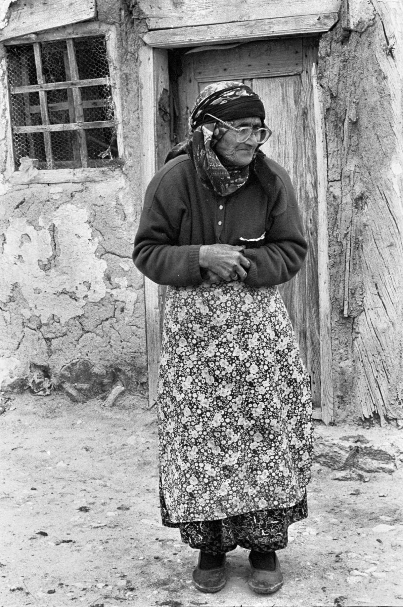

Across the fertile upland pastures of Mukriyan, in the historic rolling country near Mahabad south of Lake Urmia, oral storytelling has long celebrated the profound moral connection between pastoralists and the creatures of the highland steppes. Documented at the beginning of the twentieth century by the linguist Oskar Mann in his monumental archival work *Die Mundart der Mukri-Kurden*, one of the most poignant folk legends centers on a humble shepherd named Kak Mamand and the enchanted Golden Mare (*Mādyān-e Zarrīn*).

Kak Mamand spent his solitary days guiding village sheep through the craggy passes, passing the lonely twilight hours playing haunting laments on his *Shimshal*—the traditional Kurdish brass shepherd's pipe. One spring morning along a secluded riverbank, he stumbled upon a wild mare whose coat shimmered like spun gold in the sunlight. The magnificent creature was collapsed on the rocks, grievously wounded by a poisoned hunting bolt. Instead of capturing the valuable animal for market profit, Mamand washed her wounds with wild mountain madder and soothing herbal broths, keeping watch over her for days until her strength returned.

> As Kurdish storytellers of Mukriyan proclaim: "A pure heart is untarnished gold; the Golden Mare gallops only for one whose spirit is as clean as alpine spring water."

Once restored, the Golden Mare proved to be no ordinary beast, but a supernatural guardian spirit of the mountain springs gifted with prescient instincts. On an overcast night, the mare stamped her hooves frantically, warning Mamand that a ruthless band of mountain brigands was marching in secret to plunder the unprotected seasonal herds of the valley. Allowing Mamand to mount her bare back, the mare leaped across perilous ravines at breathtaking speed, carrying the youth to every nomad camp across the ridges. Forewarned by Mamand, the assembled clans ambushed the marauders in a rocky defile, neutralizing the threat without bloodshed. The Golden Mare vanished back into the mountain mists, leaving behind an indelible regional parable teaching that selfless compassion toward nature is rewarded with communal preservation and honor.

### Anthropological & Folklore Analysis
The legend embodies the widespread folkloric motif of the Grateful Animal and the Equine Guardian in Kurdish pastoral society. In tribal Mukri culture, horses are venerated not merely as utilitarian beasts of burden, but as intuitive spiritual companions capable of discerning human virtue and safeguarding the pastoral community against catastrophe.

### Archival Sources & Attribution
- **Primary Source:** Kurdisch-Persische Forschungen: Die Mundart der Mukri-Kurden, field recordings by Oskar Mann, Georg Reimer Verlag, Berlin, 1906.
- **Source URL:** https://www.bokan.de/laperekan/Neu/m.dehqan/qsaygranba.pdf
- **Original Language:** Mukri Kurdish & German
- **Image Attribution:** File:Bahar (2599760344).jpg | Photographer: runran | License: CC BY-SA 2.0
