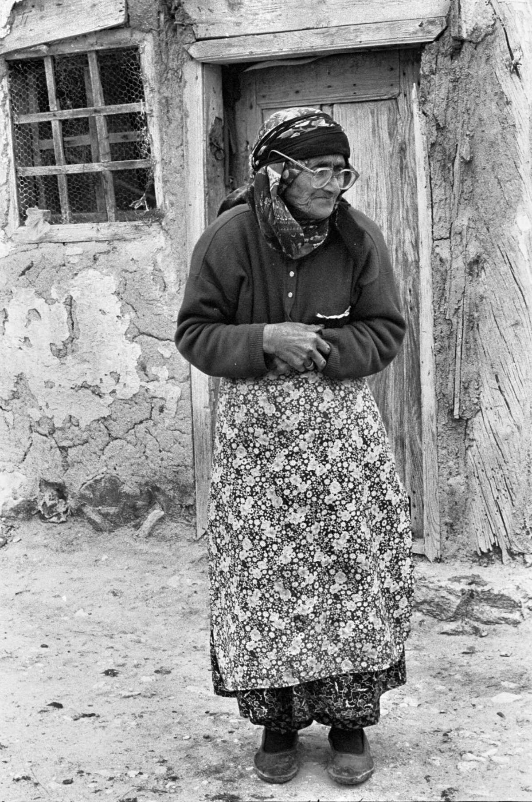

در تپه‌ماهورهای سرسبز و مراتع خرم موکریان در جنوب دریاچه ارومیه، در حوالی مهاباد کنونی، ادبیات شفاهی غنی کردی مملو از افسانه‌هایی است که خاورشناس برجسته اسکار مان (Oskar Mann) در آغاز قرن بیستم آنها را مستقیماً از زبان راویان بومی ضبط کرد. یکی از بکرترین و زیباترین این روایات، داستان «مادیان زرین» (Mādyān-e Zarrīn) و پیوند عمیق آن با یک چوپان تهیدست اما پاک‌نهاد به نام «کاک مه‌مه‌ند» است.

کاک ممند روزها گله ارباب ده را در دامنه‌های صخره‌ای به چرا می‌برد و شب‌ها با نوای شمشال (نی‌لبک فلزی چوپانی کردستان) با ستارگان نجوا می‌کرد. در یکی از روزهای آغازین بهار، هنگامی که در بیشه‌زار حاشیه رودخانه اتراق کرده بود، مادیانی وحشی را دید که تن‌پوش موهایش در تلالؤ آفتاب چونان طلای ناب می‌درخشید، اما تیری زهرآگین بر کفلش نشسته بود و از پای افتاده بود. جوان به جای آنکه مادیان گرانبها را به بازار ببرد یا اسیر سازد، با مرهم گیاهی حاصل از ریشه روناس و شیره گون، زخم حیوان را شستشو داد و شبانه‌روز از او مراقبت کرد تا توان از دست رفته را بازیابد.

> پیران کهنسال موکریان در نقل این متل می‌گویند: «دڵی پاک، زێڕی بێ‌خەوشە؛ مادیانی زێڕین هەر بۆ کەسێک ڕادەکات کە دڵی وەک ئاوی کانی بێ‌گەرد بێت.» (دلی که پاک باشد، طلای بی‌عیار است؛ مادیان زرین تنها برای کسی شیهه می‌کشد که قلبش چون زلال چشمه بی‌کینه باشد).

با بهبودی مادیان زرین، رازی شگفت آشکار شد؛ این مادیان حیوانی معمولی نبود، بلکه زادبوم چشمه‌های اساطیری بود که می‌توانست بوی خطر را از فرسنگ‌ها دورتر حس کند و به زبان تمثیل با چوپان سخن بگوید. شبی مادیان زرین با کوبیدن سم بر سنگ و شیهه‌ای محزون به ممند هشدار داد که گروهی از غارتگران بی‌رحم برای چپاول تمام رمه‌های موکریان به این سو می‌تازند. مادیان ممند را بر پشت خود سوار کرد و با سرعتی بادپا او را در کوره راه‌های کوهستانی پیش راند. ممند اهالی تمام ایلات و آبادی‌ها را پیش از سر رسیدن مهاجمان باخبر ساخت و جوانان را در گذرگاه سنگی تنگه مستقر نمود. با هدایت هوشمندانه ممند و یال درخشان مادیان که در تاریکی شب مسیر را روشن می‌ساخت، راهزنان در محاصره افتاده و اسیر شدند. از آن پس، مادیان زرین در چشم مردم منطقه نه تنها نماد توانگری، بلکه پاداش الهی برای پاک‌دستی و مهربانی با حیوانات دانسته شد.

### بن‌مایه‌ها و ویژگی‌های مردم‌شناختی
این افسانه کهن موکریانی نمونه‌ای برجسته از بن‌مایه «حیوان یاری‌رسان جادویی» (Magical Animal Helper) در فرهنگ کردی است. تجلیل از اسب به عنوان والاترین نماد نجابت و هوشیاری در زیست‌بوم عشایری، ستایش از فضیلت اخلاقی شفقت در برابر درماندگان، و بازتاب ساز بومی «شمشال» در ساماندهی روابط میان چوپان و طبیعت وحشی از مشخصه‌های بارز این اثر است.

### منابع و پژوهش
- **منبع اصلی:** پژوهش‌های کردی-فارسی: گویش کردهای موکری (Die Mundart der Mukri-Kurden)، گردآوری میدانی اسکار مان (Oskar Mann)، برلین، ۱۹۰۶.
- **پیوند مرجع:** https://medialibrary.reichert-verlag.de/de/9783954906314_the_mukri_variety_of_central_kurdish/
- **زبان اصلی متن:** کردی موکریانی و آلمانی
- **تصویر:** File:Bahar (2599760344).jpg | عکاس: runran | مجوز: CC BY-SA 2.0
