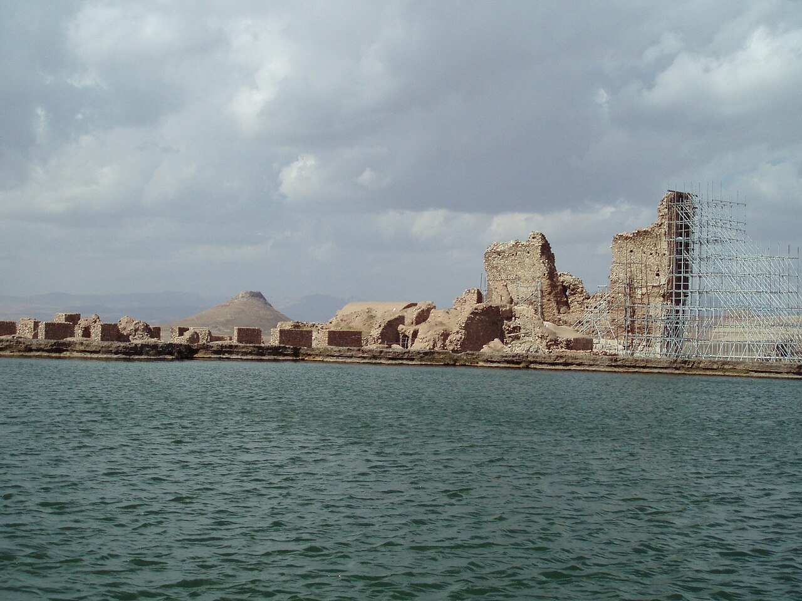

Set atop a volcanic plateau in the mystical highlands of Takab in West Azerbaijan, the ruins of the pre-eminent Sasanian royal fire temple—*Azargoshnasp*—encircle an enigmatic, bottomless turquoise artesian lake known as *Takht-e Soleyman* (The Throne of Solomon). Surging from mineral-rich aquifers over 120 meters deep, this aquatic abyss has inspired millennia of mythology centered around the *Golden Peri of Takht-e Soleyman*.

Local oral traditions preserved by the Afshar Turks and Kurds of Takab recount that beneath the calcified travertine crust of the lake rests an ethereal crystalline palace inhabited by the Golden Peri. Adorned with flowing tresses of liquid gold and a diadem crowned by the sacred fire of Azargoshnasp, she serves as the immortal custodian of ancestral Persian treasures. Tradition asserts that emperors from the Medes to the Sasanians cast their royal regalia, jeweled chalices, and golden tribute into the bottomless waters as sacred votives. The Peri swore to safeguard this royal cache until universal justice dawns upon the earth; anyone diving with avarice to plunder the relics is ensnared by sudden thermal whirlpools, sinking forever into the mineral abyss.

> "Cast not your covetous eyes into the depths of Takht-e Soleyman; the waters are a snare for the greedy, and the Peri of Azargoshnasp keeps the treasures of Iran sealed in trust beneath the stone." — Oral lore of the elders of Takab.

Scholar Ali-Ashraf Darvishian in *Encyclopedia of Iranian Folktales* and Arthur Christensen in *Ancient Folktales of Iran* note that Takht-e Soleyman represented the divine confluence of water (Anahita) and royal fire (Atar). The steaming turquoise waters of the lake emerging against the chill of the highlands continue to evoke the eternal vigil of this legendary golden guardian.

### Sources & Image Attribution
- **Research Source:** Ali-Ashraf Darvishian, *Encyclopedia of Iranian Folktales*, Vol. 14, pp. 301-309; Arthur Christensen, *Ancient Folktales and Beliefs of Iran*, p. 192.
- **Image Attribution:** Documented on Wikimedia Commons by DAVID HOLT from London, England; License: [CC BY-SA 2.0](https://commons.wikimedia.org/wiki/File:Iran_2007_048_Takht-e_Soleyman_(1732419770).jpg).
