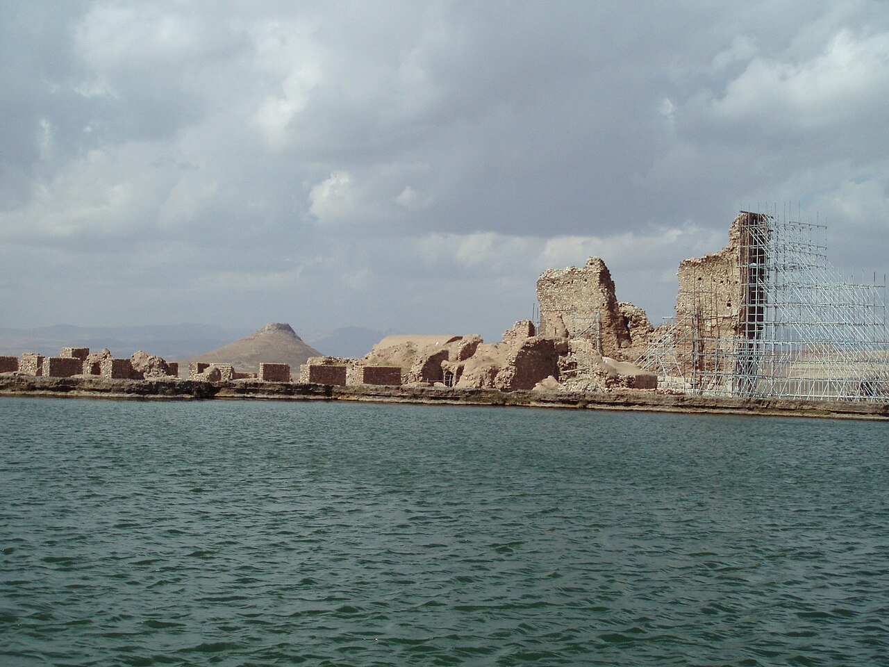

در فلاتی آتشفشانی و میان تپه‌های اسرارآمیز تکاب در آذربایجان غربی، آتشکده باستانی آذرگشنسپ در کنار دریاچه‌ای عمیق، فیروزه‌ای و بی‌پایان به نام «تخت سلیمان» آرمیده است. این چشمه آرتزین شگفت‌انگیز که آب جوشان آن از اعماق ۱۲۰ متری زمین فوران می‌کند، از هزاره‌ها پیش در باورهای زرتشتی، مادی و اسلامی مهد افسانه‌هایی بی‌شمار بوده است؛ افسانه‌هایی که همگی با رازی مشترک به نام «پری زرین دریاچه تخت سلیمان» پیوند خورده‌اند.

روایت بومی مردم تکاب بازگو می‌کند که در ژرفای تاریک و گچی این دریاچه، قصر بلورینی جای دارد که زیستگاه پری زرین است؛ فرشته‌ای مقدس با گیسوانی از طلای مذاب و تاجی از شعله‌های آتش سپند آذرگشنسپ. باور بر این است که پادشاهان باستانی ایران، از خسرو انوشیروان تا شاهان ماد، در هنگامه‌های خطر و جنگ‌های بزرگ، خزانه‌های زر و سیم، جام‌های مرصع و شمشیرهای جواهرنشان شاهنشاهی را به عنوان نذر به این دریاچه پرتاب می‌کردند تا پری زرین آنها را در کاخ پنهان خویش پاسداری کند. این پری سوگند خورده است که تا فرا رسیدن دوران صلح مطلق و عدالت جهانی، دست هیچ غواص یا طمع‌کاری به این گنجینه‌ها نرسد؛ از این رو هر کس که با طمع دستیابی به گنج در آب‌های دریاچه فرو رود، پری با گرداب‌های مغناطیسی و املاح سنگین چشمه، او را به ژرفای لجن‌های بی‌پایان می‌کشاند.

> «در آب تخت سلیمان چشم به طلا مدوز؛ دریاچه دامگاه آزمندان است و پری آذرگشنسپ گنجینه‌های ایران را در سینه خاک امانت نگه داشته است.» — کلام پیران تکاب و افشار در پای بقایای آتشکده باستانی.

علی‌اشرف درویشیان در جلد چهاردهم «فرهنگ افسانه‌های مردم ایران» و آرتور کریستنسن در «افسانه‌ها و باورهای کهن ایران‌زمین» اشاره می‌کنند که دریاچه تخت سلیمان به عنوان تجلی زنده‌ی آب مقدس ایزدبانو آناهیتا در کنار آتشکده شاهنشاهی آذرگشنسپ پرستش می‌شده است. ترکیب آتش و آب در این مکان، عمیق‌ترین پیوند نمادین در اساطیر ایرانی را شکل داده است.

امروزه نیز هنگامی که بخار گرم از سطح آب‌های فیروزه‌ای تخت سلیمان در سرمای آذربایجان برمی‌خیزد، شکوه این دریاچه بی‌پایان تداعی‌گر نگاهبانی وفادارانه‌ی پری زرین از تاریخ و گنجینه‌های مدفون نیاکان است.

زرتشتیان و مردم بومی تکاب اشاره می‌کنند که املاح و گازهای متصاعد از آب‌های تخت سلیمان، خواص درمانی اعجاب‌انگیزی دارد که در باور محلی به برکت نفس پری زرین منسوب است. آیین‌های نیایش در کنار آتشکده آذرگشنسپ و آب‌های آرام این دریاچه، جلوه‌ای از هارمونی میان عناصر بنیادین طبیعت در فرهنگ غنی آذربایجان بوده و تا به امروز، هر زائری را در برابر شکوه تاریخ به تعظیم وامی‌دارد.

### منابع و اعتبار تصویر
- **منبع پژوهشی افسانه:** علی‌اشرف درویشیان، «فرهنگ افسانه‌های مردم ایران»، جلد ۱۴، ص ۳۰۱-۳۰۹؛ آرتور کریستنسن، «افسانه‌ها و باورهای کهن ایران‌زمین»، ص ۱۹۲.
- **اعتبار تصویر:** ثبت‌شده در ویکی‌مدیا کامنز توسط DAVID HOLT from London, England؛ مجوز انتشار: [CC BY-SA 2.0](https://commons.wikimedia.org/wiki/File:Iran_2007_048_Takht-e_Soleyman_(1732419770).jpg).
