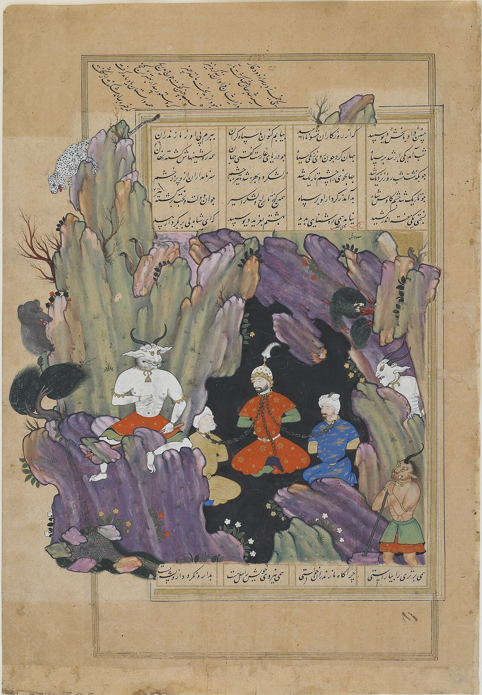

Preserved across centuries within the rich oral folklore of **West Azerbaijan** (encircling the historical domains of **ارومیه**), the legendary lore of **Div-E-Sepid** stands as a compelling testament to Iran's enduring mythic imagination. Transmitted across hearths, mountain paths, and rural caravans, the tale has survived through the living memories of local elders.

Folklorists generally categorize **Div-E-Sepid** within the mythological taxonomy of *موجود افسانه‌ای*. As with many traditional entities of Iranian folk belief, it embodies both the untamed natural elements and the ancestral anxieties regarding solitary wilderness. Classical collectors recorded its traditional traits as follows:

> "Illustration by Farima Keshavarz The White Deev was the master of all evil creatures in the Legendary country of Mazandaran. Rostam, a famous Iranian warrior, who had no rival in strenghth, went to fight the White Deev and defeated him in the last stage of "The Seven Labors of Rostam" according the Shahnameh. When Kayanian King, KayKavoos decides to attack the legendary lands of Mazandaran, where the demons lived, the king of Mazandaran asks for help from the White Deev who used his power and army of evil to crush the Iranian army. Then the Deev captured the King KayKavoos and his guards and imprizones them in the "Espirooz" mountain, and blinded them with magic. In order to save KayKavoos and his army, Rostam begins a difficult and exhausting journey, which is known and the "Seven Khans[or Labours] of Rostam". And after a lot of hardships, he defeats Arjang Deev and other guardians of Espirooz Mountain and frees KayKavoos. KayKavoos tells Rostam that it is better to destroy the White Deev before the it finds out about their release, otherwise they will have to fight him while blind. So Rostam goes to the cave where the White Deev lives and sees him in deep sleep. Rostam, feeling it would not be honorable to kill the deev in sleep, wakes him up and affter struggling with him, lifts him up and smashed him with his cow headed mace. He then takes out the deev's liver, knoing that it could be used to undo the blinding magic befell upong the troops, and takes it the the king KayKavoos. The white Deev is described as being extrmely large and powerful, having white fur/hair and a black face. …"

In local oral tradition, an encounter with **Div-E-Sepid** was regarded as a formidable threshold between familiar domestic reality and the unseen realm. Elders customarily advised night travelers, shepherds, and caravan drivers traversing the historic passes of West Azerbaijan to heed ancient apotropaic rituals—such as carrying iron amulets, maintaining solemn reverence towards nature, and never uttering provocative words—to pass through its territorial domain unharmed.

Today, the chronicle of **Div-E-Sepid** forms an invaluable component of Iran's intangible cultural heritage, offering modern readers an evocative window into how ancient communities interpreted their ecology, mystery, and moral balance.

---

### Sources & Image Attribution
- **Folklore Research & Origin:** Sourced and adapted from the Eranshahr Folklore Archive (`eranshahr.com/myths`) and regional oral narratives of West Azerbaijan.
- **Visual Artifact:** *"Kay-Ka'us chained in a grotto by the white demon (FGA F2006.7).jpg"*, sourced via Wikimedia Commons, contributed by Siyavush Beg, licensed under `Public domain` ([Source Link](https://commons.wikimedia.org/wiki/File:Kay-Ka%27us_chained_in_a_grotto_by_the_white_demon_(FGA_F2006.7).jpg)).