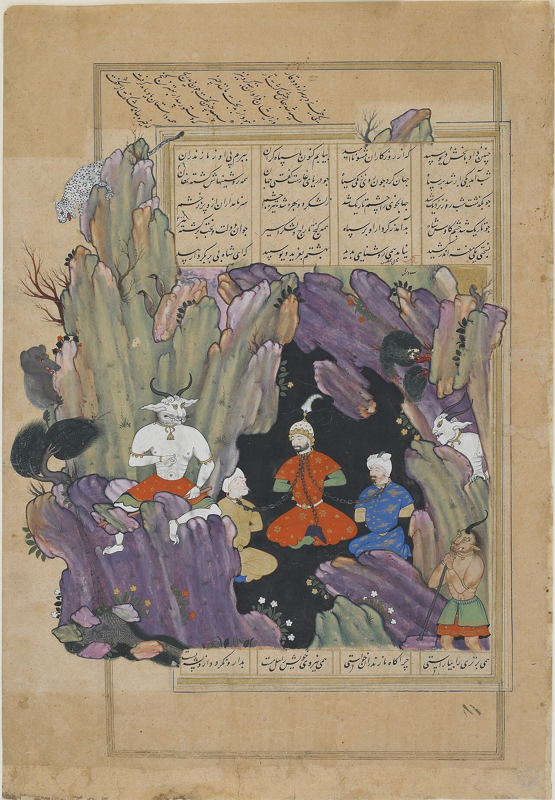

در یادمان‌های شفاهی و باورهای عامیانه‌ی مردم **آذربایجان غربی** (به‌ویژه در گستره‌ی **ارومیه**)، روایت‌های پرشماری از پدیده‌ای شگفت و موجودی دیرپا به نام **«دیو سپید»** سینه به سینه از روزگاران باستان تا کنون بازگو شده است. راویان بومی که با گویش و لهجه‌ی **ترکی آذری / کردی** به نقل قصه‌ها می‌نشستند، پیدایش این پدیده را با کوهساران، دشت‌های بی‌کران، جنگل‌ها یا آب‌های مرموز این خطه پیوند می‌زدند.

در طبقه‌بندی فرهنگ عامه، **دیو سپید** را غالباً با تیره‌ی *موجود افسانه‌ای* هم‌بسته می‌دانند؛ چهره‌ای که تجسم نیروهای ناشناخته‌ی اقلیم و جهان نادیدنی پیرامون نیاکان بوده است. در توصیف‌ها و متون بازمانده‌ی پژوهشی پیرامون این افسانه آمده است:

> «The White Div | Div-e-Sefid | دیو سفید دیو سپید در داستان های شاهنامه داستان نبرد رستم با دیو سپید خان هفتم از هفت‌خان رستم است. نام فرمانروای دیوان در کشور مازندران بود او کیکاووس شاه ایران و سپاهش را در غاری به بند کشید که رستم برای آزادی ایرانیان به نبرد با دیو سپید رفت. رستم دیو سپید را در غار خفته دید برای به جا آوردن آیین جوانمردی او را از خواب بیدار کرد و با وی جنگید یک دست و یک پای دیو را برید و جگرش را از سینه بیرون کشیده و از کاسه سر او کلاه خودی برای خویش ساخت. سپس کیکاووس و یارانش را نیز آزاد کرد. دیو سپید دیوی است که پزشکان بر این باور بودند خون دل و مغز او داروی کوری کیکاووس و سپاهیانش است تقریباً تمامی پژوهشگران بر این اعتقاد هستند که دیو سپید نامی اصیل از ادبیات و زبان مازندرانی است. داستان خان هفتم در خان آخر، رستم و اولاد به هفت کوه که غار محل زندگی دیو سپید در آن قرار داشت، رسیدند. شب را در حوالی آنجا سپری کردند. صبح روز بعد رستم پس از بستن دست و پای اولاد، به نگهبانان غار حمله‌ور شد و آنان را از بین برد. وی سپس وارد غار تاریک بی‌بن شد. در غار با دیوسپید مواجه شد که همانند کوهی به خواب رفته بود. به رنگ شبه روی و چون شیر موی جهان پر ز پهنای و بالای اوی به غار اندرون دید رفته به خواب به کشتن نکرد هیچ رستم شتاب دیوسفید مسلح به سنگ آسیاب، کلاهخود و زره‌آهنی به جنگ رستم شتافت رستم یک پای او را از ران جدا ساخت. دیو با همان حال با رستم در گلاویز بود و نبردی طولانی میان آندو صورت گرفت که گاه رستم و گاه دیو بر یکدیگر چیره می‌گشتند. در پایان، رستم با خنجر دل دیو را شکافت و جگر او را برای مداوای چشمان کم سو شدهٔ کیکاووس درآورد. بزد دست و بر داشتش نرّه شیر به گردن برآورد و افکند زیر فرو برد خنجر دلش بر درید جگرش از تن تیره بیرون کشید همه غار یکسر پر از کشته بود جهان همچو دریای خون گشته بود دیوان کوچک با مشاهدهٔ صحنه فرار را بر قرار ترجیح دادند. جگر دیوسفید را رستم نزد کاووس نابینا آورد و قطره‌ای از خون جگر به چشمان کاووی چکاند و نور به دیدگان وی بازگشت. سپاهیان ایران نیز همگی بینایی خود را بازیافتند و به جشن و پایکوبی مشغول شدند. رخساری سیاه گیسوانی سپید هیکلی تنومند دیو سپید - ویکی‌پدیا، دانشنامهٔ آزاد (wikipedia.org) کشتن دیو سپید (mehremihan.ir) هفت‌خان رستم - ویکی‌پدیا، دانشنامهٔ آزاد (wikipedia.org)»

پیران و ریش‌سفیدان منطقه در شب‌نشینی‌ها گوشزد می‌کردند که رویارویی با **دیو سپید** همواره نشانه‌ای از لزوم هشیاری در برابر ناشناخته‌های طبیعت بوده است. در اعصار گذشته، مسافران، شبانان و کاروانیانی که شب‌هنگام در این نواحی گذر می‌کردند، برای مصون ماندن از گزند یا فریب این موجودات، آیین‌ها و دعاهای محافظتی خاصی را به کار می‌بستند و از شکستن سکوت شب یا نزدیک شدن به زیستگاه‌های آنان پرهیز می‌کردند.

امروزه داستان **دیو سپید** یکی از گنجینه‌های ماندگار میراث معنوی و مردم‌شناسی دیار **آذربایجان غربی** به شمار می‌رود که پیوند عمیق روان‌شناختی انسان کهن را با رمزورازهای زیست‌بوم سرزمین ایران به تصویر می‌کشد.

---

### منابع و اعتبار تصویر
- **پژوهش و خاستگاه روایت:** برگرفته از دانشنامه فولکلور و اسطوره‌شناسی ایران‌شهر (`eranshahr.com/myths`) و روایت‌های شفاهی بومی آذربایجان غربی.
- **تصویر:** اثر *«Kay-Ka'us chained in a grotto by the white demon (FGA F2006.7).jpg»*، بارگذاری‌شده در ویکی‌انبار (Wikimedia Commons)، پدیدآورنده: Siyavush Beg، تحت مجوز آزاد `Public domain` ([مشاهده منبع](https://commons.wikimedia.org/wiki/File:Kay-Ka%27us_chained_in_a_grotto_by_the_white_demon_(FGA_F2006.7).jpg)).