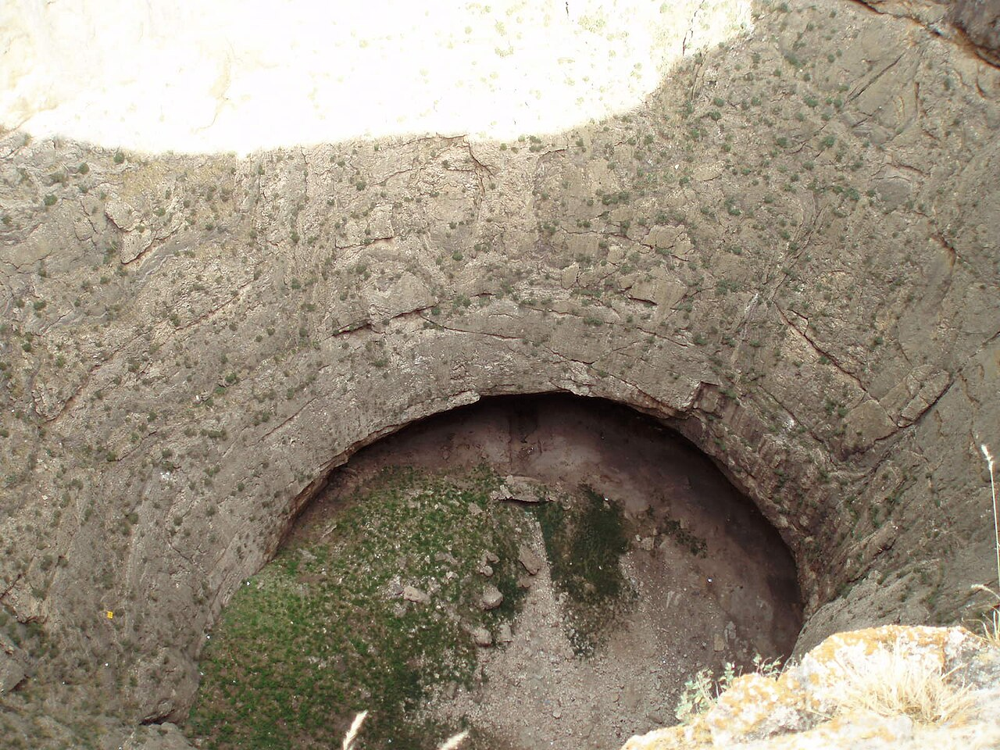

در دشت تاریخی تکاب در استان آذربایجان غربی، در چند کیلومتری آتشکده آذرگشنسب و دریاچه اسرارآمیز تخت سلیمان، کوهی مخروطی و میان‌تهی سر برآورده است که صد متر از زمین‌های پیرامون ارتفاع دارد. در تارک این کوه منفرد، گودالی ژرف و هولناک با عمقی نزدیک به هشتاد متر دهان باز کرده که دیواره‌های صخره‌ای‌اش به قعر تاریکی فرومی‌روند؛ بومیان این پدیده شگفت‌آور را از اعصار کهن «زندان دیو» یا «زندان سلیمان» خوانده‌اند. در باور عامه و اسطوره‌های کهنسال منطقه، این کوه میان‌تهی چاهی است که حضرت سلیمان پیامبر دیوهای نافرمان و سرکش را در اعماق بی‌پایان آن به بند کشیده است. لایه‌های رسوبی دیواره‌ها در گذر زمان به گونه‌ای شکل گرفته‌اند که هیبت زندانیان سنگی را تداعی می‌کنند و هیجان غریبی در دل بیننده برمی‌انگیزند.

روایت‌های سینه به سینه مردم افشار و کردستان نقل می‌کنند که حضرت سلیمان هنگامی که بر تخت زرین خود در مجاورت دریاچه می‌نشست و بر جن و انس و باد فرمان می‌راند، دیوی سرکش به نام «دیو سپیددندان» یا ارواح خبیثه را که از فرمان ساخت ایوان خسرو و کاخ‌های بلورین سر باز زده بودند، خلع سلاح کرد. سلیمان به باد دستور داد تا آنان را به این کوه بکشاند؛ سپس با عصای معجزه‌گر خویش دل کوه را شکافت، دیوان را با غل و زنجیرهای گداخته در قعر آن به بند کشید و دهانه چاه را با مهری ناگسستنی بست تا هرگز نتوانند به جهان آدمیان بازگردند.

> سالخوردگان تکاب با صدایی آرام روایت می‌کنند: «آن بخارهای گوگردی و غبار گرمی که از درز سنگ‌های دهانه کوه بیرون می‌زند، نفس‌های خشمگین دیوی است که در قعر چاه تقلا می‌کند و هر از گاهی به زنجیرهایش چنگ می‌زند.»

در گذشته، روستاییان باور داشتند اگر کسی بر لبه دهانه ژرف بایستد و سنگی به تاریکی درون چاه پرتاب کند، صدای خرد شدن سنگ پس از ثانیه‌ها پژواکی هولناک پدید می‌آورد و بوی تند گوگرد به مشام می‌رسد که نشان از حیات دیو در دخمه‌های آتشین زمین دارد. همچنین نقل می‌کردند که آب چشمه‌های رسوب‌ساز کوهستان، اشک‌های ندامت دیوان است که با گذشت هزاران سال سنگ شده و دیواره کوه را بالاتر برده است. در شب‌هایی که ماه پشت ابرها پنهان می‌گردد، صدای هولناک کوبیده شدن دست‌های سنگی بر بستر کوه طنین‌انداز می‌شود. زندان سلیمان همراه با آتش و آب تخت سلیمان، منظومه‌ای بی‌پایان از پیوند اساطیر کهن ایرانی و باورهای بومی خاورمیانه است که شکوه وهم‌انگیز آن همواره هر بیننده‌ای را مسحور می‌سازد.

### منبع روایت و تصویر
- **خاستگاه افسانه:** اسطوره‌های عامیانه تکاب و منطقه افشار آذربایجان غربی، متون جغرافیای تاریخی پیرامون پیوند سلیمان نبی با آثار باستانی شیز.
- **عکاس / پدیدآورنده تصویر:** David Holt (London, England)
- **منبع تصویر:** [صفحه تصویر در ویکی‌انبار](https://commons.wikimedia.org/wiki/File:Iran_2007_050_Zendan-e_Soleyman_(1731569267).jpg)
- **نوع مجوز:** CC BY-SA 2.0
