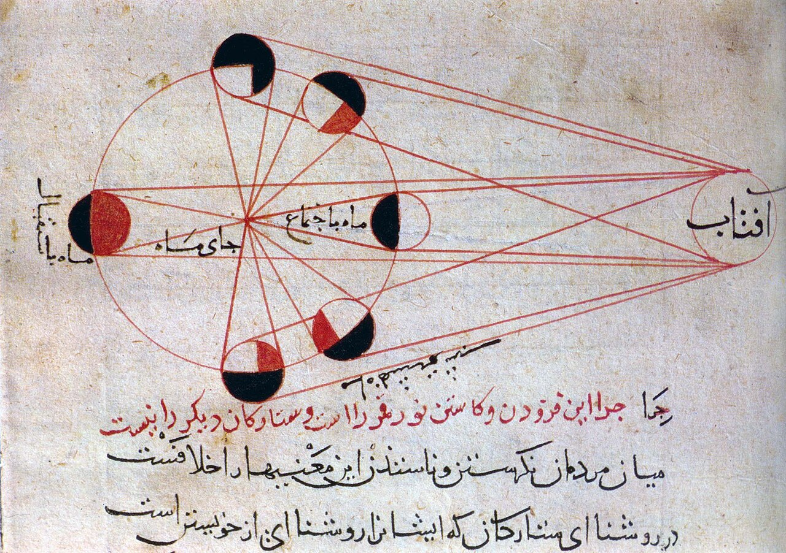

Preserved across centuries within the rich oral folklore of **Yazd** (encircling the historical domains of **یزد / میبد**), the legendary lore of **Darreh Khatun** stands as a compelling testament to Iran's enduring mythic imagination. Transmitted across hearths, mountain paths, and rural caravans, the tale has survived through the living memories of local elders.

Folklorists generally categorize **Darreh Khatun** within the mythological taxonomy of *Spirit*. As with many traditional entities of Iranian folk belief, it embodies both the untamed natural elements and the ancestral anxieties regarding solitary wilderness. Classical collectors recorded its traditional traits as follows:

> "Illustration by Farima Keshavarz Among the Qizilbash Turks of Ramian, there was a spirit called Dara-Xatin (It means The Lady of the Valleys), which wandered the Balandjar mountain (located in the west of Ramian).Dara-Xatin was a white spirit with long hair and nails, and if someone brave enough conquered her with a silver spoon or needle, it would have brought great blessing. There is also a Ramianian proverb about unending foods or blessings that says, "Dara-Xatin al wurwubdu bulmia." It means "the things that Dara-Xatin touches will not end."If they don't conquer Dara-Xatin, she brings misfortune into their lives. Translation: Sarah Mohebbi Moghadam … …"

In local oral tradition, an encounter with **Darreh Khatun** was regarded as a formidable threshold between familiar domestic reality and the unseen realm. Elders customarily advised night travelers, shepherds, and caravan drivers traversing the historic passes of Yazd to heed ancient apotropaic rituals—such as carrying iron amulets, maintaining solemn reverence towards nature, and never uttering provocative words—to pass through its territorial domain unharmed.

Today, the chronicle of **Darreh Khatun** forms an invaluable component of Iran's intangible cultural heritage, offering modern readers an evocative window into how ancient communities interpreted their ecology, mystery, and moral balance.

---

### Sources & Image Attribution
- **Folklore Research & Origin:** Sourced and adapted from the Eranshahr Folklore Archive (`eranshahr.com/myths`) and regional oral narratives of Yazd.
- **Visual Artifact:** *"Lunar phases al-Biruni.jpg"*, sourced via Wikimedia Commons, contributed by Al-Biruni, licensed under `Public domain` ([Source Link](https://commons.wikimedia.org/wiki/File:Lunar_phases_al-Biruni.jpg)).