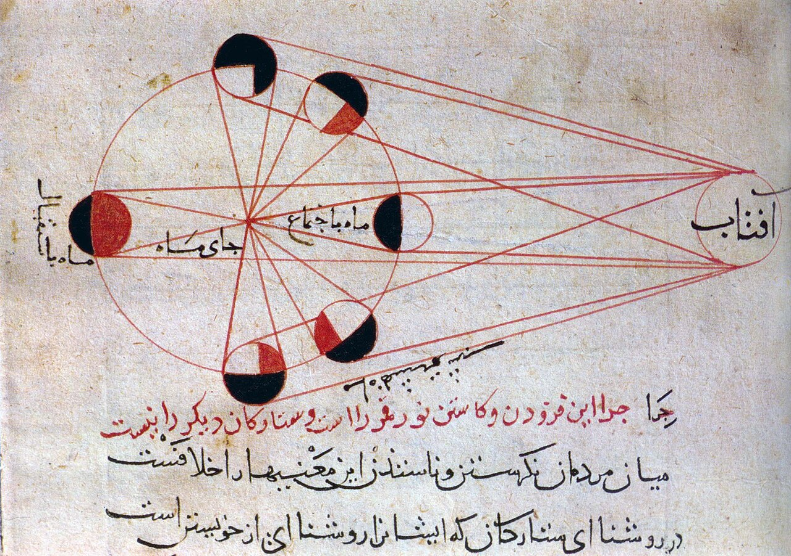

در یادمان‌های شفاهی و باورهای عامیانه‌ی مردم **یزد** (به‌ویژه در گستره‌ی **یزد / میبد**)، روایت‌های پرشماری از پدیده‌ای شگفت و موجودی دیرپا به نام **«دره خاتن»** سینه به سینه از روزگاران باستان تا کنون بازگو شده است. راویان بومی که با گویش و لهجه‌ی **یزدی** به نقل قصه‌ها می‌نشستند، پیدایش این پدیده را با کوهساران، دشت‌های بی‌کران، جنگل‌ها یا آب‌های مرموز این خطه پیوند می‌زدند.

در طبقه‌بندی فرهنگ عامه، **دره خاتن** را غالباً با تیره‌ی *Spirit* هم‌بسته می‌دانند؛ چهره‌ای که تجسم نیروهای ناشناخته‌ی اقلیم و جهان نادیدنی پیرامون نیاکان بوده است. در توصیف‌ها و متون بازمانده‌ی پژوهشی پیرامون این افسانه آمده است:

> «Lady of the Valleys|دره خاتن در خاتون به شکل زنی پریشان و ژولیده با موهای پریشان و ناخن دراز و سفید پوست بوده که در واقع یک شبه بود و نامرئی بود و سوار اسب های مردم که در چمنزارهای اطراف رودخانه قاراچای رها شده بودند می‌شد و از انرژی و بنیه اسب ها استفاده می کرد طوری که آن اسب تا سر حد مرگ نزار و لاغر می‌شد یا حتی به مرگ می رسید و وقتی سوار اسب می شد سرعت نور پیدا می‌کرد و مردم را میان برای اینکه بتوانند او را به چنگ بیاورند بر زین اسب قره قروت میزدند تا به آن اسب بچسبد و نتواند فرار کند و در کنار خود سوزن یا قاشقی داشتند تا هر وقت او را دیدند آن سوزن را به او وصل کنند تا آن نتواند فرار کند پس از این اقدام او به تسخیر صاحبخانه در می آمده و در خانه آنها کنیزی او را می کرده و برای آنها کار می کرده و نان آنها را می پخت اما به محض اینکه اهل خانه حواسشان پرت میشد از خانه فرار می کرد و خود را به کودکان خردسال کنار همان رودخانه می رساند و از آنها می‌خواست که آن وسیله را از تنش جدا کنند با این کار او آزاد می شد و به کوه بلند جار فرار می‌کردند ولی دوباره برای مکیدن بنیه اسب های دیگر وارد می شد»

پیران و ریش‌سفیدان منطقه در شب‌نشینی‌ها گوشزد می‌کردند که رویارویی با **دره خاتن** همواره نشانه‌ای از لزوم هشیاری در برابر ناشناخته‌های طبیعت بوده است. در اعصار گذشته، مسافران، شبانان و کاروانیانی که شب‌هنگام در این نواحی گذر می‌کردند، برای مصون ماندن از گزند یا فریب این موجودات، آیین‌ها و دعاهای محافظتی خاصی را به کار می‌بستند و از شکستن سکوت شب یا نزدیک شدن به زیستگاه‌های آنان پرهیز می‌کردند.

امروزه داستان **دره خاتن** یکی از گنجینه‌های ماندگار میراث معنوی و مردم‌شناسی دیار **یزد** به شمار می‌رود که پیوند عمیق روان‌شناختی انسان کهن را با رمزورازهای زیست‌بوم سرزمین ایران به تصویر می‌کشد.

---

### منابع و اعتبار تصویر
- **پژوهش و خاستگاه روایت:** برگرفته از دانشنامه فولکلور و اسطوره‌شناسی ایران‌شهر (`eranshahr.com/myths`) و روایت‌های شفاهی بومی یزد.
- **تصویر:** اثر *«Lunar phases al-Biruni.jpg»*، بارگذاری‌شده در ویکی‌انبار (Wikimedia Commons)، پدیدآورنده: Al-Biruni، تحت مجوز آزاد `Public domain` ([مشاهده منبع](https://commons.wikimedia.org/wiki/File:Lunar_phases_al-Biruni.jpg)).