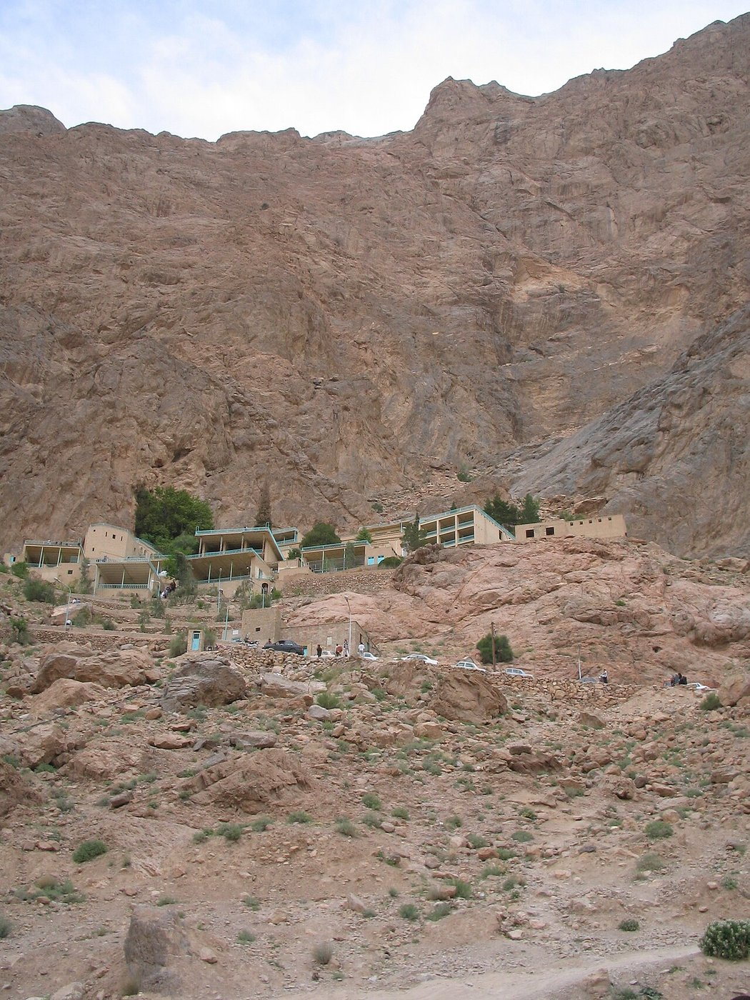

Perched upon the vertical, sun-scorched limestone cliffs of the Yazdi desert near Ardakan hangs one of the most sacred pilgrimage shrines of Zoroastrianism: *Pir-e Sabz*, universally known as *Chak-Chak*. The evocative name derives from the perpetual, rhythmic dripping ("chak... chak...") of pure mountain water filtering through the ceiling of the grotto, sustaining an ancient, thousand-year-old plane tree that bursts miraculously from the arid rockface.

Zoroastrian tradition relates that during the tumultuous collapse of the Sasanian dynasty, Princess Hayat-Banu (Nikbanou), daughter of the last Persian emperor, fled across the unforgiving central desert pursued by ruthless invaders. Cornered against the sheer escarpment with no hope of mortal retreat, the chaste princess cried out in anguish to the mountain: "Enfold me in your bosom like a loving mother!" Miraculously, the mountain split open, enfolding the royal maiden within its crystalline heart. Frustrated invaders found only her footprint cast upon the rock. Ever since, the mountain weeps tears of sorrow for the lost princess—tears that drip perpetually to quench the thirst of pilgrims.

> "The mountain of Chak-Chak is stone weeping over the cruelty of the ages; these drops are not common rain, but the immortal tears of a pure princess keeping the soul of Yazd fragrant forever." — Hymn chanted by Zoroastrian Mobeds at Pir-e Sabz.

Eminent scholar Dr. Katayoun Mazdapour in *Legends of the Zoroastrian People and Yazd* notes that Pir-e Sabz represents one of six sacred desert shrines commemorating noble maidens swallowed by the mountains. This legend embodies ancient Indo-Iranian reverence for water, mountains, and inviolable feminine sanctity. Every summer, pilgrims from across the globe gather at Chak-Chak, drinking from the sacred drops to renew their spiritual bond with ancestral fortitude.

### Sources & Image Attribution
- **Research Source:** Katayoun Mazdapour, *Legends of the Zoroastrian People and Yazd*, Tehran: Hermes, pp. 45-52; Iraj Afshar, *Monuments of Yazd*, Vol. 1, p. 119.
- **Image Attribution:** Documented on Wikimedia Commons by Elnaz; License: [CC BY-SA 3.0](https://commons.wikimedia.org/wiki/File:Chak-chak.jpg).
