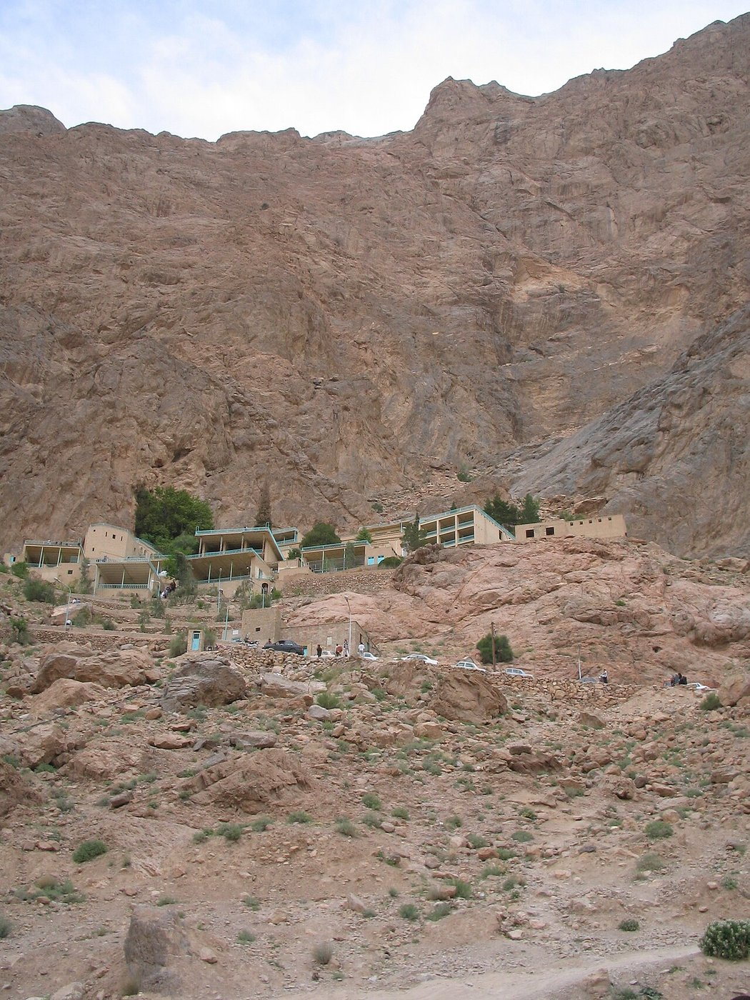

در میان کوه‌های صخره‌ای و خشک کویر یزد، زیارتگاهی معلق در دل کوهی سترگ جای گرفته است که زرتشتیان جهان آن را «پیر سبز» یا «چَک‌چَک» می‌نامند. نام چک‌چک از صدای پیوسته و آهنگین چکیدن قطره‌های زلال آب از سقف صخره‌ای غار بر سطح زمین برگرفته شده است؛ آبی گوارا که در دل این برهوت تشنه، درختی چنار و همیشه سبز با قدمتی هزارساله را در میان شکاف سنگ‌ها زنده نگه داشته است.

روایت بهدینان بازگو می‌کند که در هنگامه سقوط ساسانیان و هجوم سپاهیان تازی به فلات مرکزی، «حیات‌بانو» (نیک‌بانو)، شاهدخت پارسای ایرانی، در پی سواران مهاجم به سوی کوه‌های خشک یزد گریخت. چون سواران دشمن به نزدیکی او رسیدند و راهی برای نجات نماند، شاهدخت رو به کوهستان فریاد برآورد: «مرا چون مادری مهربان در آغوش گیر!» صخره‌ی خارا با صدایی لرزان دهان گشود و حیات‌بانو را در دل خویش پنهان ساخت. اما سواران چون به کوه رسیدند، جز رد گامی بر سنگ نیافتند. از آن روزگار، صخره‌های خشک پیر سبز در سوگ شاهدخت معصوم، پیوسته قطره‌های اشک فرو می‌ریزند؛ قطره‌هایی که از دل سنگ می‌چکد («چک... چک...») و مسافران دل‌شکسته را سیراب می‌سازد.

> «کوه چک‌چک گریه‌ی سنگ است بر بی‌وفایی روزگار؛ این قطره‌ها نه آب باران، که اشک‌های شاهزاده‌ای پاک است که خاک یزد را تا ابد معطر و سربلند نگه داشته است.» — سرود کهن موبدان زرتشتی در زیارتگاه پیر سبز.

دکتر کتایون مزداپور، پژوهشگر برجسته فرهنگ و زبان‌های باستانی، در کتاب «افسانه‌های مردم زرتشتی و یزد» یادآور می‌شود که پیر سبز یکی از شش زیارتگاه اساطیری زرتشتیان در اطراف یزد است که همگی با ناپدید شدن شاهزادگان پارسا در سینه کوه پیوند خورده‌اند. این اسطوره نمونه‌ای درخشان از تقدس آب و کوه در آیین مزدیسنا و احترام عمیق به مقام زن پاکدامن در فرهنگ اصیل ایرانی است. هر ساله در خردادماه، پیروان ادیان مختلف از سراسر گیتی به چک‌چک می‌آیند تا با نوشیدن قطره‌ای از این آب مقدس، پاکی و شجاعت نیاکان را گرامی بدارند.

سکوت پرابهت کوهستان اردکان و نوای جاودان چکیدن آب بر سنگ‌های سپید، چک‌چک را به یکی از تکان‌دهنده‌ترین تجلی‌گاه‌های پیوند اساطیر کهن با خاک و وفاداری در قلب کویر ایران بدل ساخته است.

### منابع و اعتبار تصویر
- **منبع پژوهشی افسانه:** کتایون مزداپور، «افسانه‌های مردم زرتشتی و یزد»، تهران، نشر هرمس، ص ۴۵-۵۲؛ ایرج افشار، «یادگارهای یزد»، جلد ۱، ص ۱۱۹.
- **اعتبار تصویر:** ثبت‌شده در ویکی‌مدیا کامنز توسط Elnaz؛ مجوز انتشار: [CC BY-SA 3.0](https://commons.wikimedia.org/wiki/File:Chak-chak.jpg).
