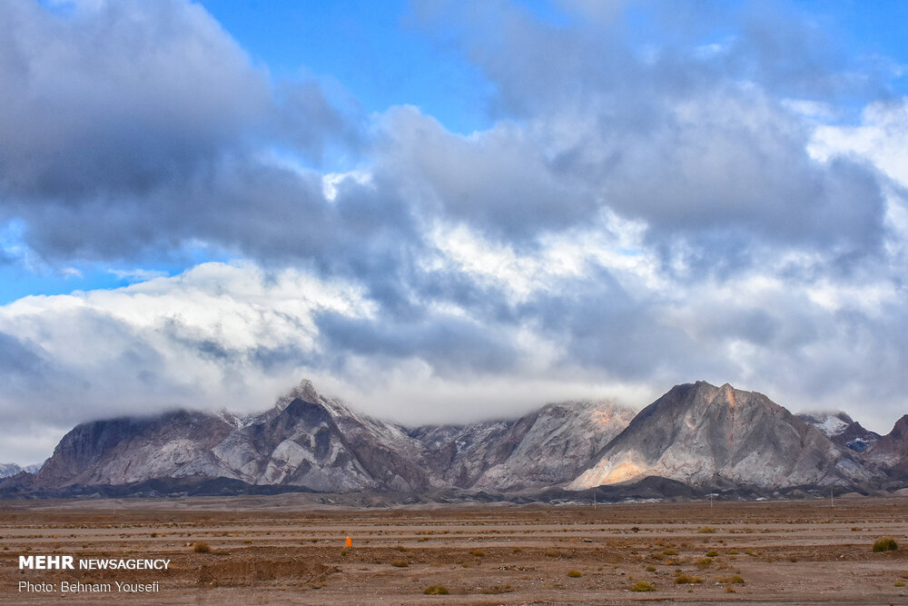

در قلب کویر مرکزی ایران، در مرز مشترک استان‌های یزد، سمنان و اصفهان، منطقه‌ای مخوف، وهم‌انگیز و صعب‌العبور از تپه‌های شنی روان و باتلاق‌های نمکی گسترده شده است که بومیان از صدها سال پیش آن را «ریگ جن» (یا مثلث برمودای ایران) نامیده‌اند. این سرزمین خاموش و بی‌آب که در گذشته هیچ کاروانی جرئت ورود به آن را نداشت، در باور کهنسالان یزد و خرانق، قلمرو مطلق ارواح سرگردان، جن‌های صحرانشین و غول بیابان است؛ جایی که قوانین زمین در هم می‌شکند و ردپای مسافران در چند ثانیه به کام تپه‌های روان فرومی‌رود. چشم‌انداز بی‌پایان ماسه‌ها با هر وزش باد شکل عوض می‌کند و سراب‌های فریبنده، تشنه‌کامان را به کام هلاکت می‌کشاند.

ساربانان کهنسال روایت می‌کنند که تپه‌های ماسه‌ای ریگ جن زنده هستند و شب‌ها راه می‌روند. بادهای کویری هنگامی که در میان قیف‌های شنی می‌لغزند، پدیده‌ای شگفت‌آور به نام «آواز کویر» یا «زنگ شتربانان جن» پدید می‌آورند؛ صدایی شبیه زنگوله کاروان، گریه نوزاد یا صدای آشنای دوستی که مسافر تنها را از دور با نام کوچک فرا می‌خواند. اگر کسی به دنبال این صداها از مسیر کاروان منحرف شود، به سوی تله‌های پنهان نمکی (دق‌های باتلاقی) کشانده می‌شود که سطح آن‌ها خشک اما عمقشان لجنی چسبنده و بلعنده است. غول بیابان، این غریبه‌ها را به قعر ماسه‌ها می‌کشد تا اثری از استخوان‌هایشان نیز بر جای نماند.

> پیران خرانق به مسافران کویر هشدار می‌دهند: «به ریگ جن پا نگذارید؛ جن‌های باد آنجا حکومت دارند و با تغییر شکل تپه‌ها، جهت یابی ستارگان را در چشمانتان واژگون می‌سازند تا در تشنگی خاکستر شوید.»

در قصه‌های بومی آمده است که تنها کاروانیانی توانستند از لبه ریگ جن گذر کنند که با بستن چشم‌های شترها و پاشیدن نمک تقدیس‌شده بر سم دام‌ها، افسون غول بیابان را شکستند. مردم کویر باور دارند که در مرکز این ریگزار بی‌پایان، بهشتی گمشده با نخلستان‌های زرین و چشمه‌های آب گوارا در تسخیر پادشاه پریان است، اما هرگز چشمی خاکی آن را نخواهد دید مگر آنکه از جان خویش بگذرد. مقنیان یزدی که قنات‌های عمیق حاشیه کویر را حفر می‌کردند، معتقد بودند رگه‌های آب زیرزمینی از زیر ریگ جن گذر می‌کنند تا پاکی خاک را از گزند دیوان حفظ نمایند. ریگ جن با سکوت مطلق روز و زوزه‌های وهم‌آور شب‌هایش، ساربانان کهن در شب‌های تاریک، برای در امان ماندن از وسوسه بادهای جن، زنگوله‌های برنجی کاروان را با پارچه‌های پشمی خاموش می‌کردند تا صدایی تولید نشود و شترها تنها با بوی راهنما راه بپیمایند. آنان باور داشتند که در زیر تل‌های ماسه، شهری مدفون با برج‌های گِلی قرار دارد که در ایام باستان به سبب ناسپاسی مردمانش در کام ریگ فرورفت و ساکنانش به جن‌های سرگردان بدل شدند. ریگ جن با سکوت مطلق روز و زوزه‌های وهم‌آور شب‌هایش، مظهر ترس و شیفتگی انسان کویرنشین در رویارویی با عظمت ناشناخته طبیعت ایران است.

### منبع روایت و تصویر
- **خاستگاه افسانه:** فرهنگ روایی کاروان‌داران و ساکنان حاشیه کویر در یزد، اردکان و خرانق، مقالات مردم‌شناسی کویرشناسی ایران.
- **عکاس / پدیدآورنده تصویر:** Behnam Yousefi
- **منبع تصویر:** [صفحه تصویر در ویکی‌انبار](https://commons.wikimedia.org/wiki/File:Rig-e_Jenn_2019-12-06_01.jpg)
- **نوع مجوز:** CC BY 4.0
