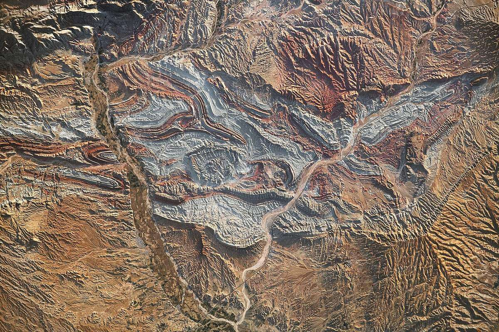

Across the windswept grasslands of Soltaniyeh in Zanjan province, where the massive turquoise cupola of the ancient mausoleum dominates the plateau, generations of bardic minstrels (*Ashiqs*) have strummed their nine-stringed lutes to recount the romantic epic of *Bahram and Gulu Khandan* (Bəhram ilə Gülxəndan). In regional folklore, Prince Bahram, the valorous son of King Bahman of Soltaniyeh, was destined for the military conquest of kings until a supernatural vision completely transformed his destiny.

While hunting a gazelle across the emerald meadows of the Sultani pasture, Bahram lost his hunting party and rested beneath an ancient weeping willow by a bubbling mineral spring. In a profound slumber, an angelic elder appeared before him, offering him a golden chalice containing the sacred nectar of divine love, known in Ashiq lore as the *Bota*. Inside the swirling elixir, the youth beheld the radiant reflection of Princess Gulu Khandan, a maiden of distant eastern lands.

> In the passionate cadence of the Zanjan Ashiqs: "The minstrel who drinks the chalice of love turns mountain cliffs into open roads; Bahram's voice enchants the plains of Soltaniyeh, where true love vibrates along the lute's strings."

Upon waking, Bahram renounced all imperial wealth and princely honors. Stowing away his steel armor, he took up the Ashiq's wooden saz. Realizing that his quest required not military violence but poetic truth and spiritual fortitude, he walked on foot across perilous deserts and through fortified enemy realms. Confronted by treacherous warlords and cunning mountain sorcerers, Bahram fought exclusively with his voice and his strings, composing improvised verses that melted the hostility of his captors and won the admiration of entire populations. The epic of Bahram and Gulu Khandan endures as an inspiring testament to the transformational power of art, music, and spiritual devotion over imperial might.

### Anthropological & Folklore Analysis
The narrative encapsulates the fundamental structural conventions of traditional Azerbaijani Ashiq epics (Dastans). The core motif of divine initiation through dream-visions and the drinking of the mystical love potion (*Bota*) symbolizes an internal spiritual metamorphosis, elevating an ordinary warrior into an enlightened cultural messenger and wandering troubadour.

### Archival Sources & Attribution
- **Primary Source:** The Dastan of Bahram and Gulu Khandan in Zanjan Ashiq Literature, ethnographic study by Mohammad Razzaghi, Anthropology and Culture.
- **Source URL:** https://anthropologyandculture.com/%D8%A8%D8%B1%D8%B1%D8%B3%DB%8C-%DA%A9%D9%88%D8%AA%D8%A7%D9%87-%D8%AF%D8%A7%D8%B3%D8%AA%D8%A7%D9%86-%D8%A8%D9%87%D8%B1%D8%A7%D9%85-%D8%A7%DB%8C%D9%84%D9%87-%DA%AF%D9%88%D9%84%D9%88-%D8%AE%D9%86/
- **Original Language:** Azerbaijani Turkish & Persian
- **Image Attribution:** File:Folded Rocks of Northwest Iran (iss069-e-089946 lrg).jpg | Photographer: NASA Johnson Space Center | License: Public domain
