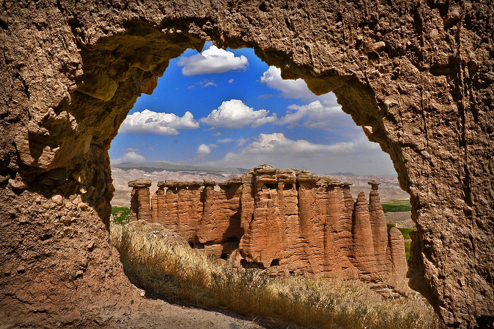

در حاشیه رودخانه پرپیچ‌وخم قزل‌اوزن در شهرستان ماهنشان استان زنجان، ساختارهای زمین‌شناسی شگفت‌آوری از خاک و ماسه‌سنگ سر برآورده‌اند که ستون‌هایی برافراشته با کلاه‌سنگ‌هایی پهن بر فراز خویش دارند؛ ستون‌هایی که زمین‌شناسان آنان را «هودو» می‌نامند اما از دیرباز در فرهنگ شفاهی مردم زنجان به «دودکش جن» (یا جین باجاسی) معروف بوده‌اند. درست در جوار این ستون‌های وهم‌انگیز، دژ صخره‌ای سترگ بهستان با ده‌ها اتاقک، راه‌پله و روزنه تراشیده در دل سنگ سرخ‌رنگ قرار دارد که بومیان ساخت آن را فراتر از توان انسان می‌دانند و به ارواح و جن‌ها نسبت می‌دهند. این پیکره‌های خاکی در تاریکی غروب نمایی چون تندیس دیوانی بیدار دارند که سر بر شانه بادهای دشت سوده و به نظاره عبور آب‌های سرخ قزل‌اوزن نشسته‌اند و هر عابری را به حیرت وا می‌دارند.

بر پایه باورهای کهن ماهنشان، این ستون‌های قارچ‌مانند، در حقیقت دودکش‌های کاخ‌های زیرزمینی جن‌ها و پریان صخره‌نشین هستند. سالخوردگان روستا نقل می‌کنند که در روزگاران باستان، جن‌های سازنده در دل شب‌های تاریک با تیشه‌هایی از شهاب‌سنگ کوه را می‌تراشیدند و تالارهایی تو در تو پدید می‌آوردند. کلاه‌سنگ‌های بالای هر ستون برای این تعبیه شده بود که باران و سیلاب به دهانه دودکش نفوذ نکند و دود اجاق‌های افسانه‌ای آنان که در آن فلزات جادویی را ذوب می‌کردند، به آسمان برود. مردم باور داشتند این موجودات در روشنایی روز از دیدگان پنهان می‌شوند و در هنگام وزش بادهای سخت، از میان روزنه‌های ستون‌ها سوت می‌کشند تا راه را به کاروان‌های سرگردان بیابان نشان دهند و از خطر غرق شدن در باتلاق‌های قزل‌اوزن برهانند.

> کهنسالان بهستان به فرزندان خود هشدار می‌دادند: «هنگام غروب آفتاب کنار ستون‌های دودکش جن ننشینید و سنگ به روزنه‌هایش پرتاب نکنید؛ دودکش جن حریم اهالی خاک است و نفرین آنان خواب آدمی را آشفته می‌سازد.»

افسانه دیگری بازگو می‌کند که در زمان هجوم راهزنان به دره قزل‌اوزن، حاکم نیکوکار دژ از فرشته نگهبان کوهستان یاری خواست. ناگهان تندبادی سرخ‌رنگ برخاست و خاک کوهستان به شکل ستون‌هایی غول‌پیکر با سیمای جنگاوران درآمد. راهزنان با دیدن صدها قامت سربه‌فلک‌کشیده که گویی لشکری از دیوان بودند، وحشت‌زده گریختند و هرگز بازنگشتند. پله‌های باریک درون قلعه بهستان که امروزه نیز پای بازدیدکنندگان را به تالارهای مرتفع باز می‌کند، در ذهن مردم راه‌هایی است که پریان برای پرواز شبانه به سوی ماه تراشیده‌اند. جوانان روستاهای ماهنشان هنوز هم داستان‌های دلدادگی پریان این دژ را در شب‌های زمستان بازگو می‌کنند. این چشم‌انداز اسرارآمیز در کنار خروش قزل‌اوزن، تابلویی زنده از تخیل ژرف و پیوند ناگسستنی فولکلور آذربایجانی زنجان با شگفتی‌های طبیعت است.

### منبع روایت و تصویر
- **خاستگاه افسانه:** فرهنگ شفاهی مردم ماهنشان و روستای بهستان زنجان، باورهای اسطوره‌ای هودوها و غارهای دست‌کند قزل‌اوزن.
- **عکاس / پدیدآورنده تصویر:** Hamid Reza Bazargani
- **منبع تصویر:** [صفحه تصویر در ویکی‌انبار](https://commons.wikimedia.org/wiki/File:Behestan_Castle_By_Hamid_Reza_Bazargani_(Custom).jpg)
- **نوع مجوز:** CC BY-SA 4.0
