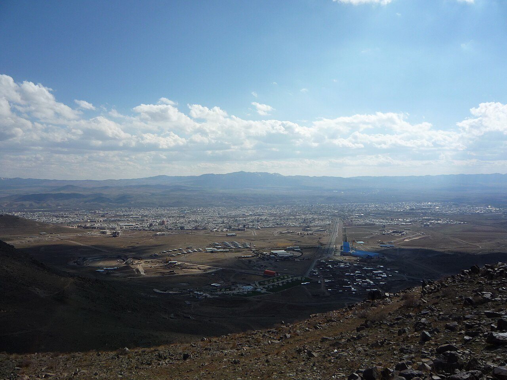

Spanning the historic riverbed of Zanjan-Rood south of the city of Zanjan, the monumental brick bridge of *Mir Baha-eddin* has channeled torrential seasonal floods through its soaring pointed arches for centuries. In local Azerbaijani Turkish folklore, the miraculous resilience of this Qajar-era bridge against devastating inundations is attributed to a supernatural entity known as *Qizil Ilan*—the Golden Serpent of Zanjan-Rood, an immense luminous reptile dwelling within the central stone foundation piers.

Zanjani oral tradition recounts that during the bridge’s original construction, devastating flash floods repeatedly swept away the masonry piers before the arches could be keyed in. One night, the benevolent benefactor Mir Baha-eddin beheld a vision in which a crowned golden serpent spoke from the riverbed: "Imbed a vessel of fresh milk and wild rue ashes beneath the central caissons; I shall coil my spirit around the bedrock and shield the masonry from the fury of the torrent." The masons complied, and the serpent took up residence within the foundation. Ever since, even the most violent deluges have broken harmlessly against the arches.

> "The Bridge of Mir Baha is not mere mortar and brick; the body of the Golden Serpent coils around its piers. Whoever damages the bridge awakens the river serpent to drag his fortune into the murky depths." — Saying of Zanjan elders.

Folklorist Mousa Khani in *Folklore of the People of Zanjan* and Samad Behrangi in *Tales of Azerbaijan* note that serpent guardians of bridges and sacred springs are deep-seated archetypes in northwestern Iranian culture. Serpents were venerated as symbols of subterranean stability and guardians against destructive floodwaters. Caravaneers crossing the bridge traditionally dropped morsels of bread into the churning waters as an offering to the guardian serpent. Today, the graceful arches of Mir Baha-eddin Bridge reflected upon the twilight waters of Zanjan-Rood continue to celebrate this harmonious alliance between architecture and myth.

### Sources & Image Attribution
- **Research Source:** Mousa Khani, *Folklore of the People of Zanjan*, Zanjan, pp. 87-92; Samad Behrangi & Behrooz Dehghani, *Legends of Azerbaijan*, Tehran: Nil, p. 145.
- **Image Attribution:** Documented on Wikimedia Commons by Mardetanha; License: [CC BY-SA 3.0](https://commons.wikimedia.org/wiki/File:Gavazang1.JPG).
