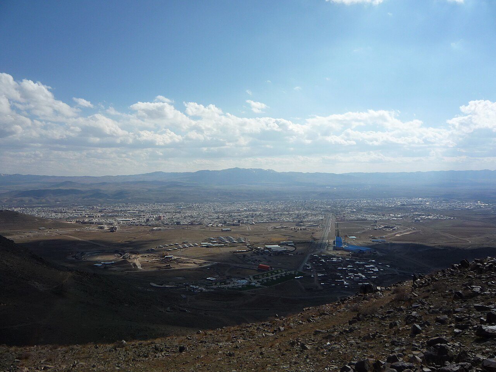

بر روی بستر تاریخی رودخانه زنجان‌رود در جنوب کهن‌شهر زنجان، پل خشتی و باشکوه «میربهاءالدین» با دهانه‌ها و طاق‌های قوسی استوار خود قرن‌هاست که آب‌های خروشان فصلی را به سلامت از خود عبور می‌دهد. در باورهای عامه مردم زنجان، پایداری معجزه‌آسای این پل آجری در برابر سیلاب‌های سهمگین تاریخ، به حضور موجودی اسطوره‌ای به نام «قیزیل ایلان» یا «مار طلایی زنجان‌رود» نسبت داده می‌شود؛ ماری عظیم و نورانی که در میان پایه‌های ضخیم مرکزی پل لانه دارد و با پیچیدن کالبد جادویی‌اش به دور شالوده سنگی، آن را از فروریختن حفظ می‌کند.

افسانه ترکی زنجانی بازگو می‌کند که در دوران قاجار، هنگام ساخت این پل، هر بار که معماران طاق‌های میانی را برمی‌افراشتند، سیلابی شبانه از راه می‌رسید و پایه‌ها را در خود فرومی‌برد. تا اینکه میربهاءالدین، بانی نیکوکار پل، در شبی تاریک در عالم رویا دید که ماری زرین با تاجی از زمرد سبز در بستر زنجان‌رود با او سخن می‌گوید: «در پایه‌های پل، خمره‌ای از شیر تازه و خاکستر اسفند بنهید تا من در شکاف پایه‌ها مأوا گزینم و با جسم خویش شالوده را از خشم آب پاسداری کنم.» معماران چنین کردند؛ مار طلایی در دل سنگ‌ها آشیان ساخت و از آن پس، حتی ویرانگرترین سیلاب‌ها نیز نتوانستند کمترین لرزه‌ای بر اندام این پل هفت‌چشمه وارد سازند.

> «پل میربهاء تنها آجر و ساروج نیست؛ تن مار طلایی بر پایه‌هایش پیچیده است. هر که به سنگ پل بی‌حرمتی کند، مار آب از زیر طاق سر برمی‌آورد و بختش را به تاریکی می‌برد.» — متل کهنسالان زنجان در حاشیه سبزه‌میدان.

موسی خانی در کتاب «فرهنگ عامه مردم زنجان» و صمد بهرنگی در تحقیقات فولکلوریک آذربایجان یادآور می‌شوند که باور به مارهای نگهبان ابنیه و آب‌ها، ریشه‌ای بسیار کهن در فرهنگ بومی منطقه دارد. مار در باورهای ترکان آذربایجان و قفقاز، نگهبان گنج و روح زندگی در زیر سازه‌ها شناخته می‌شده است. مردم زنجان در گذشته به هنگام گذر از روی پل، صلوات می‌فرستادند و تکه‌ای نان در آب می‌انداختند تا قدردان مار طلایی باشند که پل را برای کاروانیان استوار نگه داشته است.

امروزه انعکاس طاق‌های زیبای پل میربهاءالدین در آب‌های زنجان‌رود هنگام غروب آفتاب، جلوه‌ای دل‌انگیز پدید می‌آورد؛ یادبودی از پیوند هنر معماری سنتی و اسطوره‌های نگهبان آب در زنجان.

### منابع و اعتبار تصویر
- **منبع پژوهشی افسانه:** موسی خانی، «فرهنگ عامه مردم زنجان»، زنجان، ص ۸۷-۹۲؛ صمد بهرنگی و بهروز دهقانی، «افسانه‌های آذربایجان»، نشر نیل، ص ۱۴۵.
- **اعتبار تصویر:** ثبت‌شده در ویکی‌مدیا کامنز توسط Mardetanha؛ مجوز انتشار: [CC BY-SA 3.0](https://commons.wikimedia.org/wiki/File:Gavazang1.JPG).
